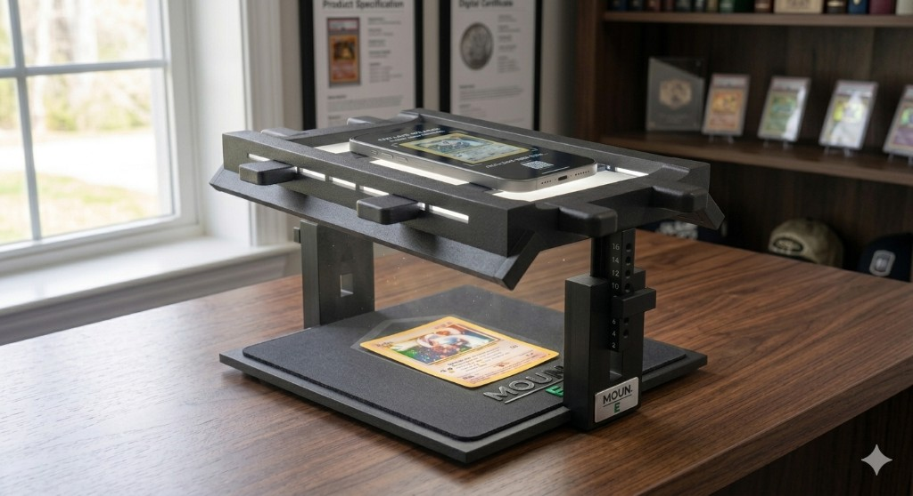
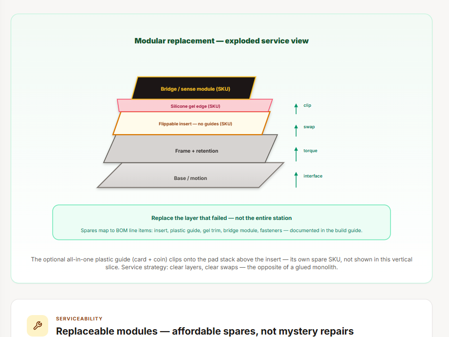

# The Moun · Moun EPIC

**A capture-workstation product program connecting physical design, engineering, branding, research, and a guided digital presentation.**

Created by **Joseph D. W. Edwards / [RawPowered](https://github.com/RawPowered)**.

> **Portfolio and technical review only. All rights reserved in original materials; no reuse license is granted. These files are not intended for others to operate, manufacture, redistribute, or commercialize.** [Read the intended-use notice](NOTICE.md).

*Product visualization from the supplied presentation. It describes design direction, not a verified manufactured or certified product.*

## Start with the work

The Moun brings repeatable capture geometry, controlled lighting, a specimen deck, modular construction, and a product family into one development program. The material spans the Eco, Pro, Investor, and Curator direction, including Moun E and Moun E Cobra concepts.

This publication includes **all 155 files supplied from the artwork folder and Grade Station `dist` folder**, preserved with their original contents: layered Photoshop files, product and packaging imagery, CAD/editor references, an OBJ/MTL mesh, and the complete built web presentation with its PHP supporting files. A reading edition makes the presentation accessible directly on GitHub.

| Area | Review the material |
|---|---|
| Product thesis and staged direction | [Whitepaper](docs/Whitepaper.md) · [EPIC lineage](docs/EPIC-Lineage.md) |
| Market and customer reasoning | [Market research](docs/Market-Research.md) · [Product features](docs/Product-Features.md) |
| Mechanical design and assembly | [Mechanical](docs/Mechanical.md) · [Moun E build](docs/Moun-E-Eco-Build.md) · [Pro build](docs/Pro-Build.md) |
| Electrical design | [System electrical](docs/Electrical.md) · [Moun E electrical](docs/Moun-E-Electrical.md) · [Cobra electrical](docs/Cobra-Electrical.md) |
| Manufacturing and component planning | [Manufacturing](docs/Manufacturing.md) · [Pro manufacturing](docs/Pro-Manufacturing.md) · [Moun E manufacturing](docs/Moun-E-Manufacturing.md) |
| Software and control concepts | [Software logic](docs/Software-Logic.md) |
| Brand and original artwork | [Brand direction](docs/Brand.md) · [Layered design files](design-source/) |
| Business planning and calculations | [Investor guide](docs/Investor-Guide.md) · [Investment calculator reading](docs/Investment-Calculator.md) |
| Patent preparation concepts | [Patent overview](docs/Patent-Overview.md) |
| Complete reading path | [All 33 sections](docs/INDEX.md) · [12 diagram exports](docs/diagrams/) |

## Inspect the design development

| CAD/editor reference | Assembly and service reference |
|---|---|
|  |  |

These images distinguish structural development from the product visualizations elsewhere in the presentation. The [reference OBJ](presentation/tinker.obj) and [material file](presentation/obj.mtl) are included. The presentation describes the mesh as a merged TinkerCAD reference; production-ready per-part CAD is a separate requirement.

## Files and provenance

- **[design-source/](design-source/):** `Logo.psd`, `The Moun EPIC and Box Art.psd`, and `The Moun Concept.png`.
- **[presentation/](presentation/):** the full supplied 152-file built presentation, retaining its directory structure and file contents.
- **[docs/](docs/INDEX.md):** 33 reading-edition sections extracted from the rendered presentation, plus 12 standalone SVG diagram exports. Interactive controls appear as text and initial displayed values.
- **[File inventory](FILES.md)** and **[SHA-256 manifest](PUBLICATION-MANIFEST.json):** original-file paths, sizes, and hashes for the 44,812,298-byte supplied snapshot.
- **[Third-party notices](THIRD-PARTY-NOTICES.md):** retained bundle notices and associated dependency license files.

The built snapshot is published for inspection. This repository does not include the separate editable React/TypeScript project outside the supplied `dist` folder. PHP installation, access control, administration, NDA-template, and analytics files are archived implementation material; this upload does not deploy a live investor portal.

## Development stage and intended use

This is a product-development portfolio. Engineering dimensions, performance targets, manufacturing economics, and investor calculations retain the assumptions and verification limits of their source sections. The publication does not establish hardware qualification, manufacturing readiness, financial results, or a patent filing or grant.

Some originals retain internal/confidential review wording. This is the creator-authorized public portfolio copy; original work remains reserved under the [review-only notice](NOTICE.md). Third-party rights and licenses remain with their owners.

[Grade Station showcase](https://github.com/RawPowered/Grade-Station) · [RawGraded](https://github.com/RawPowered/RawGraded) · [Joseph Edwards portfolio](https://github.com/RawPowered)
