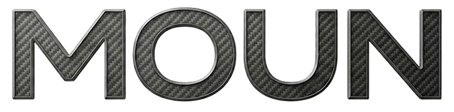
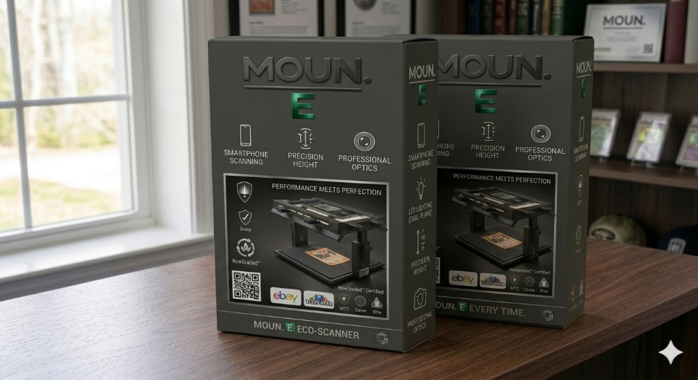

# Brand

[All sections](INDEX.md) · [Original presentation files](../presentation/) · [Review-only notice](../NOTICE.md)

Reading edition extracted from the supplied built presentation on October 25, 2026. Interactive controls are represented as text and initial displayed values; this is not a live service or a verified engineering, financial, or manufacturing result. Original internal-review labels are retained as historical document context.

---

Moun · internal build guide

## Brand

Moun is the hardware program name: carbon-and-gunmetal wordmark, forest accent for Eco (E), and an EPIC letter line for shelf SKUs — Eco, Pro, Investor, Curator. This page locks UI tokens, logo usage, and narrative guardrails for partners and diligence.

Naming

### Why Moun?

Moun follows the same simple four-letter shape as some of the most durable global names — short, ownable, and easy to say in a booth or a deck.

MeaningIn archaic English the root reads like “it must” or “to be able to” — obligation and capability in one syllable cluster, which matches how we want the product to feel: something you rely on, not a gimmick.

Utah and the dropped TIt is also a quiet nod to the state where the founder learned electrical engineering and digital electronics. In Utah speech, “mountain” often lands as “moun’n” — the hard T softens. Dropping the T from “Mount” on purpose became more than accent: it changed the meaning.

Mount vs Moun“Mount” in product language usually means fix or attach — you clamp a phone into a mount. The Moun is the opposite posture: a simple workflow surface that lets you position the device freely, keep the screen accessible, and work without worrying that a rigid clamp story will eat your accuracy or your table real estate. Top-down control pairs with a true top-down view of the specimen.

Platform and EPICMoun is the base concept of the platform — the same way a vehicle line has a base trim. Moun E is that entry flagship; Moun P, I, and C are planned to complete the EPIC shelf family (Eco, Pro, Investor, Curator).

Category gapWhen people buy a light tent, a photo booth, or another anonymous phone holster, they often forget who built it — and they are left with clunky hardware that scars the table, optics that wander between shows, and no single system that matches controlled top-down capture with operator-friendly ergonomics. Moun is the answer to that gap.

InvestorsThe name should read as infrastructure, not a disposable accessory — aligned with a serious bench story, document-controlled engineering, and economics that can scale with distribution and repeat purchase.

### Wordmark · official

Use moun-logo-official.png for packaging PDFs, investor decks, and any place the wordmark stands alone on white or light photography.

### Wordmark · fitted (UI)

Use moun-logo-fitted.png only in tight UI (sidebar, mobile). Do not add a solid backdrop behind the mark — transparent PNG is correct.

### EPIC · program lockup

Use moun-epic-lockup-official.png for the EPIC program line (E · P · I · C). The file carries a carbon black field — show it on moun-carbon or full-width dark bleed; do not recolor or crop the letter treatments.

Retail identity

### Moun E Eco-Scanner — shelf artwork

Retail faces the market as Moun E Eco-Scanner: gunmetal / carbon panel art, forest-green “E,” white feature callouts (smartphone scanning, precision height, optics, dual-plane LED). Same plastic + pad CM scope as elsewhere on this page — “E” carries Eco positioning and recycled-packaging intent where suppliers lock it in.

AI-generated packaging visuals for creative, retail, and investor review only. Partner marks (eBay, TCGplayer, RawGraded, etc.), certification art, QR destinations, and compatibility strips need brand, partner, and counsel approval before production print.

Shelf angle — front + side + partial back: MOUN. and forest E, product render, eco leaf mark, performance copy and certification row. Illustrative only.

Front / twin layout — smartphone scanning, precision height, professional optics, LED dual-plane, RawGraded-style badge, eBay / TCGplayer strips, QR. Final copy TBD with counsel.

### Color system

Tailwind tokens live under `moun.*` — use these for UI consistency. EPIC tier accents mirror the lockup; use mainly in product / roadmap contexts.

moun-carbon

Carbon

Deepest base, print sidebar, high-contrast shells

#12151a

moun-gunmetal

Gunmetal

Primary dark UI (nav, chrome panels)

#1a1f26

moun-gunmetal-mid

Gunmetal mid

Elevated surfaces, gradients

#232a33

moun-gunmetal-edge

Gunmetal edge

Hairlines, borders on light cards

#343d4a

moun-forest

Forest

Primary accent — CTAs, active nav, Eco tier

#14532d

moun-forest-bright

Forest bright

Hover / emphasis on green actions

#166534

moun-forest-deep

Forest deep

Gradient endpoints, dark green wash

#0c1f14

moun-bright

Bright

Default page background anchor

#fafaf9

moun-bright-warm

Bright warm

Body gradient, secondary panels

#f5f4f1

moun-ink

Ink

Primary text on light surfaces

#14181d

#### EPIC tier accents

E

Eco · Moun E

#14532d

P

Pro · Moun P

#1a365d

I

Investor · Moun I

#7f1d1d

C

Curator · Moun C

#c4c4c4

### Typography

Inter  — 'Inter', system-ui, -apple-system, sans-serif

- · 400 — body

- · 600 — subheads / UI emphasis

- · 700 — section labels

- · 900 — display / hero

### Voice

- · Confident and precise — hardware and workflow outcomes, not hype.

- · Investible tone: cite planning bands, counsel review, and “illustrative until quote” where numbers appear.

- · Respect the hobby: “collectors” means people; “Curator” is the C-tier SKU name.

### Logo usage

- × Do not stretch, skew, or add outlines not present in source art.

- × Do not place the carbon wordmark on busy mid-grey noise — minimum contrast is WCAG-minded for adjacent UI text.

- × Do not swap “Moun” casing in customer-facing copy — sentence case for prose; “Moun E” for the Eco SKU.
