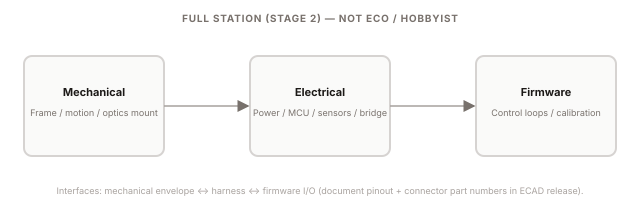

# System specification

[All sections](INDEX.md) · [Original presentation files](../presentation/) · [Review-only notice](../NOTICE.md)

Reading edition extracted from the supplied built presentation on October 25, 2026. Interactive controls are represented as text and initial displayed values; this is not a live service or a verified engineering, financial, or manufacturing result. Original internal-review labels are retained as historical document context.

---

Document control

Moun / RawGraded Pro

Engineering build guide

RevisionRev BDate2026-04-09AuthorJoseph D. W. Edwards

Confidentiality

Confidential — not for distribution. For private review with manufacturing partners, contractors, or technical diligence only.

Related platform

[RawGraded.com](https://rawgraded.com) — An AI platform developed by Joseph D. W. Edwards, creator of Moun.

CAD provenance

3D reference mesh exported from TinkerCAD (tinker.obj + obj.mtl). Single merged object; per-part BOM linkage requires re-export with separated bodies or STEP for production RFQ.

Change log

- Rev B  (2026-04-09) — Vite/React build guide: SVG ortho schematics, OBJ viewer, doc control blocks.

- Rev A  (2026-04-01) — Initial static blueprint (legacy HTML).

EPIC · Lineage plan

The Moun model line is sequenced to spell EPIC — Eco, Pro, Investor, Curator — with shelf codes E · P · I · C (Model P = Moun P static bay; Model I = Moun I full station). Phase 1 leads with Moun E; complexity and price posture step up through the line. Full-station mechanical, electrical, firmware, and manufacturing pages live under Investor · Moun I in the sidebar; Pro holds Moun P (static printed bay) only.

## System specification

Architecture and verification targets for the production Moun program, plus pointers to the static Eco / Pro (Moun P) SKUs used for Phase 1 proof.

Rev B Internal only

### Guide map

Use this map to jump to the layer you care about: program narrative and IP prep, entry SKUs and manufacturing, or the full-station engineering release.

Brand

Logo usage, EPIC lockup, color tokens (carbon / gunmetal / forest), typography, voice.

Whitepaper

Thesis (problem / solution / IP & retail fit), four SKU stages (EPIC), roadmap + engineering map, IP prep.

Eco · Overview

Phase 1 storyboard and Ground 1 — open Eco → Moun E · Eco build in the sidebar for CM, BOM, and CAD.

Pro build

Static printed bay (Moun P), positioning, Eco vs Pro vs full station.

Pro manufacturing

Draft BOM, assembly, indicative CM stack including in-box LED path.

Product features

Full program capabilities, disruptor narrative, mechanical art.

Mechanical

Production chassis, motion, OBJ viewer, ortho schematics.

Electrical

Power, MCU, bridge, schematics — full station only.

Software logic

Firmware control loops, physics sandbox, scripted components.

Manufacturing

Full-station BOM workspace and tooling narrative.

### System overview

The diagram below is the production-intent stack: mechanical staging and motion, electrical sensing and lighting, and firmware closed-loop control. Magnetic pogo-bridge (Electrical) is the modular interface between moving and stationary electronics — confirm pinout against the released schematic. Eco and Moun P (Pro) are static capture benches without this motion/MCU stack; they are documented under Eco and Pro. The full stack matches Moun I under Investor in the sidebar and feeds the Curator roadmap.

#### Interface focus

The pogo bridge  carries power and signals across the motion interface on the full station . Eco and Pro (Moun P) base SKUs omit this stack; lighting there is optional or in-kit only per those sections — not the bridge + motion problem this diagram describes. Document retention force, wipe distance, and cycle life in the next ECAD revision.

Electrical (full station)Eco · Overview (Phase 1)

### Target specifications

Design goals — replace with measured data as hardware is qualified.

- 85°

Tilt range

Mechanical envelope target; verify against limit switches and linkage.

- 95+

Lighting CRI

LED module selection target.

- <0.2°

Level accuracy

Control loop target; IMU + mounting dependent.

### Verified / as-tested

Populate from qualification builds: instrument, procedure reference, and serial number.

- Pending

As-built verification

Record measured values, test date, instrument ID, and build serial here when available.
