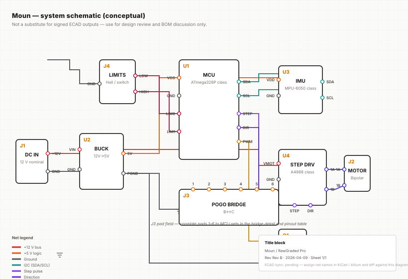
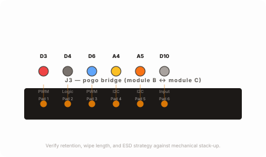

# Electrical engineering

[All sections](INDEX.md) · [Original presentation files](../presentation/) · [Review-only notice](../NOTICE.md)

Reading edition extracted from the supplied built presentation on October 25, 2026. Interactive controls are represented as text and initial displayed values; this is not a live service or a verified engineering, financial, or manufacturing result. Original internal-review labels are retained as historical document context.

---

## Electrical engineering

System schematic, bridge detail, and MCU pin map — keep in lockstep with the authoritative ECAD netlist and BOM.

### System schematic

Data-driven SVG from systemElectricalModel.ts — extend blocks, pins, and Manhattan wires as the design firms up.

Next steps: export netlist from ECAD, diff net names against `SCHEMATIC_WIRES`, then add sheet 2 for LED channel, connectors, and protection devices.

### Bridge interface detail

### MCU pin assignment

| ID | Pin | Signal | Function |
| --- | --- | --- | --- |
| 1 | D3 | PWM | Stepper Step |
| 2 | D4 | Logic | Stepper Direction |
| 3 | D6 | PWM | LED MOSFET Gate |
| 4 | A4 | I2C | SDA (Data) |
| 5 | A5 | I2C | SCL (Clock) |
| 6 | D10 | Input | Lower Limit (Hall) |
| 7 | D11 | Input | Upper Limit (Hall) |

### Power rails and filtering

12V

#### Primary rail (power)

Drives stepper driver VMOT and LED strings. Size input fuse, bulk capacitance, and inrush for your actual load.

5.0V

#### Logic rail (VCC)

Buck from 12 V — verify ripple, transient, and brown-out behavior when the motor accelerates.

3.3V

#### Sensor reference

If the IMU or other parts need 3.3 V, add an LDO or secondary regulator; keep returns tight to the MCU analog reference strategy.

#### Safety note

Hardware limit inputs should remain capable of disabling motion independent of firmware fault paths. Map to MCU inputs and gate drivers per your hazard analysis; document interlock timing in the ECAD review.
