# Investor guide

[All sections](INDEX.md) · [Original presentation files](../presentation/) · [Review-only notice](../NOTICE.md)

Reading edition extracted from the supplied built presentation on October 25, 2026. Interactive controls are represented as text and initial displayed values; this is not a live service or a verified engineering, financial, or manufacturing result. Original internal-review labels are retained as historical document context.

---

Deal room · Moun

Moun / RawGraded Pro

## Investor guide

Controlled capture for cards, coins, and collectibles — built so marketplace apps and grading workflows actually work in the real world.

How today’s collectibles market and grading dynamics support Moun as a standalone hardware business — with RawGraded.com as complementary software optionality, not a prerequisite — subject to diligence and counsel.

Joseph Edwards is the sole founder and owner today — no outside funding closed on the program. This room is framed like a Kickstarter-class early opportunity: checks back inventory and manufacturing proof first; bind any equity or instruments only with counsel.

This is the written Investor guide for fundraising and diligence. Moun I is the EPIC-line hardware SKU (full electromechanical station); chassis, BOM, and build detail are under Investor · Moun I in the sidebar, not on this page.

Updated 2026-04-12 Confidential · strategic discussion

Planning unit economics · MOQ 1000

Planning landed cost @ 1000 MOQ — Moun E + Moun E Cobra flagship focus. Cobra uses an illustrative x0.96 simplification factor until dedicated CM quotes are bound.

Moun E (Eco) — landed / unit

$16.85–49.25

~$33.05 mid · Phase 1 CM band

Moun E Cobra — landed / unit

$16.18–47.28

~$31.73 mid · premium variant planning band

Flagship focus

Moun E + Cobra only

Roadmap models stay non-priced on this investor page.

Projected CAC at launch

$0

Organic social, community, and word-of-mouth first — no paid acquisition budget in the opening phase. Model paid channels later when unit economics and inventory are proven.

| Outlet / channel | Assumption | Contribution · Eco | Contribution · Cobra |
| --- | --- | --- | --- |
| DTC / own checkout | ~3% all-in payment processing (planning) | ~-26.96%–56.56% | ~18.75%–72.19% |
| Third-party marketplace | ~12% selling + payment (category-dependent placeholder) | ~-39.95%–52.12% | ~10.44%–69.35% |
| Wholesale → retail | ~50% of MSRP to brand (keystone-style partner buy) | ~-146.31%–15.73% | ~-57.63%–46.06% |

Contribution margin = (net revenue after channel mechanics − planning landed COGS) ÷ net revenue. Investor-facing focus is Moun E + Moun E Cobra; any legacy Pro/full references remain internal planning context. Channel percentages and Cobra complexity are planning assumptions only, not supplier or partner quotes. Negative contribution at high landed edges means ASP does not clear planning COGS under that channel assumption — bind to quotes.

This guide is for private discussion only. It is not an offer to sell securities, investment advice, or a solicitation. Figures and events are summarized from publicly linked sources; follow those links for exact wording, dates, and updates. Forward-looking statements are inherently uncertain.

Deal room by model

### Per-model investment economics (digestible view)

Each flagship model is broken out with its own pricing, cost band, landed-per-unit by MOQ, and channel contribution assumptions.

Model economics

#### Moun E (Eco)

Price / unit: $39.99

~$16.35–46.55 variable / unit (Eco CM model incl. 2× commodity USB strip row)

~$500–2700 one-time NRE (amortizes with volume)

Landed / unit @ MOQ 1000: $16.85–49.25

- MOQ 500 $17.35–51.95 planning landed (variable + NRE/500)

- MOQ 1000 $16.85–49.25 planning landed (variable + NRE/1000)

- MOQ 2000 $16.6–47.9 planning landed (variable + NRE/2000)

~-23.16%–57.86% gross vs. $39.99 planning ASP (within CM bands; before retail partner margin & freight)

Channel contribution

- DTC / own checkout

~-26.96%–56.56%

~3% all-in payment processing (planning)

- Third-party marketplace

~-39.95%–52.12%

~12% selling + payment (category-dependent placeholder)

- Wholesale → retail

~-146.31%–15.73%

~50% of MSRP to brand (keystone-style partner buy)

Model economics

#### Moun E Cobra

Price / unit: $59.99

~$15.7–44.69 variable / unit (Cobra planning model from Eco baseline + simplification factor)

~$480–2592 one-time NRE planning band

Landed / unit @ MOQ 1000: $16.18–47.28

- MOQ 500 $16.66–49.87 planning landed (variable + NRE/500)

- MOQ 1000 $16.18–47.28 planning landed (variable + NRE/1000)

- MOQ 2000 $15.94–45.98 planning landed (variable + NRE/2000)

~21.19%–73.03% gross vs. $59.99 planning ASP (before channel and freight)

Channel contribution

- DTC / own checkout

~18.75%–72.19%

~3% all-in payment processing (planning)

- Third-party marketplace

~10.44%–69.35%

~12% selling + payment (category-dependent placeholder)

- Wholesale → retail

~-57.63%–46.06%

~50% of MSRP to brand (keystone-style partner buy)

Jump to

SnapshotGround 1 · LaunchPhase 1 mfgProduct & offerMoun E · sales artMarketWeb scaleGrading $Crowds & showsUse casesSourcesProductRetail comparevs. $20 DIYApps & capturevs. Light tentGo-to-marketCustomersRawGradedShark Q&AEdgeRisksUse of capitalValuationThe ask

Flagship investor lens

Moun E + Cobra only

OpportunityUnit economicsSales motionRisk posture

The flagship thesis is physical workflow reliability: Moun E captures broad retail adoption while Cobra supports premium operators without leaving the same product family.

Expand diligence assumptions

Planning figures are directional until supplier quotes, duties, freight, warranty reserves, and channel contract terms are finalized.

Ground 1

### Launch plan — flagship first

Ground 1 is the first shelf push behind Moun E and Moun E Cobra. Both variants stay in the same flagship family with shared capture thesis and differentiated ergonomics/price posture. Other lines remain roadmap-only context until flagship sell-through and quote-backed expansion milestones are met.

Moun E is the entry tranche: lowest landed cost in the family, recycled-packaging intent on cartons, and the same capture thesis as the rest of the line — phones, slabs, and coins on one deck.

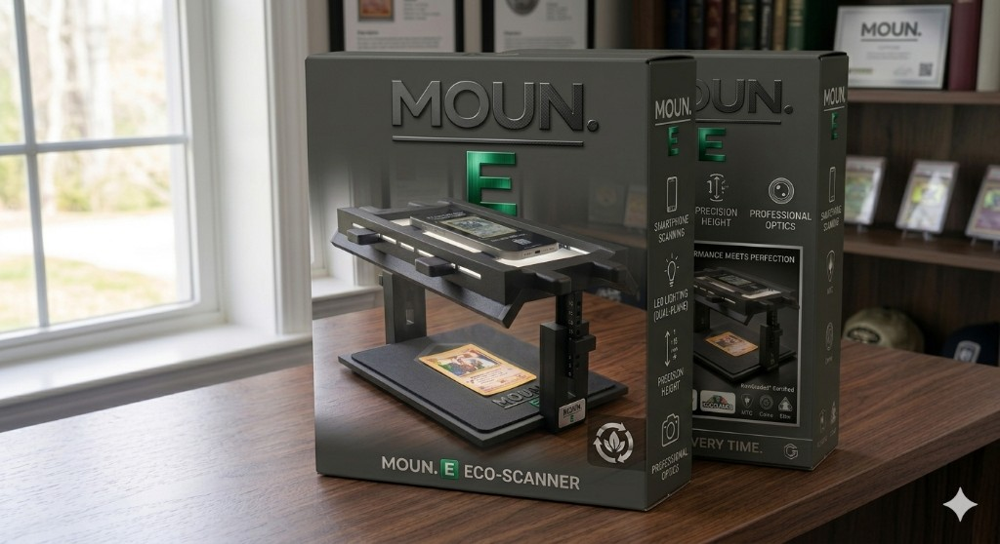

Representative Moun E carton mockup — shelf copy, partner marks, and certification art are illustrative pending brand and counsel review.

Model stack · price ladder (low → high)

| Model | Shelf name | Positioning | Status |
| --- | --- | --- | --- |
| E Eco | Moun E | Entry · smartphone scanning studio; plastic + padding; 2× USB adhesive LED strips (commodity kit). | Ground 1 focus |
| P Pro | Moun P | Pro line · Moun P static bay — richer kit than E (in-box lighting path per manufacturing scope). Some engineering paths still use legacy “hobbyist” filenames. | In guide / roadmap |
| I Investor | Moun I | Full station program — production materials stack, motion/sensing, and partner-ready BOM as in the engineering build guide. | In guide / roadmap |
| C Curator | Moun C | Flagship bulk workflow for shops and vendors: proprietary conveyor-fed analysis line — load a stack, run a controlled belt, single-file output with separation, dust treatment, and integrated flip/capture mechanics plus custom control software. Larger manufacturing footprint; sellable to card rooms pricing bulk inventory. Engineering and visuals not yet published. | Reveal pending |

Curator (C) is the premium tier in the roadmap; industrial mechanics and software are proprietary and will be documented here when the reveal is ready.

Pricing honesty

### What shoppers already pay for — and what Moun is not claiming

Nobody pays a premium for a bare plastic measuring plate alone. Commodity centering aids and print guides commonly sit ~$10–25; bundled starter kits with a small booth or basics often fluctuate ~$12–16 at promotional retail — those anchors are real shopper psychology.

Moun E (Eco) is positioned as an integrated capture kit at a planning ASP tied to the build guide — deck, kitted commodity lighting, pack-out, and brand — not as magic margin on a single overlay. Replace planning numbers with binding CM quotes and channel tests before any public price list.

Phase 1 manufacturing

### Moun E — landed vs. planning ASP

Plastic + pad CM scope for the first shelf push, plus illustrative commodity USB strip COGS in the Eco model. Compare planning retail $39.99  to the Eco CM table in the build guide — bind strip quotes and kit labor before you treat margin as binding.

Retail story includes two kitted USB strips at planning ASP; Eco CM rows are plastic + pad + illustrative strip COGS. Compare like-for-like in RFQs.

| MOQ | Planning landed (variable + NRE ÷ MOQ) |
| --- | --- |
| 500 | $17.35–51.95 planning landed (variable + NRE/500) |
| 1000 | $16.85–49.25 planning landed (variable + NRE/1000) |
| 2000 | $16.6–47.9 planning landed (variable + NRE/2000) |

Anchor @ MOQ 1000: $16.85–49.25  · ~-23.16%–57.86% gross vs. $39.99 planning ASP (within CM bands; before retail partner margin & freight)

Reality check · three scenarios

#### Low · Objectively fair · Optimistic

Parallel scenario rows: stress vs midpoint vs upside within the planning CM model. “Will it sell?” (velocity, channel proof) is not the same question as per-unit margin.

Tail risk example: high landed plus slow sell-through ties up capital in inventory — the Low row is where that shows up first.

Low (stress)

High end of CM band + NRE high (worst simultaneous planning corner for this MOQ)

Landed / unit$49.25

Gross vs ASP ($39.99)-23.16%

Capital in (MOQ×landed + NRE)$51,950

Contribution / unit (DTC net − landed)$-10.46

Objectively fair

Midpoint landed + midpoint NRE (single point — not the full simultaneous envelope)

Landed / unit$33.05

Gross vs ASP ($39.99)17.35%

Capital in (MOQ×landed + NRE)$34,650

Contribution / unit (DTC net − landed)$5.74

Optimistic

Low end of CM band + NRE low

Landed / unit$16.85

Gross vs ASP ($39.99)57.86%

Capital in (MOQ×landed + NRE)$17,350

Contribution / unit (DTC net − landed)$21.94

MOQ 1000 for triad alignment with hero strip. DTC uses ~3% payment assumption from channel model — not proof of sell-through.

Interactive economics live in the unified calculator

Order size, sell-through, optional custom ASP per unit, CM scenario chips, and money-in vs contribution — plus cap table, ownership %, royalties, and reverse valuation — are in one block so you can draft and review offers without jumping sections.

Open product & offer calculator →

Lineage · EPIC

#### Eco → Pro → Investor → Curator

The model line is sequenced to spell EPIC  — Eco, Pro, Investor, Curator — with shelf codes E · P · I · C . Model P is Moun P  — the Pro-line static printed bay; some engineering routes still use legacy “hobbyist” in filenames.

- E Moun E  — Entry · smartphone scanning studio; plastic + padding; 2× USB adhesive LED strips (commodity kit).

- P Moun P  — Pro line · Moun P static bay — richer kit than E (in-box lighting path per manufacturing scope). Some engineering paths still use legacy “hobbyist” filenames.

- I Moun I  — Full station program — production materials stack, motion/sensing, and partner-ready BOM as in the engineering build guide.

- C Moun C  — Flagship bulk workflow for shops and vendors: proprietary conveyor-fed analysis line — load a stack, run a controlled belt, single-file output with separation, dust treatment, and integrated flip/capture mechanics plus custom control software. Larger manufacturing footprint; sellable to card rooms pricing bulk inventory. Engineering and visuals not yet published.

Product pricing, sell-through, and offer construction: unified calculator.

Calculator

### Run the investment math on a dedicated page

The full calculator now lives in its own Deal Room page to keep assumptions, channel math, and tranche outputs easier to read.

Open investment calculator

Moun E · retail story

### Sales infographics — use, capture, and channel

Illustrative boards for diligence: shelf hero with device and cartons, then four-step unbox-to-scan, four-panel ecosystem from capture through Curate / Evaluate / listings, and portable vs desk evaluation scenes. Copy, pricing, partner marks, and UI on source art are not final retail claims — align with counsel, CM, and channel before paid use.

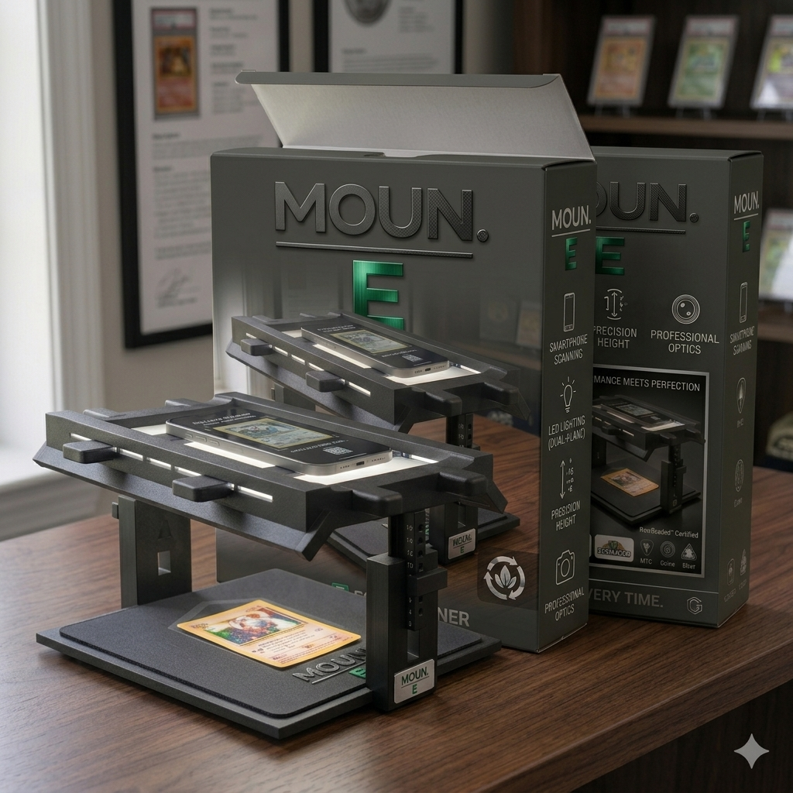

Retail hero — in-scene device + packaging; reinforces Stage 1 shelf story and professional capture posture (illustrative photography, not compliance artwork).

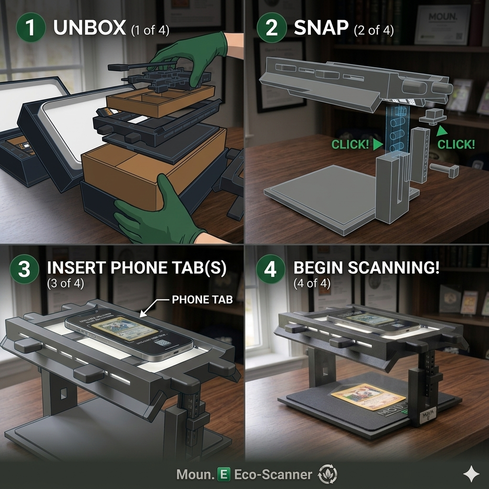

Assembly path — unbox → snap → phone tab → scan (shelf storyboard).

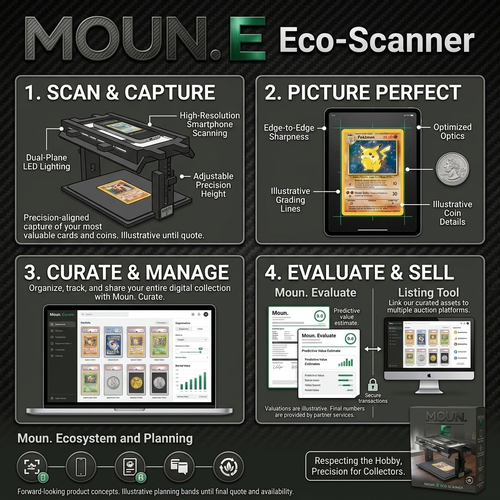

Ecosystem — capture → imaging → collection software → evaluate / list (illustrative partner and valuation callouts).

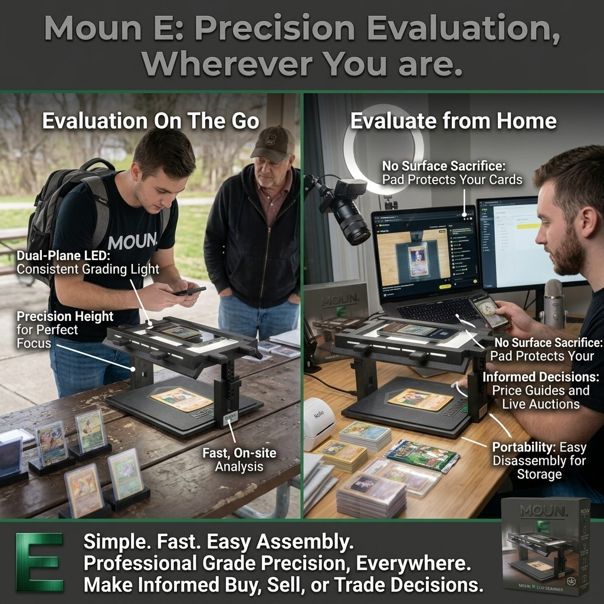

Use cases — on-the-go and at-desk evaluation; reinforces dual-plane lighting and portability narrative.

Mockups only — not released packaging, app UI, or auction integrations; forward-looking planning until binding quotes and partner agreements.

At a glance

### Executive snapshot

Four lenses investors reach for in the first two minutes — answered before you have to interrupt.

01

#### Hardware-first

Moun wins on lighting, staging, and repeatable capture — not on a mandatory SaaS upsell.

02

#### Obvious pain

Phones are good; kitchens, shops, and con floors are not. Grading economics in 2026 keep attention on card value and documentation.

03

#### Five-lane GTM

Direct B2C, social, Amazon, Walmart, and live shows — each answers a different discovery path in the same hobby.

04

#### Capital → velocity

Phase 1 is sequenced Eco-first (plastic + padding CM scope) so early checks buy inventory and proof before funding the full Pro (Moun P) electrical kit and assembly stack; then capital feeds scale, compliance, and channel execution.

The 60-second story

Collectors and shops already use their phones for eBay image search, TCGPlayer-style comps, listings, and diligence — but glare, shadows, and bad lighting break those tools. Moun is the portable booth that makes those apps reliable. It sells at retail, online, and on the con floor because you can demonstrate it in sixty seconds. Software like RawGraded.com is upside; the box is the business.

Macro

### Market as it is today

#### Hobby visibility and anniversaries

The Pokémon franchise marked its 30th anniversary in 2026 with official global activations and year-long programming — a high-visibility moment that draws mainstream attention to TCG products, collectibles, and nostalgia-driven participation. See sources: The Pokémon Company (30th anniversary announcement) and Wikipedia summary for breadth of tie-ins.

#### Record-setting sales set the cultural ceiling

In February 2026, Logan Paul’s PSA 10 Pikachu Illustrator sold at Goldin Auctions for about $16.5 million (AP; Guinness cites $16,492,000 for the same event). Guinness World Records confirmed multiple record dimensions for this card over time — including, for this auction, the most expensive trading card sold at auction overall — reinforcing headline liquidity and rarity narratives for the category.

#### Grading cost and time pressure (2026)

Third-party grading remains capacity- and price-sensitive. In February 2026 PSA publicly raised fees on several card tiers and lengthened posted turnaround estimates for select levels, pointing to sustained submission growth — a story that circulated across Reddit, X, and hobby communities alongside PSA’s official notice. CGC Cards publishes long turnaround estimates for economy-facing tiers and states that times are not guaranteed; users frequently report longer real-world waits than headline numbers. These are current-market constraints, not relics of the pandemic-era backlog alone.

Traffic & attention

### Destination sites — not a niche bookmark folder

Collectors and sellers constantly hit major pricing and marketplace domains. The panels below are screenshots from a commercial SEO/analytics tool (Semrush-class UI) dated April 8, 2026, for the root domains shown. They are third-party estimates of organic footprint and AI-search visibility — not audited by Moun — but they illustrate order-of-magnitude attention these properties already command. Traffic and keyword figures are modeled tool outputs, not audited financial statements or verified publisher metrics.

Figures are as shown in the tool at capture time (desktop filters where indicated). Traffic and backlink counts are modeled estimates; use for directional scale only.

[tcgplayer.com](https://www.tcgplayer.com)

United States · desktop

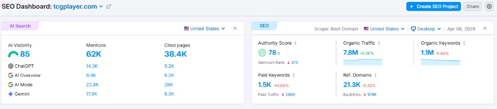

Organic traffic (est.)~7.8M visits / month

Organic keywords (est.)~1.1M

Authority / backlinks (est.)Score 78 · ~101M backlinks

AI visibility (tool index)85 · high mention & cited-page counts

[pricecharting.com](https://www.pricecharting.com)

Worldwide · desktop

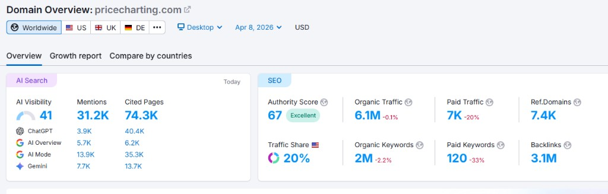

Organic traffic (est.)~6.1M visits / month

Organic keywords (est.)~2M

Authority / backlinks (est.)Score 67 · ~3.1M backlinks

AI visibility (tool index)41 · strong cited-page depth

[ebay.com](https://www.ebay.com)

Tool dashboard · desktop (general marketplace footprint)

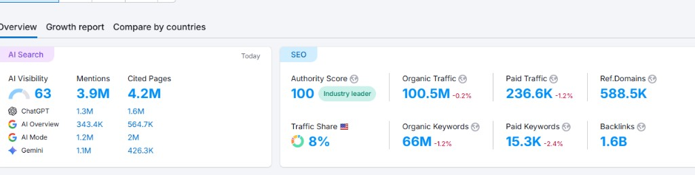

Organic traffic (est.)~100.5M visits / month

Organic keywords (est.)~66M

Authority / backlinks (est.)Score 100 · ~1.6B backlinks

AI visibility (tool index)63 · very high AI mention volume

This is everyday web behavior for the category: pricing, listing, and trading decisions run through high-traffic surfaces. Moun sits upstream of all of them — better inputs (imagery) wherever the seller lists or researches.

Positioning

#### Not middleware tied to one service — sell-first capture

Investors sometimes ask whether hardware is “just an accessory” for a single app or grading API. The answer is no: the same controlled observation plane and lighting that power comps and pre-grade diligence are exactly what move units in ordinary resale — clear, repeatable product photography.

- List on eBay, TCGplayer, Mercari, Facebook Marketplace, Etsy, Shopify, trade servers, or cash meetups — the bench improves trust and conversion regardless of which logo is on the checkout page.

- If the owner never runs image search and never submits to PSA, CGC, or anyone else, the station still pays back through faster listing workflows and fewer retakes, refunds, and “is this the same card?” disputes.

- Software and data partners (including optional RawGraded.com) can layer on top; the core SKU is justified by physical capture and throughput, not by piggybacking on one proprietary feed.

Economics

### DIY prep spend vs. third-party grading fees

Collectors comparison-shop desk magnifiers (often ~$35–120 for serious task lamps) and inexpensive centering aids — basic plastic or print guides commonly land ~$10–25; bundled “starter” kits with a small light box or similar often promo in the ~$12–16 range at mass-market retailers — while simultaneously routing large sums through PSA, CGC, Beckett, TAG, and peers. Hardware that improves pre-submission capture is typically a rounding error next to grading invoices — but it materially affects match quality, resubmission rates, and time-to-list.

Retail price sentences here are directional spot-checks of common listings, not a formal survey.

Reported March 2026 throughput across the major graders is measured in millions of items per month, not thousands (see Sports Illustrated citing GemRate, linked below).

#### Representative DIY “grading prep” retail basket

Piecemeal ecommerce stacks — inspection lamp or magnifier, basic centering or comparison aids, cleaning consumables, sleeves and holders, plus a small ring light or tripod when buyers upgrade ad hoc — often land roughly ~$95–300 combined for a serious hobbyist assembling from separate SKUs. That is still often less than a single moderate bulk submission once per-card service fees stack up. Bundled entry kits can undercut that sum for light-only workflows; they anchor price expectations without replacing enthusiast-grade pieces.

- LED magnifier / task inspection lamp $35–$120

- Centering / comparison aid (plastic or print guide) $10–$25

- Cleaning kit + sleeves / semi-rigid holders $25–$90

- Ring light or small tripod (often added) $25–$65

- Bundled hobby “starter” kits (promotional pricing, illustrative) ~$12–$16

The ~$95–300 narrative matches the four piecemeal lines (lamp + guide + consumables + add-on light). The bundled starter row is a typical promo anchor (~$12–16) — not stacked into that sum. Illustrative retail bands — directional spot-checks, not a formal price survey.

#### Published PSA card prices (anchor for “per card” spend)

Realized grading cost per card varies by tier, membership, promos, and declared value. PSA’s official February 2026 bulletin listed new card submission prices including Value Bulk $24.99, Value $32.99, Value Plus $49.99, Value Max $64.99, and Regular $79.99 (effective Feb. 10, 2026).

[PSA submission updates](https://www.psacard.com/info/submission-updates)

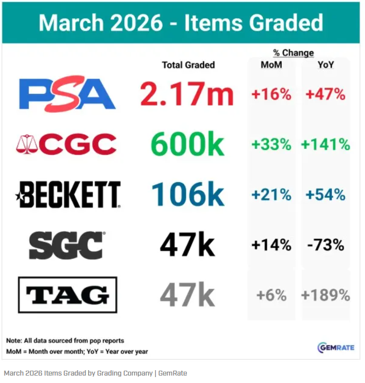

On-file GemRate-style summary graphic (March 2026). Figures are cross-checked against SI’s reporting of GemRate data.

[Sports Illustrated (collectibles) — GemRate summary](https://www.si.com/collectibles/march-gemrate-report-psa-tcg-rookie-hype-drive-record-card-month)

- Sports Illustrated, citing GemRate, reported roughly 2.97 million cards graded across major grading companies in March 2026 — up about 19% month-over-month versus February (on the order of 480,000 additional items).

- Same source: year-over-year volume up nearly 50% versus the prior March (~2 million items then).

- PSA: about 2.17 million items graded, +16% MoM and +47% YoY; TCG plus non-sport grading cited at more than 2.1 million items in March (~70% of all grading volume).

[Yahoo Sports (cllct, quoting PSA)](https://sports.yahoo.com/articles/psa-increasing-prices-turnaround-time-141500962.html)

Coverage of PSA’s February 2026 pricing and turnaround updates quoted the company: roughly 15,000 cards graded per day globally in 2021 versus about 90,000 per day at the time of the article.

Illustrative monthly service spend (March volume × hypothetical average fee)

Not company-reported revenue. Actual ASP mixes economy tiers, express, cross-overs, and non-card categories. Use only as order-of-magnitude sensitivity.

- ~2.97M items × $25 hypothetical average fee ~$74M

- ~2.97M items × $40 hypothetical average fee ~$119M

- ~2.97M items × $60 hypothetical average fee ~$178M

Moun monetizes once on the prep-and-capture layer; grading incumbents monetize per item at scale. When millions of cards move through third-party grading monthly, even small improvements in pre-submission imagery and operator consistency compound across the entire downstream stack.

On the ground

### Real crowds, real venues

The hobby is visibly active on the ground: flagship weekends cited below reach the mid–high tens of thousands in one metro (Pokémon Worlds, Gen Con). Regional card shows, league nights, retailer events, and side tournaments run year-round across the U.S.; we do not have one audited number for “total category foot traffic,” but the flagship headcounts below show concentrated demand in single metros.

[NPR Pokémon World Championships — 2025 (Anaheim, CA) NPR: more than 25,000 people at the Anaheim Convention Center. Open source](https://www.npr.org/2025/08/25/nx-s1-5518254/pokemon-world-championships-2025)[Honolulu Star-Advertiser Pokémon World Championships — 2024 (Honolulu, HI) Star-Advertiser: Pokémon Co. cited ~14,000 badged attendees expected; convention center at full capacity. Open source](https://www.staradvertiser.com/2024/08/15/hawaii-news/pokemon-event-draws-thousands-to-waikiki/)[Gen Con Gen Con — 2025 (Indianapolis, IN) Official press: nearly 72,000 unique attendees — record, sold-out tabletop flagship (TCG-heavy floor). Open source](https://www.gencon.com/press/record-breaking-gencon-2025)

Originals are on Wikimedia Commons under the licenses shown; copies ship from this site’s /investors/ folder so they load under strict CSP. Each Commons file page documents authorship and terms. Historical illustrations of floor energy only — not used to imply any specific headcount.

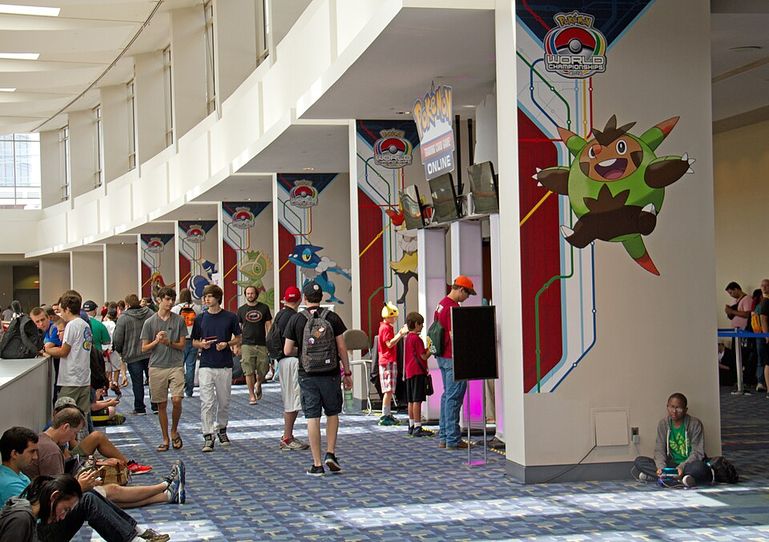

Pokémon World Championships — expo hall (Washington, D.C., 2014). Later U.S. Worlds have scaled further; see NPR & Star-Advertiser citations.

David (Washington, DC)  · [CC BY 2.0](https://creativecommons.org/licenses/by/2.0) · [Wikimedia Commons](https://commons.wikimedia.org/wiki/File:Pok%C3%A9mon_World_Championships_2014.jpg)

Merchandise lines at Pokémon World Championships (Honolulu, 2024) — demand visible on the floor.

Daniel Ramirez (Honolulu, USA)  · [CC BY 2.0](https://creativecommons.org/licenses/by/2.0) · [Wikimedia Commons](https://commons.wikimedia.org/wiki/File:Line_to_buy_merchandise_at_Pokemon_World_Championships_(54277323262).jpg)

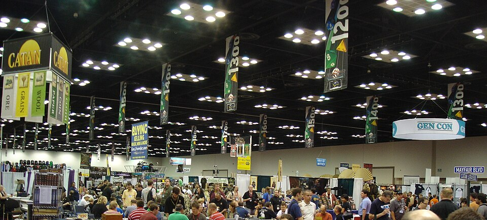

Gen Con exhibit hall (Indianapolis, 2010). Attendance has grown to record levels — see Gen Con press for 2025 figures.

Huntleigh  · [CC BY-SA 3.0](https://creativecommons.org/licenses/by-sa/3.0) · [Wikimedia Commons](https://commons.wikimedia.org/wiki/File:Gen-Con_Show_Floor,_2010.JPG)

Use-case scenarios

### Where the trade happens

Each panel is a deliberate scene: show floor, prep desk, live stream, or listing bench — who holds the phone, what posture the rig fixes, and why repeatable capture supports comps, inventory, and buyer trust. Keep every image paired with an outcome line investors can diligence.

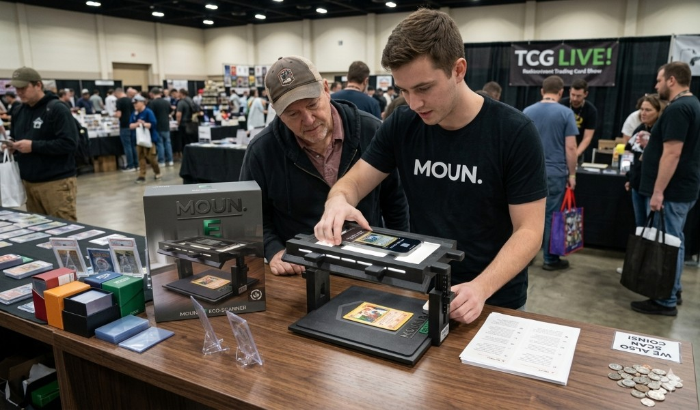

#### Card show · live price-check at the table

Vendor sets Moun E on the trade table: card or slab under the lit bridge, phone staged for marketplace or guide lookup in the same conversation as the handshake — no second capture rig or back-room delay.

- High-intent floor: regional shows, league nights, and con booths where comps move deals.

- Adjacent table story (“we also scan coins”) hints cross-category capture without expanding claim scope here.

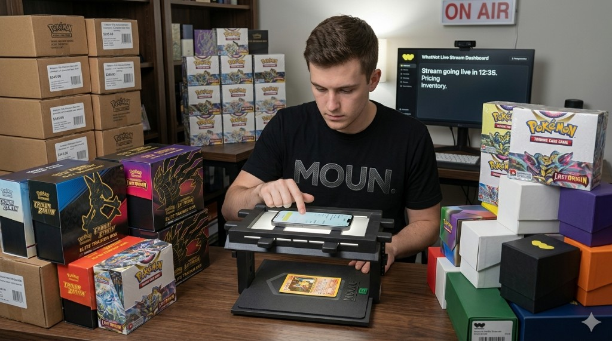

#### Live seller prep · stream-ready capture

High-volume seller stages inventory beside a live dashboard: Moun E holds phone and card in one repeatable plane so pricing and listing apps see the same lighting as the eventual stream — fewer retakes between “off-air” prep and “on-air” lots.

- Fits Whatnot-style and short-form workflows where the clock is the show.

- Monitor UI and “ON AIR” treatment are illustrative — partner marks and compliance are separate.

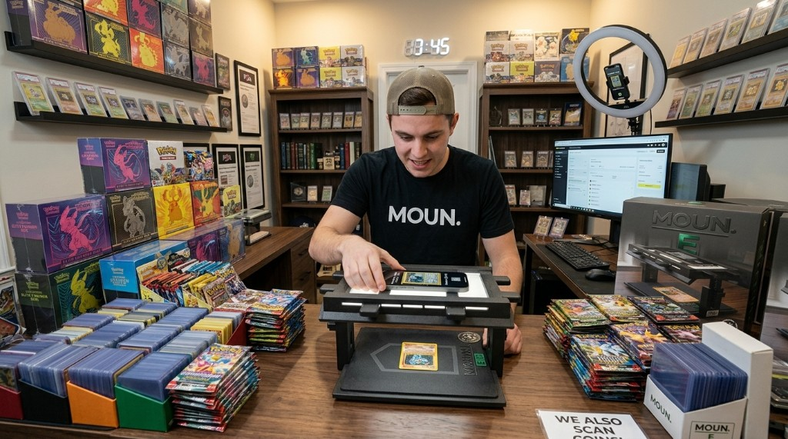

#### Dealer desk · inventory & listing throughput

Home or shop desk with deep SKU: operator runs Moun E between piles of slabs, ETBs, and bins — same integrated bridge for quick captures into inventory or marketplace drafts without rebuilding a tent rig between lots.

- Background UI suggests deal-room / ops software — not a shipped feature promise.

- Ring light and second phone in scene are common creator stack; Moun story is the controlled capture path.

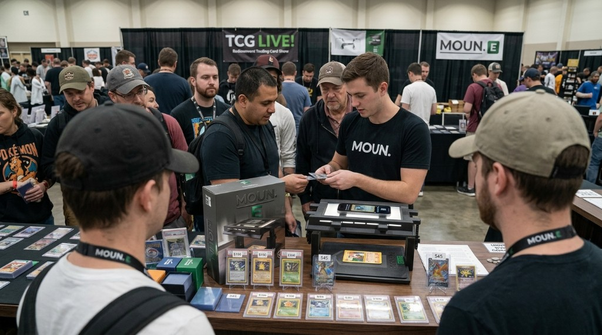

#### Show floor density · many eyes on the comp

Booth draws a ring of buyers: one rig, visible price tags, and phones in a consistent posture so crowd conversation stays anchored to the same capture everyone is looking at — social proof on the floor, not only in the feed.

- Third-party event names on signage are illustrative set dressing — clear before any paid placement.

- Lanyards and partner marks require brand and counsel approval for real collateral.

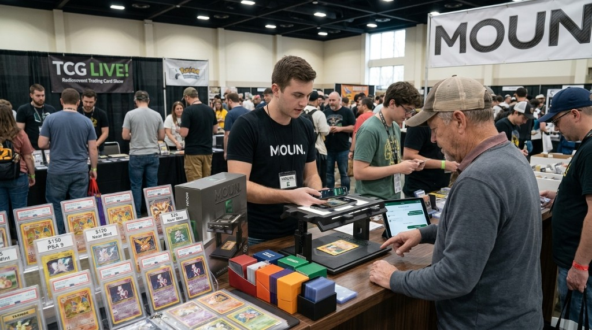

#### Two-party booth · buyer-facing readout

Vendor runs capture on the rig while a tablet faces the customer — identity, condition, or comp data on a shared screen so the negotiation stays at the table instead of passing phones hand-to-hand.

- Dual-phone posture shows capture plus control; final UX is product-specific.

- Slab wall and price tags reinforce high-trust SKUs where glare control matters.

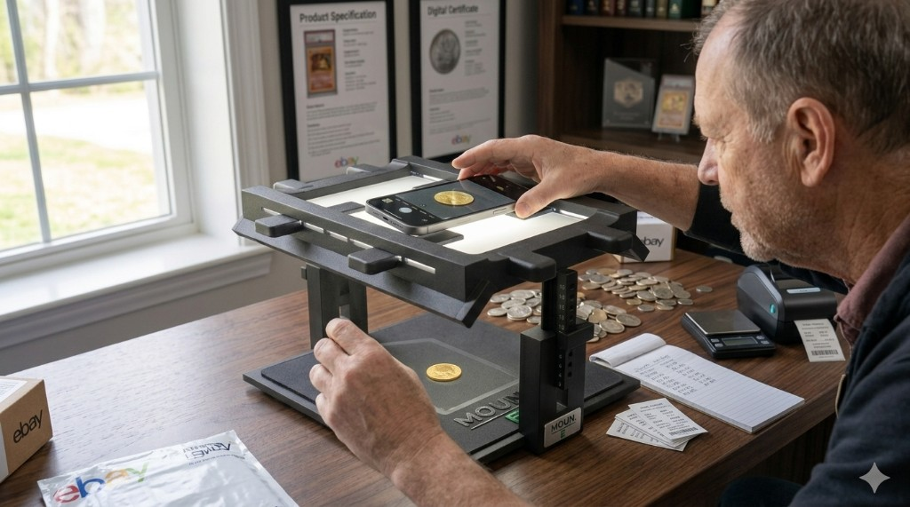

#### Coins & bullion · listing bench workflow

Numismatics seller uses the same bridge posture for small metal: coin on deck, phone locked for top-down capture into listing or mail-in workflows — scale and label printer in frame signal repeatable ops, not a hobby snapshot.

- eBay-branded materials in scene are illustrative context for marketplace sellers — not an endorsement or partnership claim.

- Adjustable column / scale marks in CAD communicate fitment; freeze spec vs CM scope separately.

Illustrative AI-generated composite for internal decks — venue signage, talent, product finish, packaging, and companion claims are not final; replace with cleared photography before marketing or retail use.

Verification

### Verified public sources

Third-party pages backing market claims — open in a new tab for diligence.

- Pokémon 30th anniversary (2026)

The Pokémon Company promoted a year-long 30th anniversary celebration (franchise milestone since 1996), including official news and global activations.

The Pokémon Company International

[https://www.pokemon.com/us/pokemon-news/get-ready-to-celebrate-30-years-of-pokemon](https://www.pokemon.com/us/pokemon-news/get-ready-to-celebrate-30-years-of-pokemon)

- Pokémon 30th anniversary (encyclopedic summary)

Independent overview of the 2026 anniversary programming and franchise context.

Wikipedia (user-maintained — corroborate critical facts)

[https://en.wikipedia.org/wiki/Pok%C3%A9mon_30th_Anniversary](https://en.wikipedia.org/wiki/Pok%C3%A9mon_30th_Anniversary)

- Logan Paul — Pikachu Illustrator auction (Feb 2026)

Associated Press reported the PSA-10 Pikachu Illustrator sold at Goldin Auctions for $16.5 million after extended bidding; Guinness staff present confirmed it set a record for any trading card sold at auction.

Associated Press

[https://apnews.com/article/logan-paul-pokemon-record-auction-e4f17184466589e7313b58de734a06ad](https://apnews.com/article/logan-paul-pokemon-record-auction-e4f17184466589e7313b58de734a06ad)

- Guinness World Records — sale and multiple record titles

Guinness World Records documented the February 2026 auction (reporting a $16,492,000 price) and the card’s status as the most expensive trading card sold at auction (overall), building on prior records including the 2021 private-sale price.

Guinness World Records

[https://www.guinnessworldrecords.com/news/2026/2/logan-pauls-rare-pokemon-card-becomes-most-expensive-ever-sold-in-record-setting-auction](https://www.guinnessworldrecords.com/news/2026/2/logan-pauls-rare-pokemon-card-becomes-most-expensive-ever-sold-in-record-setting-auction)

- Guinness — record title detail page

Official record page: most expensive trading card sold at auction (overall).

Guinness World Records

[https://www.guinnessworldrecords.com/world-records/782465-most-expensive-trading-card-sold-at-auction-overall](https://www.guinnessworldrecords.com/world-records/782465-most-expensive-trading-card-sold-at-auction-overall)

- PSA — pricing & estimated turnaround (February 2026)

PSA increased prices on select card tiers and extended estimated turnaround times for Value Plus, Value Max, and Regular (effective Feb. 10, 2026), citing higher submission volume and the need to align demand with grading capacity. Hobby collectors discussed the changes widely on social platforms; terms are defined on PSA’s official submission-updates page.

PSA (official)

[https://www.psacard.com/info/submission-updates](https://www.psacard.com/info/submission-updates)

- CGC Cards — posted turnaround times & estimates disclaimer

CGC publishes per-tier fees and estimated working-day turnaround; it states that times are estimates only and not guaranteed, and that research-heavy cards can take longer. Economy-facing tiers can show long posted ranges (e.g. Bulk). Forum and social posts often describe real waits exceeding expectations — diligence should rely on CGC’s posted terms.

CGC (official)

[https://www.cgccards.com/submit/services-fees/cgc/](https://www.cgccards.com/submit/services-fees/cgc/)

- CGC Cards — Bulk & Economy fee update (March 2026)

CGC Cards announced updated Bulk and Economy tier fees for U.S. card submissions, effective March 24, 2026.

CGC (official)

[https://www.cgccards.com/news/article/14993/cgc-updates-bulk-economy-tiers/](https://www.cgccards.com/news/article/14993/cgc-updates-bulk-economy-tiers/)

- Pokémon World Championships — 2025 U.S. attendance (Anaheim)

NPR reported more than 25,000 people gathered at the Anaheim Convention Center for the 2025 Pokémon World Championships.

NPR

[https://www.npr.org/2025/08/25/nx-s1-5518254/pokemon-world-championships-2025](https://www.npr.org/2025/08/25/nx-s1-5518254/pokemon-world-championships-2025)

- Pokémon World Championships — 2024 scale (Honolulu)

Honolulu Star-Advertiser reported Pokémon Co. International’s Chris Brown expecting 14,000 badged attendees for the 2024 World Championships in Honolulu, with the Hawaiʻi Convention Center at full capacity and thousands attending opening events.

Honolulu Star-Advertiser

[https://www.staradvertiser.com/2024/08/15/hawaii-news/pokemon-event-draws-thousands-to-waikiki/](https://www.staradvertiser.com/2024/08/15/hawaii-news/pokemon-event-draws-thousands-to-waikiki/)

- Gen Con — flagship U.S. tabletop convention attendance (2025)

Gen Con’s official press release stated nearly 72,000 unique attendees for the sold-out 2025 Indianapolis convention — a record for the event (tabletop gaming includes extensive TCG and collectible play).

Gen Con

[https://www.gencon.com/press/record-breaking-gencon-2025](https://www.gencon.com/press/record-breaking-gencon-2025)

- March 2026 grading volume (GemRate via Sports Illustrated)

Sports Illustrated summarized GemRate data: roughly 2.97 million cards graded across major companies in March 2026, with PSA about 2.17 million items and TCG/non-sport grading cited as a large share of monthly volume.

Sports Illustrated

[https://www.si.com/collectibles/march-gemrate-report-psa-tcg-rookie-hype-drive-record-card-month](https://www.si.com/collectibles/march-gemrate-report-psa-tcg-rookie-hype-drive-record-card-month)

- PSA daily throughput (press quoting PSA, Feb 2026)

Yahoo Sports / cllct coverage of PSA’s February 2026 pricing update quoted PSA stating it graded about 15,000 cards per day globally in 2021 versus about 90,000 per day more recently.

Yahoo Sports (cllct)

[https://sports.yahoo.com/articles/psa-increasing-prices-turnaround-time-141500962.html](https://sports.yahoo.com/articles/psa-increasing-prices-turnaround-time-141500962.html)

Sources and limitations

- Primary citations: PSA, CGC, Gen Con, NPR, Honolulu Star-Advertiser, Associated Press, Guinness — claims follow what those pages report at link time.

- Secondary summaries: e.g. Sports Illustrated reporting GemRate aggregates — we restate SI’s summary, not independent pulls of GemRate’s database.

- Illustrative retail bands (grading-desk basket, DIY prep lines) are directional spot-checks of common listings — not a formal survey or audited market sizing.

- SEO / analytics screenshots: organic traffic and keyword counts are tool-modeled estimates — useful for order-of-magnitude attention, not audited reach or financials.

Product

### Why Moun fits this moment

- 1 Portable in both intended form factors (entry Pro / Moun P build and full station program) — bench or retail counter friendly.

- 2 Modular application strategy: workflows can include a phone as the camera, or adapt when a handset is not available, reducing friction for shops and collectors.

- 3 Even, task-oriented lighting and a controlled observation plane — the best practical environment for inspecting cards, coins, and adaptable to figurines and other collectibles.

- 4 Purpose-built stage for phone-led tools you already use: eBay image search, TCGPlayer market photo workflows, and similar visual-comp apps—reducing glare, shadow, and background noise that break matches.

- 5 Not a commodity folding light tent: modular pack-out, durable cleanable planes, and repeatable top-down capture for seconds-to-result workflows — without flimsy screens and fabric that fail in transit and soil under daily shop or show use.

- 6 All-in-one positioning vs fragmented retail “mixed modules” (see Market research) — one coherent capture envelope for listing, diligence, and AI-assisted workflows.

Pricing story

### What people pay today vs. Moun E flagship pricing

Investor deal board — read this first

Planning basis @ 1000 MOQ · Eco (Phase 1) + Pro CM + full-station BOM seed · Not an offer

Page architecture

#### Each model follows the same four-page stack

Moun E

- Engineering page

- Electrical page

- Manufacturing page

- Financial page

Moun E Cobra

- Engineering page

- Electrical page

- Manufacturing page

- Financial page

Collectors and shops still assemble inspection lighting, aids, and capture accessories from separate SKUs. Moun is priced as one integrated envelope — entry static bay vs. full mechanical program.

Fragmented retail today

### Typical “grading desk” basket

Illustrative combined spend

~$95–300

- LED magnifier / task inspection lamp $35–120

- Centering / comparison aid (plastic or print guide) $10–25

- Cleaning kit + sleeves / semi-rigid holders $25–90

- Ring light or small tripod (often added) $25–65

Combined range (~$95–300) is the piecemeal stack above. Promotional all-in starter kits (small booth + basics) often list ~$12–16 at mass retailers — a separate price anchor, not added into that sum. Still no shared reference plane, repeatable top-down capture path, or coordinated pack-out — buyers stop at “good enough” photos.

Planned MSRP — Moun E Cobra

### Moun E Cobra · premium variant

Target retail

$59.99

Wall-forward premium variant in the Moun E family

- Shared flagship ecosystem with Moun E core accessories and workflows

- Premium geometry and faster table-to-capture posture for frequent operators

- Phone-first capture workflow aligned with listing and comp apps

Flagship narrative anchor

### Moun E · core SKU

Target retail

$39.99

Entry flagship retail SKU for broad channel adoption

- Lowest-friction launch SKU for DTC, social commerce, and retail pilots

- Uses shared flagship claims and accessory language with Cobra

- Built for high-clarity capture without speculative future system dependencies

Status-quo ranges mirror the illustrative DIY basket in Market research (common retail bands, not a formal survey). Target MSRPs are for private investor discussion only — finalize against landed cost, duties, certification, and partner margin before any public price list.

The left column is recurring commodity spend without a system; the center and right columns are deliberate SKU targets that replace that sprawl with a single product story.

Unit economics

#### Cost discipline vs. planned retail — everyone can win

Phase 1 manufacturing leads with Moun E (Eco CM scope) before the heavier Pro / full-station stacks. The rows below pull from the Eco CM table, the Pro (Moun P) CM table, and the Manufacturing BOM seed + illustrative tooling — same sources as the build guide.

- Eco CM bands  — ecoManufacturingModel.ts ECO_CM_COST_ROWS, variable sum, NRE sum

- Pro CM bands  — hobbyistManufacturingModel.ts HOBBYIST_CM_COST_ROWS, variable sum, NRE sum

- Full station unit cost  — bomSeed.ts + Manufacturing tooling chart Factory BOM seed rollup + Phase-1 tooling amortization

##### Moun E (Eco) · $39.99 planning ASP

~$16.35–46.55 variable / unit (Eco CM model incl. 2× commodity USB strip row)

~$500–2700 one-time NRE (amortizes with volume)

Planning landed (variable + NRE ÷ MOQ)

- MOQ 500 $17.35–51.95 planning landed (variable + NRE/500)

- MOQ 1000 $16.85–49.25 planning landed (variable + NRE/1000)

- MOQ 2000 $16.6–47.9 planning landed (variable + NRE/2000)

Anchor @ MOQ 1000: $16.85–49.25

~-23.16%–57.86% gross vs. $39.99 planning ASP (within CM bands; before retail partner margin & freight)

Retail story includes two kitted USB strips at planning ASP; Eco CM rows are plastic + pad + illustrative strip COGS. Compare like-for-like in RFQs.

##### Moun E Cobra · $59.99 planned MSRP

~$15.7–44.69 variable / unit (Cobra planning model from Eco baseline + simplification factor)

~$480–2592 one-time NRE planning band

Planning landed (variable + NRE ÷ MOQ)

- MOQ 500 $16.66–49.87 planning landed (variable + NRE/500)

- MOQ 1000 $16.18–47.28 planning landed (variable + NRE/1000)

- MOQ 2000 $15.94–45.98 planning landed (variable + NRE/2000)

Anchor @ MOQ 1000: $16.18–47.28

~21.19%–73.03% gross vs. $59.99 planning ASP (before channel and freight)

Cobra is positioned as the premium fixed-geometry variant for users who want faster setup and sturdier bench posture while staying in the Moun E ecosystem.

Forward-looking illustration only. Replace ranges with binding CM quotes, actual freight/duties, retail markdown allowance, and returns reserve. Eco / Pro (Moun P) NRE and full-station tooling amortize — early units bear higher fully-loaded cost until volume catches the model. Eco low/high bands are a simultaneous envelope across rows, not a confidence interval — see Phase 1 manufacturing section for scenario-style presentation.

Consumer reality

### “I didn’t spend $300 — this is good enough. Why do I need ~$279 of ‘plastic and lights’?”

Acknowledge the floor first. Commodity centering aids often land ~$10–25; pair a ~$10 LED with a kitchen table and you can absolutely produce a photo “for free” in the hobby sense. For casual Discord shots or a one-off listing where perfection does not move price, that stack is rational.

#### When the $21 bench is enough

- You are not optimizing for resale velocity — you just need proof of ownership or a quick share.

- You will tolerate retakes, glare, and inconsistent framing because volume is one card at a time.

- You are not running comps, search matches, or shop-grade intake where inconsistency costs trust.

#### What ~$279 is buying (it is not snobbery)

- A single integrated observation plane + task lighting so top-down capture is repeatable — the same geometry session to session. Cheap stacks drift: lamp height, white balance, and shadow gradient change; image-search and comp tools punish that variance.

- Throughput for people who sell or trade often: fewer retakes, fewer “is this the same card?” disputes, faster listing prep — the cost is the desk hours you do not get back.

- Controlled diffuse light path vs. a bare LED pointed at foil — less hot spotting and color fringing that break marketplace matches and grading-intent photos.

- Portable, wipeable rig for shows and shops — not a loose lamp and paper template sliding on a folding table in a hotel room.

- Serious-enough presentation: buyers subconsciously compare your photos to everyone else’s; consistency reads as care; chaos reads like hiding damage.

The business case is not “every human who owns a card.” It is the slice that already outgrew the $21 stack — volume sellers, shops, and committed collectors whose time, trust, and match quality are worth more than another Amazon lamp. Compete on workflow and outcomes, not on beating the absolute minimum cash outlay.

Workflow wedge

### Built for marketplace image workflows

Shops and collectors already lean on the phone in their pocket: eBay image search to find comps, and TCGPlayer’s market tools that lean on clear photos for identification and price context — for raw inventory and for slabs that still need quick verification or relist imagery. Those features work best when the capture is stable, evenly lit, and free of glare. Moun is the controlled environment those apps assume but rarely get in the wild.

#### eBay image search

Visual search and “similar sold” flows depend on a legible, low-glare front and back. Handheld shots under mixed lighting produce reflections and color cast that degrade match quality; the station normalizes the frame so the scanner software can do its job.

#### TCGPlayer — photo-driven market checks

Pricing and identification workflows that use the camera benefit from a neutral backdrop, consistent distance, and repeatable lighting—so variants, set symbols, and condition cues read clearly without reshooting.

#### Raw or slab — seconds to comps, not keystrokes

Manual search means long titles, set codes, and collector numbers under time pressure; image-first routes on major marketplaces jump to structured comps when pixels are trustworthy. Slabs need the same discipline for relists, verification, and price graphs as raw inventory.

Scanners vs. environment:  Sensors and apps have improved dramatically; the bottleneck is usually the scene—kitchen tables, shop cases lit by fluorescents, convention hall spill light, or a busy counter. Moun targets that gap: not replacing the phone, but giving it a professional-grade stage.

Without a station:  Asking staff or customers to reproduce listing-quality or search-quality captures ad hoc at home, in a retail shop, or on a convention floor is slow, inconsistent, and often frustrating. The product is the portable, repeatable capture booth those workflows implicitly require.

Objection handling

### Why not just a photo booth box?

Fold-out light tents, ring-lit mini studios, and overhead “crane” mounts are everywhere online. Moun competes in the same jobs-to-be-done but is not a traditional phone-plus-tent-plus-tripod stack: it targets transparent shop and travel workflows with repeatable geometry—not a collapsible enclosure that walls off the work surface. Typical top-down phone or camera rigs exist, but they struggle to hold stable absolutes shot-to-shot; bundled ring lights can throw harsh hotspots, ring-shaped reflections, or blind spots when glare comes off slab or card surfaces. The retail screenshots below are illustrative third-party listings only—not endorsements.

What “photo booth” often looks like at retail

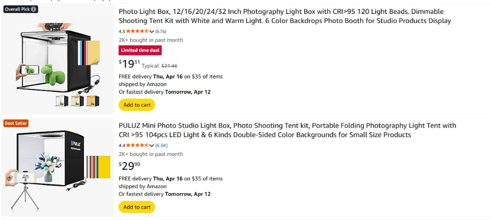

Folding light tent / photo booth SKUs

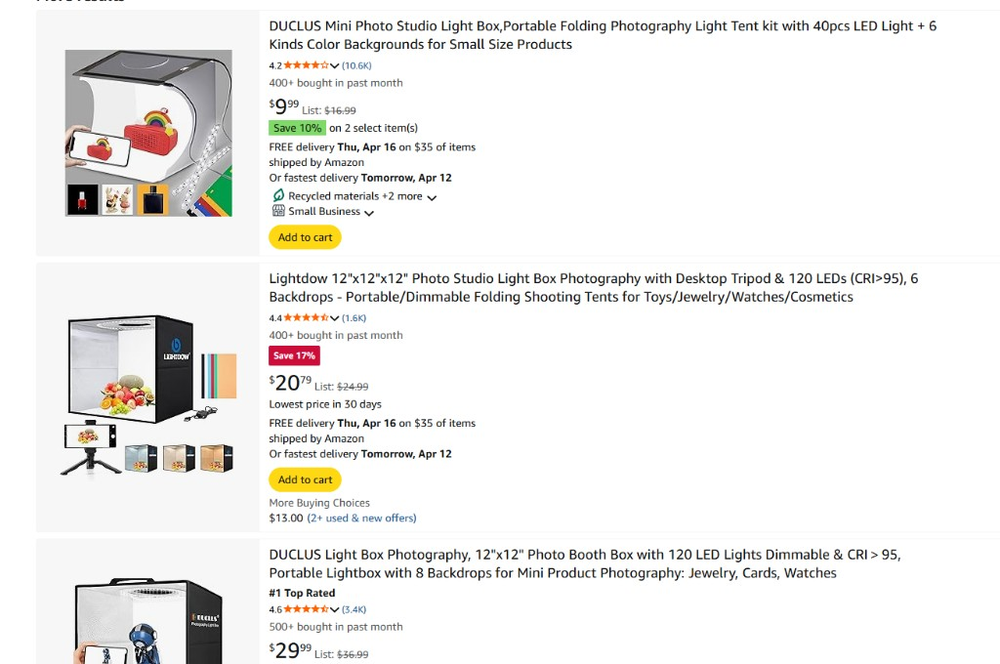

More light-box tent listings

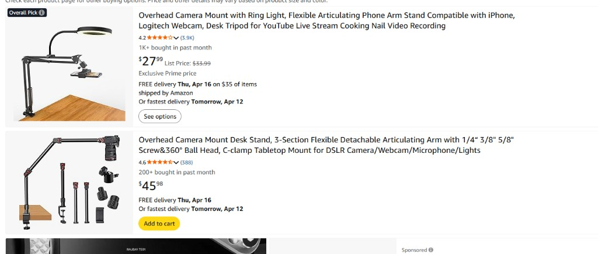

Overhead desk mounts & C-clamp rigs

Illustrative third-party retail screenshots: folding light tents/booths and desk-mounted overhead crane mounts with C-clamps (not product endorsements).

For high-value card work, maximum transparency matters: a fully enclosed booth hides hands and slabs from the buyer’s line of sight. That is a trust gap in a hobby with scammers and thieves—room for out-of-view swaps or bad-faith condition and value games. Moun’s headline is capture quality and workflow; this is a secondary security and credibility angle for vendors who trade face-to-face.

#### Commodity tents, light boxes & ring-top rigs

- Flimsy shells, limited height control

Thin fabric or plastic booths and loose diffusers are built for occasional product snaps, not a stable, adjustable reference plane for repeated show-floor or counter use.

- Walled-in staging

Closed sides and top openings turn capture into a small “black box.” That can be wrong for card vendors where buyers expect to see condition checks in the open—maximum visibility when money and slabs change hands.

- Integrated ring / panel LEDs and slab glare

Top-mounted ring or dense LED arrays can produce harsh hotspots, ring-shaped artifacts, or camera-facing blind spots on reflective graded slabs—less consequential for every product category, painful for specular card surfaces.

#### Overhead clamps, crane arms & bolt-on lights

- Furniture wear and clunky hardware

C-clamps score and fatigue table edges; long arms, springs, and joints feel clunky and never guarantee an instantly usable frame the moment you need it.

- Crane posture vs. phone workflow

Overhead and crane setups often leave the phone clamped where the screen is hard to reach—bad for moving between capture, listings, Lens, and notes without re-rigging.

- Ring lights on arms repeat the glare problem

The same harsh ring-light behavior shows up when a clamp rig bundles a small ring LED—fine for some subjects, rough on glossy encapsulated cards.

#### Moun response

- Furniture-friendly, clampless placement

No swinging arms; no screw-down clamps chewing tables. Direct, maneuverable, sturdy placement—stage the device in and out without locking hardware to the furniture.

- Repeatable geometry

Purpose-built staging holds framing and lighting relationships closer to stable absolutes than ad-hoc top-down holes in a tent or a cantilevered arm that drifts between shots.

- Even task lighting for surfaces

Lighting intent favors even, slab-friendly observation over face-style ring hotspots—aligned with repeatable listing and inspection passes.

- Phones through tablets

The same clampless posture scales from phone to large phone to tablet or iPad-class cameras without sacrificing usable light or burying the whole UI behind a cage of hardware.

Distribution

### Sell-to-market strategy

Moun is a demonstrable consumer product: lighting, capture, and workflow sell in person and on camera. The go-to-market plan is deliberately multi-channel — not a single lane. Together, direct B2C, social, Amazon, Walmart, and on-the-ground shows cover how buyers actually discover and buy in this hobby.

All five motions work in parallel: (1) direct B2C through an owned storefront and lifecycle marketing, (2) social platforms for proof and scale, (3) Amazon and (4) Walmart for retail discovery and trust, and (5) trade shows, conventions, and regional events where the product can be seen, touched, and ordered on the spot.

#### Direct B2C

Direct B2C

First-party site, email/SMS, and retargeting — full control of story, bundles, and margin; the backbone for launches and repeat purchases.

Pros

- Highest gross margin when checkout is owned; no marketplace rake on the first sale.

- Own the customer relationship for accessories, upgrades, and future SKU.

- Flexible merchandising: kits, financing messaging, and warranty copy without retailer templates.

Cons

- Traffic must be built or bought — no built-in marketplace footfall.

- Brand trust and support load sit entirely on the team until scale.

#### Social commerce

Social

Short-form and community platforms (e.g. TikTok, Instagram Reels, YouTube, hobby groups) — demos, UGC, and links to shop.

Pros

- Product is visually demonstrable: lighting, glare control, and capture quality sell in motion.

- Rapid creative testing: hooks, angles, and collaborations without retailer approval cycles.

- Organic and paid reach stack with shows and retail (“I saw this at the con / on Amazon”).

Cons

- Requires consistent content cadence — algorithm and policy risk.

- Attribution and fulfillment expectations must be clear in bio and landing pages.

#### Amazon

Retail

Third-party (Seller Central) retail presence for shoppers who start on Amazon and expect Prime-like fulfillment when available.

Pros

- Massive intent traffic and search volume for gadget and hobby-adjacent categories.

- Reviews and Buy Box dynamics can compound once listing velocity and ratings exist.

- FBA optional path for customers who prioritize fast, predictable delivery.

Cons

- Fees, advertising costs, and policy compliance — margin pressure versus direct.

- Competitive listing environment and counterfeit/warranty perception risks in some categories.

- Operational overhead: catalog, tax, inventory reconciliation, and MAP/channel policy if multi-channel.

#### Walmart Marketplace

Retail

Retail marketplace listing for Walmart.com shoppers and omnichannel reach where the program fits the SKU.

Pros

- Large trusted retail brand; overlaps with value-conscious and generalist shoppers.

- Another search surface beyond Amazon for the same hero SKU.

- Can reinforce legitimacy for investors and partners (“available at major retailers”).

Cons

- Onboarding, performance standards, and logistics expectations differ from DTC playbooks.

- Typically slower to scale than Amazon for niche electronics without retail advocacy.

- Same class of marketplace fees and promotional spend as other large platforms.

#### Trade shows, conventions & regional events

Shows & field

TCG and collectibles shows, regional hobby expos, and partner booths — live demo, pre-orders, and retail introductions where buyers already have intent.

Pros

- Hands-on proof: the station sells when people see even lighting and capture in real conditions.

- Dense audience of shops, breakers, and serious collectors in one place.

- Wholesale conversations, influencer meetups, and press adjacent to the category.

Cons

- Booth fees, freight, staffing, and calendar risk (weather, cancellations).

- Inventory must be staged for spike demand around key weekends.

- ROI depends on follow-through to DTC and retail after the floor conversation.

ICP

### Who it serves

#### Card shops & vendors

Throughput, intake quality, and customer-facing inspection without ad hoc rigs.

#### Collectors (home)

Serious-enough capture path without enterprise cost; path to upgrade.

#### Cross-category

Same lighting and staging discipline for TCG, coins, and adaptable fixturing for figures.

Software optionality

### RawGraded.com — complementary platform (not required)

RawGraded.com is a solid foundational web platform for structured assessment: TCG and other collectible types with condition scoring, identification, and documentation where a formal numeric “grade” may not apply. The roadmap can scale with capital — e.g. valuation surfaces and APIs fed by marketplaces — but that upside is separate from the Moun hardware story.

RawGraded.com is not a dependency for the hardware to succeed. The station sells on inspection, lighting, capture quality, and workflow — buyers do not need the web product to justify the purchase. If RawGraded.com under-delivers or stalls, the hardware line can still win on retail and DTC merit alone.

[RawGraded.com](https://rawgraded.com)

Anticipate the room

### Questions a Shark would ask

Answers on the page so you spend live time on numbers, structure, and terms — not on reframing the deck.

#### Why is this a company — not a ring light and a tripod?

A ring light does not give you a controlled observation plane, repeatable geometry, or a workflow tuned for slabs, raw cards, and adjacent categories. The product is the integrated envelope — light + stage + modularity — that listing and search pipelines implicitly assume.

#### Why not a folding photo booth box or Amazon light tent?

Commodity tents optimize for price, not for repeated breakdown, transit, or retail-grade cleanliness. Fabric wrinkles, diffusers soil, zippers fail, and poles bend — so results and reliability drift exactly when you are on the road or behind a busy counter. Moun is modular and purpose-built: less flimsy backdrop material, surfaces that stay presentable, organized packing in a smaller effective footprint, even lighting, and a deliberate top-down workflow so setup is nearly instant and captures land in seconds — whether the goal is a TCGPlayer-style check, eBay listing comparison, Google Lens, or an optional platform like RawGraded.

#### Why now?

Market attention on TCG and collectibles is elevated; major graders have publicly adjusted pricing and turnaround in 2026, keeping “card value” in the conversation. Marketplace and image-search workflows are mainstream. The gap is environmental, not sensor — and buyers feel it every time a comp search fails.

#### Do I have to believe in RawGraded.com?

No. RawGraded is complementary software optionality. The hardware thesis stands alone on inspection, capture quality, and retail/convention demonstration.

#### Who pays — collector or shop?

Both. Shops care about throughput and consistent intake; serious hobbyists care about listing quality and comps at home. The same SKU narrative supports both with different marketing hooks.

#### What stops a big marketplace or Chinese OEM from copying?

Execution risk always exists. Defensibility stacks from brand, community trust, industrial design, accessory ecosystem, retail relationships, and speed of iteration — not from a single patent claim in a pitch deck. Diligence should scrutinize BOM discipline, supplier strategy, and channel proof.

#### How do you make money — DTC or retail?

Both. DTC and social protect margin and story; Amazon and Walmart add discovery and legitimacy; shows convert skeptics fast. The model is intentionally multi-channel so no single algorithm or buyer owns the company.

#### What will you do with capital?

Ship product at scale: inventory, manufacturing readiness, certifications where required, retail onboarding, and the marketing engine across the five lanes. Exact allocations belong in a financial model under NDA — this guide frames the strategic buckets.

#### What does an investor diligence first?

Working prototypes or pilot units, landed cost trajectory, return rates in test channels, retail readiness (packaging, compliance), and any early sell-through or waitlist evidence. Third-party market stats in this deck link to primary sources.

Positioning

### Why this can dominate the category story

Not hype — structural reasons the pitch survives first contact with sophisticated buyers.

Demonstrable in seconds — the product is its own best salesperson on video and on a show floor.

Solves a universal bottleneck: environment quality for phone-based capture, not “another app.”

Beats commodity photo tents on the metrics that matter for operators: transport survivability, cleanable surfaces, smaller organized footprint, and repeatable top-down geometry.

Multi-channel GTM reduces single-point dependency on one marketplace or one ad network.

Expandable from cards to coins and other collectibles without repositioning the core “controlled capture” story.

Software upside (RawGraded) without betting the hardware story on that platform succeeding.

Intellectual honesty

### Risks — and how we think about them

Investors reward teams that name the downside before the spreadsheet does.

#### Consumer hardware COGS, freight, and tariff exposure

Mitigation:  Supplier diversification, SKU discipline (Moun P vs full station), and pricing tested per channel before scale commits.

#### Marketplace policy, fee, or listing changes

Mitigation:  Balanced mix: owned site, social, two major retailers, and in-person — no single gatekeeper.

#### Seasonality and hobby cyclicality

Mitigation:  Cross-category staging (coins, figures) and B2B shop use cases smooth some consumer seasonality.

#### Fast-follow competition at lower price

Mitigation:  Brand, fit-and-finish, support, and retail presence; continuous improvement on lighting and workflow ergonomics.

Deployment

### Where capital converts into velocity

Strategic buckets — line-item budgets sit in the financial model.

01

#### Inventory & manufacturing (Eco-first Phase 1)

Lead with the Eco tranche: mold readiness, first plastic + mousepad inventory, and CM pack-out — then step into full Pro (Moun P) BOM, LED kitting, and assembly scale once channel proof exists.

02

#### Compliance & packaging

Retail-ready packaging, labeling, and certifications as required for target channels.

03

#### Channel execution

Amazon/Walmart onboarding, creative for social, show calendar, and retail marketing assets.

04

#### Engineering bandwidth

Finalize hardware revisions, accessories, and optional software integrations without starving core ship velocity.

Pre-revenue

### Justifying a $3M pre-money class valuation without sales

With no audited revenue, a valuation is not “proved” by a trailing multiple. It is a negotiated belief about future cash flows, risk[Truncated]
