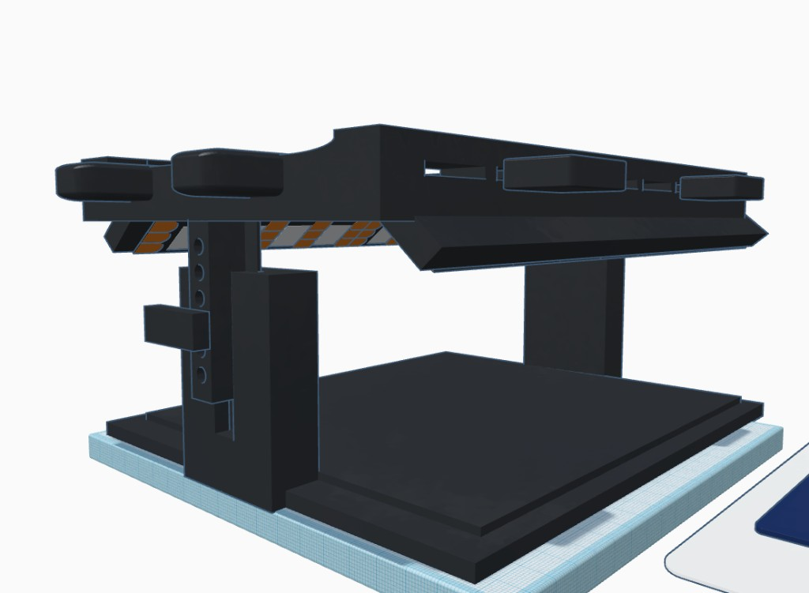
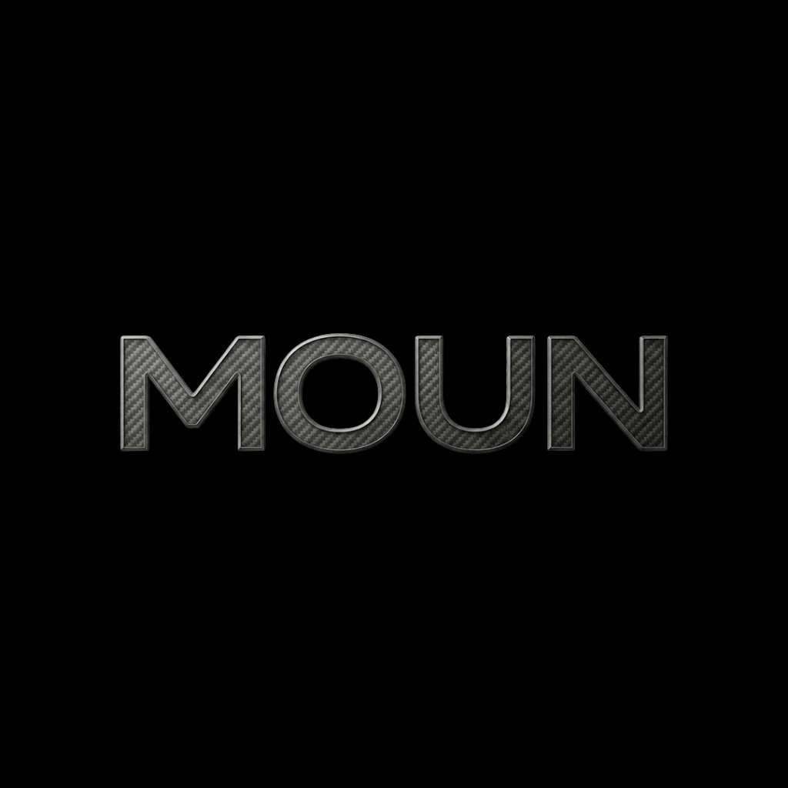
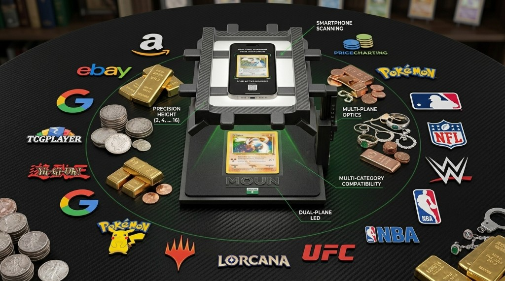
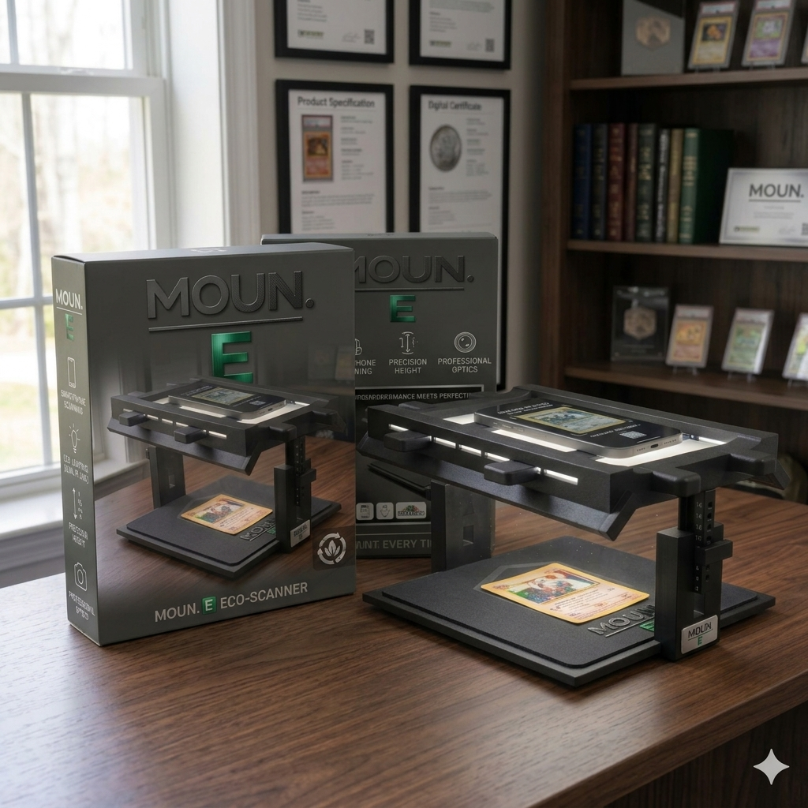
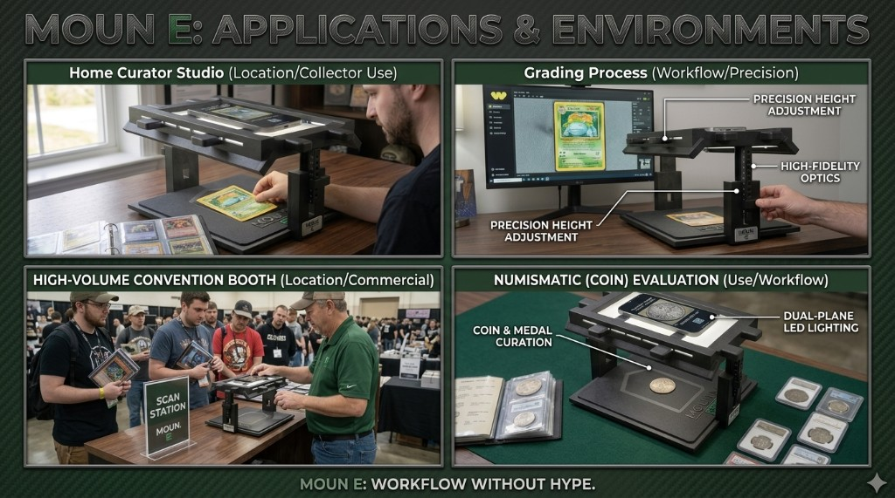
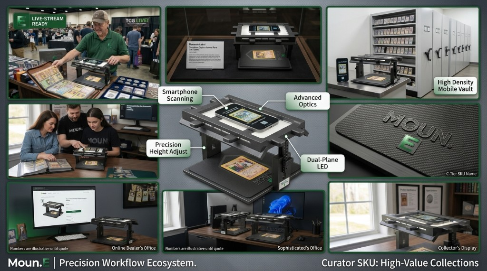
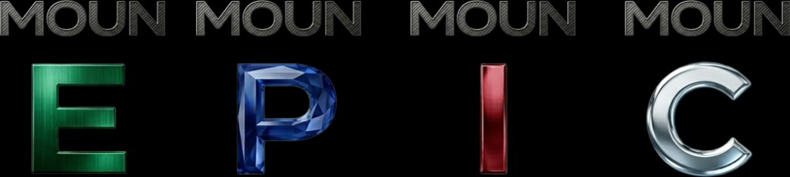

# No more poles, tents, or ring lights

[All sections](INDEX.md) · [Original presentation files](../presentation/) · [Review-only notice](../NOTICE.md)

Reading edition extracted from the supplied built presentation on October 25, 2026. Interactive controls are represented as text and initial displayed values; this is not a live service or a verified engineering, financial, or manufacturing result. Original internal-review labels are retained as historical document context.

---

Moun EPIC platform Internal preview — not a public offer.

 Flagship  Lifestyle  Desk  Hardware

The Moun · Flagship

## No more poles, tents, or ring lights

The Moun is the lead product: premium hardware posture, controlled illumination, and a roadmap that scales from Eco through Curator.

Engineering-grade clarity

Matte chassis language and capture deck — built for repeatability, not one-off rigs.

Explore Moun EDeal room

FlagshipLifestyleDeskHardware

2.97M+

Cards graded in March 2026

GemRate summary (reported by Sports Illustrated).

2.9M+

Pokemon CCG sold listings (recent filtered window)

eBay sold/completed snapshot, captured 2026-04-09.

$95–300

Typical fragmented grading-desk basket

Lamp + guide + consumables + add-on light stack.

~$12–16

Promo starter-kit anchor pricing

Mass-retail baseline for light-only entry bundles.

Illustrative flagship context: one capture posture across categories and channels — internal preview only.

Why flagship wins

01

## Not a tent. A flagship station.

Amazon-style light boxes are commodity accessories; The Moun is a dedicated capture platform engineered to be the center of a workflow.

02

## One SKU replaces the piecemeal stack.

Instead of separate lamps, guides, tripods, and improvised mounts, Moun consolidates setup into one premium product story that scales with the business.

03

## Built for trust-heavy selling.

Open staging, repeatable geometry, and controlled illumination support higher-confidence listings where image quality directly impacts perceived value.

01

## Controlled illumination

Task lighting and deck geometry tuned for marketplace-grade imagery — not a tent and a lamp stack.

02

## EPIC roadmap

Eco → Pro → Investor → Curator — one letter line for packaging, IP, and channel proof.

03

## Partner posture

Hardware-first story with diligence-ready manufacturing pages when you are ready to go deep.

## Category comparison

Internal benchmark framing for deck narratives.

Dimension

Basic light box

Moun E

Positioning system

Foldable tent posture with ad-hoc placements

Engineered deck + bridge alignment for repeatable setup

Lighting behavior

Ambient variability from room and operator choices

Controlled capture environment tuned for marketplace output

Brand memory

Accessory category utility

Distinct hardware signature across Eco, Pro, Investor, Curator

Commercial narrative

Single SKU utility story

Portfolio roadmap with partner and diligence-ready depth

Flagship gallery

## Flagship in the wild

The Moun anchors real collector environments with unmistakable visual identity and bench-ready confidence.

Flagship packshot: premium shelf and desk presence.

Secure workflow stack: calibration, optics, and archival use cases.

Applications across collector, retail, and event environments.

EPIC

## One family · four shelves

E · P · I · C — Eco, Pro, Investor, Curator — same capture thesis as capability steps up.

Product whitepaper

Illustrative photography and diagrams for internal review only. Slideshow pauses on hover; use arrow keys or the rail to change slides.
