# Market research

[All sections](INDEX.md) · [Original presentation files](../presentation/) · [Review-only notice](../NOTICE.md)

Reading edition extracted from the supplied built presentation on October 25, 2026. Interactive controls are represented as text and initial displayed values; this is not a live service or a verified engineering, financial, or manufacturing result. Original internal-review labels are retained as historical document context.

---

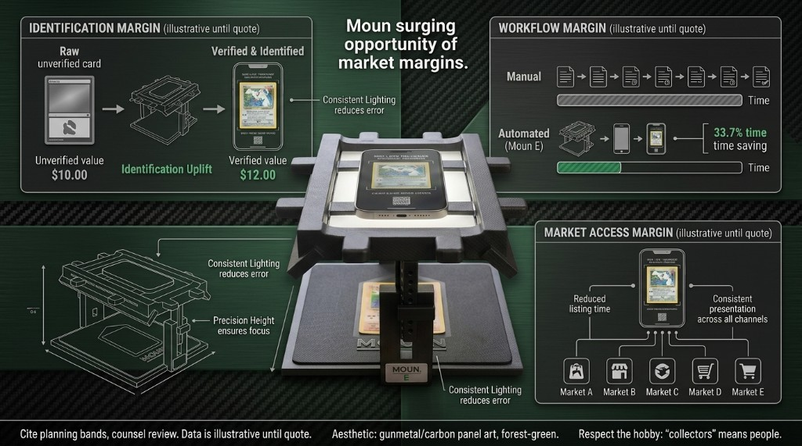

Illustrative margin and workflow storyboard (gunmetal / forest styling). Numbers, marks, and claims are directional until quotes and counsel — not a public offer.

Moun / RawGraded Pro

## Market research

Why fragmented “mixed modules” cap outcomes — and how an integrated station unlocks AI, pricing, and visual search at full strength — with current search, trend, and marketplace velocity context.

Updated 2026-04-09

### Thesis

#### Disruption model: from scattered manual parts to one capture-native workstation

Collectors preparing cards and coins for submission—or evaluating raw inventory—typically assemble capability from unrelated SKUs: centering templates, desk magnifiers, cleaning kits, holders, and mailers. Each piece works in isolation; none was designed to feed modern AI, pricing APIs, or image search with consistent geometry, lighting, and motion.

No off-the-shelf “module” today closes that gap. The closest options are analog tools plus whatever phone or browser workflow the user improvises. That caps signal quality for both human judgment and machine perception.

Moun is positioned as the physical layer that makes existing digital tools measurably more effective: stable pose, repeatable illumination, and video-friendly motion so third-party AI grading flows, TCGplayer-style price checks, and eBay / Google image search see the same asset the way a pro bench would.

Synthesis

Market margin opportunity lens

Skim the board, then use the sections below for sources, screenshots, and caveats.

Diligence collage — reconcile each panel with primary data and disclaimers in the trend, grading, and comps sections; forward-looking labels are planning language only.

### Search demand — Pokémon keyword (Google Trends, United States)

Across a five-year window, U.S. web search interest for “Pokémon” retreated from the late-2022 / early-2023 spike but remains structurally elevated versus the early-2021 baseline — and the capture on file shows a renewed climb into 2025–2026 approaching prior highs.

The past-year curves in the captures show volatile but rising momentum, including a sharp spring peak — consistent with set drops, Championships marketing, and content cycles that keep the TCG in constant conversation.

[How Google Trends indexes interest](https://support.google.com/trends/answer/4365533?hl=en)

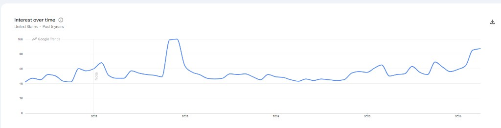

Web search · United States · Past 5 years (screenshot: Google Trends).

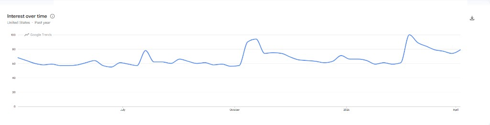

Web search · United States · Past 12 months — elevated floor with a late-season spike (screenshot: Google Trends).

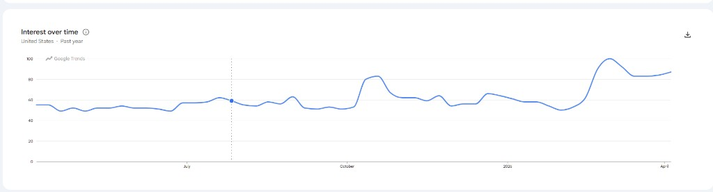

Corroborating past-year capture — peak at the top of the chart window (screenshot: Google Trends).

#### YouTube discovery rides the same keyword

Collectors and casual fans increasingly meet the franchise through short-form and long-form video. In Google Trends, re-run the Pokémon term with the channel set to YouTube to compare video interest versus web — the pulses typically align with major product beats and events.

#### Trending now — Games category (United States, 7 days)

In the April 2026 capture on file, “pokémon champions” led Google’s Games trending list with six-figure-plus reported volume and very high week-over-week growth — a concrete signal that flagship game launches spill into search behavior at the top of the funnel.

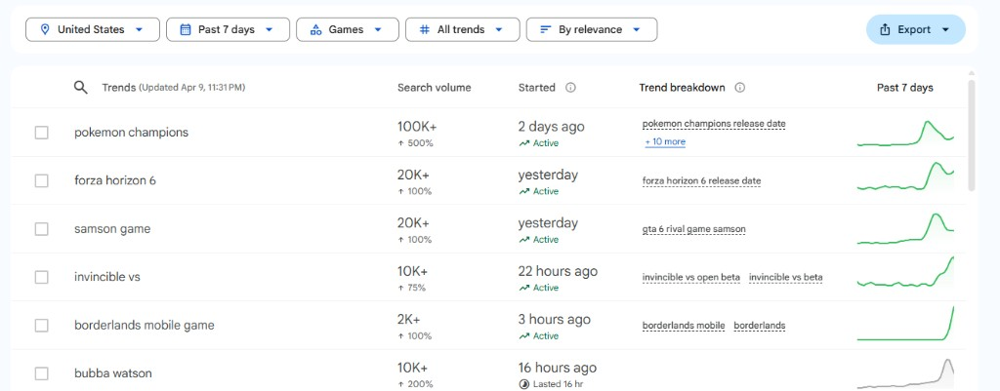

Screenshot: Google Trends — Trending now, Games, United States, past 7 days (April 2026 capture).

#### Year-round set rhythm

Pokémon TCG does not rely on a single holiday beat: licensors and publishers schedule multiple set windows per year. Rolling calendars (trade press) help shops and breakers plan inventory and marketing — and keep listing / grading / comp workflows busy continuously.

[Example rolling calendar (2026 set dates — third party)](https://screenrant.com/pokemon-tcg-sets-2026-all-releases-dates/)

### Secondary-market velocity — eBay sold listings (recent window)

Screenshots captured 2026-04-09

Filtered sold + completed Pokémon listings over a short recent window (per eBay URL parameters) show millions of rows — mostly singles once the category is narrowed to individual cards. That throughput is exactly when consistent capture, identification, and pricing tools matter.

[Broad Pokémon query Capture on file: 3,500,000+ sold / completed rows for “Pokemon” with the linked time filter (includes sealed product, accessories, and mixed categories). Reproduce on eBay](https://www.ebay.com/sch/i.html?_nkw=Pokemon&LH_Complete=1&LH_Sold=1&LH_Time=1&_ftrt=901&_ftrv=148)[Collectible Card Games → Individual Cards Capture on file: 2,900,000+ sold rows with the same completion filters, scoped to CCG individual cards — the core SKU type shops and collectors reprice constantly. Reproduce on eBay](https://www.ebay.com/sch/183454/i.html?_nkw=Pokemon&LH_Complete=1&LH_Sold=1&LH_Time=1&_ftrt=901&_ftrv=148)

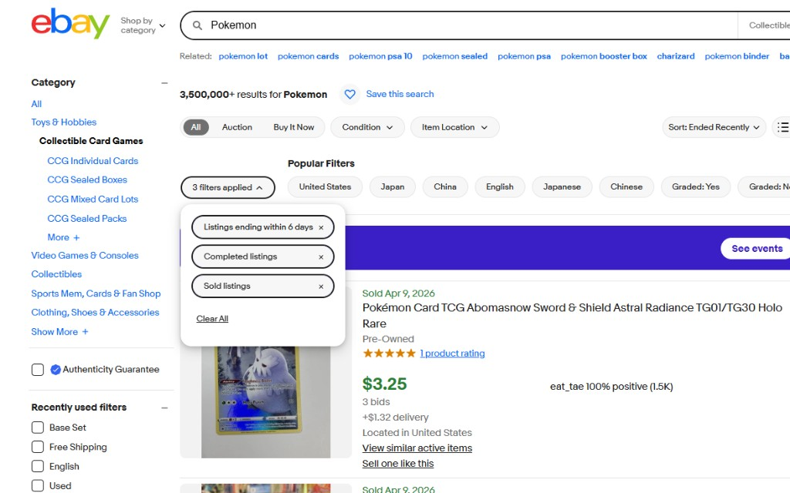

Broad Pokémon sold search — header count from eBay UI (snapshot).

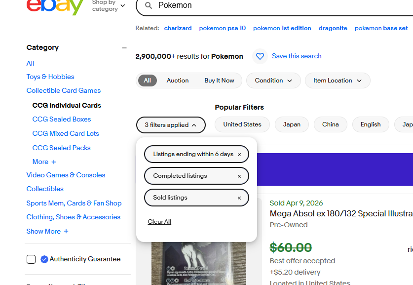

Same window, drilled into CCG individual cards — snapshot.

When millions of cards turn over in days, “good enough” phone snapshots fail at scale. Moun targets the environmental layer so image search, marketplace comps, and AI-assisted workflows see the same clean asset every time.

Interpretation guardrails: Google Trends shows relative interest (0–100) for the region and window you select — not absolute search counts. Switching the Trends channel to YouTube surfaces parallel demand for Pokémon-related video discovery. eBay “results” totals are produced by eBay’s live search and change as listings age; figures cited here match screenshots captured 2026-04-09 and the exact filter URLs below. Screenshots are for internal diligence only; Pokémon, Google, YouTube, and eBay are trademarks of their respective owners.

### DIY prep spend vs. third-party grading fees

Collectors comparison-shop desk magnifiers (often ~$35–120 for serious task lamps) and inexpensive centering aids — basic plastic or print guides commonly land ~$10–25; bundled “starter” kits with a small light box or similar often promo in the ~$12–16 range at mass-market retailers — while simultaneously routing large sums through PSA, CGC, Beckett, TAG, and peers. Hardware that improves pre-submission capture is typically a rounding error next to grading invoices — but it materially affects match quality, resubmission rates, and time-to-list.

Retail price sentences here are directional spot-checks of common listings, not a formal survey.

Reported March 2026 throughput across the major graders is measured in millions of items per month, not thousands (see Sports Illustrated citing GemRate, linked below).

#### Representative DIY “grading prep” retail basket

Piecemeal ecommerce stacks — inspection lamp or magnifier, basic centering or comparison aids, cleaning consumables, sleeves and holders, plus a small ring light or tripod when buyers upgrade ad hoc — often land roughly ~$95–300 combined for a serious hobbyist assembling from separate SKUs. That is still often less than a single moderate bulk submission once per-card service fees stack up. Bundled entry kits can undercut that sum for light-only workflows; they anchor price expectations without replacing enthusiast-grade pieces.

- LED magnifier / task inspection lamp $35–$120

- Centering / comparison aid (plastic or print guide) $10–$25

- Cleaning kit + sleeves / semi-rigid holders $25–$90

- Ring light or small tripod (often added) $25–$65

- Bundled hobby “starter” kits (promotional pricing, illustrative) ~$12–$16

The ~$95–300 narrative matches the four piecemeal lines (lamp + guide + consumables + add-on light). The bundled starter row is a typical promo anchor (~$12–16) — not stacked into that sum. Illustrative retail bands — directional spot-checks, not a formal price survey.

#### Published PSA card prices (anchor for “per card” spend)

Realized grading cost per card varies by tier, membership, promos, and declared value. PSA’s official February 2026 bulletin listed new card submission prices including Value Bulk $24.99, Value $32.99, Value Plus $49.99, Value Max $64.99, and Regular $79.99 (effective Feb. 10, 2026).

[PSA (official)](https://www.psacard.com/info/submission-updates)

#### March 2026 — items graded (GemRate, summarized by Sports Illustrated)

[Sports Illustrated (collectibles) — full article](https://www.si.com/collectibles/march-gemrate-report-psa-tcg-rookie-hype-drive-record-card-month)

- Sports Illustrated, citing GemRate, reported roughly 2.97 million cards graded across major grading companies in March 2026 — up about 19% month-over-month versus February (on the order of 480,000 additional items).

- Same source: year-over-year volume up nearly 50% versus the prior March (~2 million items then).

- PSA: about 2.17 million items graded, +16% MoM and +47% YoY; TCG plus non-sport grading cited at more than 2.1 million items in March (~70% of all grading volume).

- CGC about 600k (+141% YoY), Beckett about 106k, TAG about 47k with very high YoY growth; SGC cited down YoY but up MoM.

On-file GemRate-style summary graphic (March 2026). Figures are cross-checked against SI’s reporting of GemRate data.

#### PSA throughput context (press quoting PSA)

Coverage of PSA’s February 2026 pricing and turnaround updates quoted the company: roughly 15,000 cards graded per day globally in 2021 versus about 90,000 per day at the time of the article.

[Yahoo Sports (cllct, quoting PSA)](https://sports.yahoo.com/articles/psa-increasing-prices-turnaround-time-141500962.html)

#### Illustrative monthly service spend (March volume × hypothetical average fee)

Not company-reported revenue. Actual ASP mixes economy tiers, express, cross-overs, and non-card categories. Use only as order-of-magnitude sensitivity.

| ~2.97M items × $25 hypothetical average fee | ~$74M |
| --- | --- |
| ~2.97M items × $40 hypothetical average fee | ~$119M |
| ~2.97M items × $60 hypothetical average fee | ~$178M |

Moun monetizes once on the prep-and-capture layer; grading incumbents monetize per item at scale. When millions of cards move through third-party grading monthly, even small improvements in pre-submission imagery and operator consistency compound across the entire downstream stack.

### Quick comps beat manual typing — raw cards and slabs

Secondary-market listings for the same franchise coexist at wildly different price points: desk shots, handheld snaps, and stand displays all compete for buyer trust. Auctions can diverge sharply from buy-it-now medians in the same week.

Shops and collectors need that check whether the item is raw or already encapsulated: re-listing, verification, insurance photos, and show-floor trades all reward the same thing — fast, trustworthy identification and price context.

Typing full Pokémon names, set names, card numbers, and filters to disambiguate variants is slow and error-prone under con-floor or counter pressure. Image recognition flows on major platforms collapse that path when the camera feed is legible — routing to structured product pages and live comps in seconds.

The handset is already the sensor; Moun supplies the environment (even light, top-down geometry, controlled glare) so automated matchers and human review agree on the same asset.

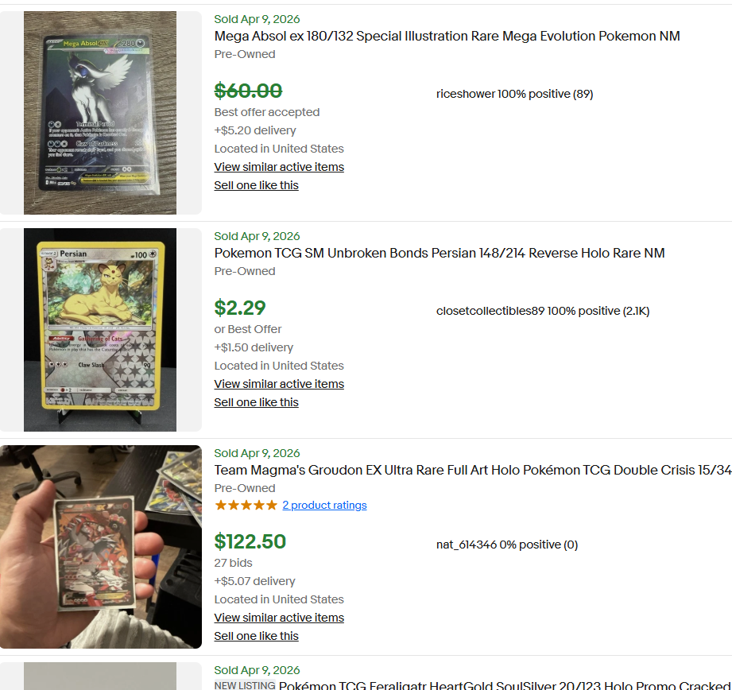

eBay sold examples — same-day listings with inconsistent capture quality and wide price dispersion; visual search quality depends on what sellers (and buyers) put in frame.

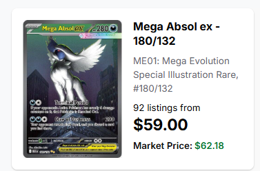

Structured product view once the correct SKU is identified — the destination image-led flows aim for.

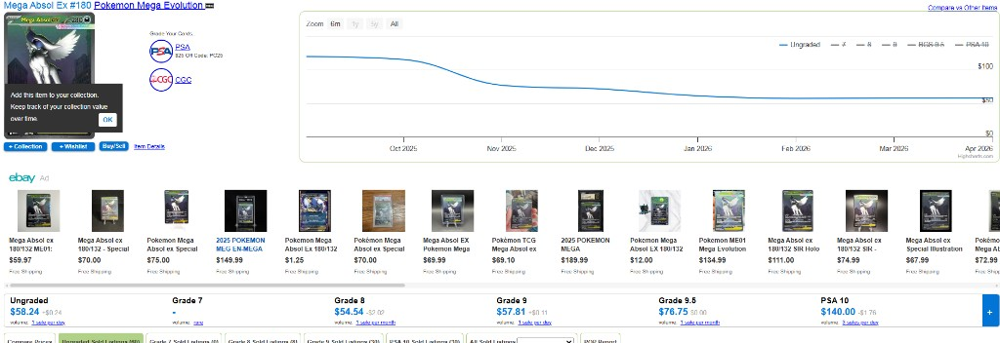

Deeper comp dashboards — history, grade ladders, and live feeds assume the operator can trust the starting image.

Screenshots illustrate third-party tools (e.g., eBay, TCGplayer) for internal positioning — no endorsement or partnership implied.

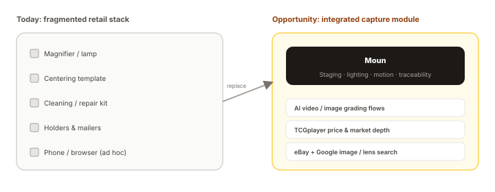

Retail today optimizes parts, not the loop. The disruption is an integrated physical module that upstreams quality into AI and marketplace tools users already rely on.

### Current retail landscape

Representative ecommerce results cluster around manual inspection, protection, and shipping — not an integrated capture platform for AI or market analytics.

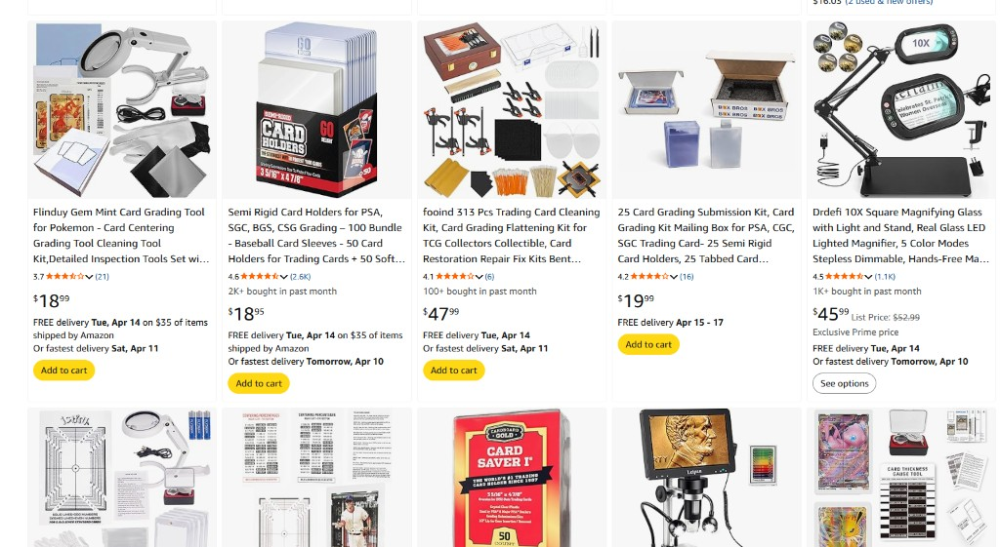

Illustrative third-party listings (screenshot on file). Use for internal positioning only; does not imply vendor relationships.

Retail substitutes

### Light tents, ring-lit boxes & overhead crane rigs

Ecommerce is full of folding photo studios, fabric light tents, and C-clamp overhead arms with bolt-on ring LEDs. They fill the “better than a desk lamp” gap for small-product photography; they are a weak structural match for open, trust-heavy card trading or repeatable slab-grade capture.

The captures below are typical third-party listings (illustrative only). They show why Moun sits in a different category: open staging, clampless placement, and lighting intent tuned for reflective cards—not a walled booth or a swinging arm that blocks the phone screen.

Illustrative third-party retail listings

Folding light tent / photo booth SKUs

More light-box tent listings

Overhead desk mounts & C-clamp rigs

Illustrative third-party retail screenshots: folding light tents/booths and desk-mounted overhead crane mounts with C-clamps (not product endorsements).

For high-value card work, maximum transparency matters: a fully enclosed booth hides hands and slabs from the buyer’s line of sight. That is a trust gap in a hobby with scammers and thieves—room for out-of-view swaps or bad-faith condition and value games. Moun’s headline is capture quality and workflow; this is a secondary security and credibility angle for vendors who trade face-to-face.

#### Commodity tents, light boxes & ring-top rigs

- Flimsy shells, limited height control

Thin fabric or plastic booths and loose diffusers are built for occasional product snaps, not a stable, adjustable reference plane for repeated show-floor or counter use.

- Walled-in staging

Closed sides and top openings turn capture into a small “black box.” That can be wrong for card vendors where buyers expect to see condition checks in the open—maximum visibility when money and slabs change hands.

- Integrated ring / panel LEDs and slab glare

Top-mounted ring or dense LED arrays can produce harsh hotspots, ring-shaped artifacts, or camera-facing blind spots on reflective graded slabs—less consequential for every product category, painful for specular card surfaces.

#### Overhead clamps, crane arms & bolt-on lights

- Furniture wear and clunky hardware

C-clamps score and fatigue table edges; long arms, springs, and joints feel clunky and never guarantee an instantly usable frame the moment you need it.

- Crane posture vs. phone workflow

Overhead and crane setups often leave the phone clamped where the screen is hard to reach—bad for moving between capture, listings, Lens, and notes without re-rigging.

- Ring lights on arms repeat the glare problem

The same harsh ring-light behavior shows up when a clamp rig bundles a small ring LED—fine for some subjects, rough on glossy encapsulated cards.

#### Moun positioning

- Furniture-friendly, clampless placement

No swinging arms; no screw-down clamps chewing tables. Direct, maneuverable, sturdy placement—stage the device in and out without locking hardware to the furniture.

- Repeatable geometry

Purpose-built staging holds framing and lighting relationships closer to stable absolutes than ad-hoc top-down holes in a tent or a cantilevered arm that drifts between shots.

- Even task lighting for surfaces

Lighting intent favors even, slab-friendly observation over face-style ring hotspots—aligned with repeatable listing and inspection passes.

- Phones through tablets

The same clampless posture scales from phone to large phone to tablet or iPad-class cameras without sacrificing usable light or burying the whole UI behind a cage of hardware.

### Manual by default

Magnifiers, grids, and gauges depend on operator skill, fatigue, and ambient light — not a single calibrated envelope.

### Mixed modules

Cleaning, inspection, protection, and shipping are separate purchases with no shared reference frame or data trail.

### No intelligence bridge

Retail SKUs do not connect to pricing graphs, reverse image search, or video-native AI — the user must bridge the gap by hand.

### Where integrated hardware wins

#### AI at full strength

Models (including video-first grading flows) need stable framing, controlled glare, and repeatable tilt. A purpose-built station supplies that where a handheld phone on a desk cannot.

#### TCGplayer & live comps

Price checkers and market depth tools work best when the user can trust SKU identity and condition context. Consistent capture reduces mis-clicks and ambiguous listings.

#### eBay & Google image search

Reverse image search rewards sharp corners, true color, and square-on geometry. Integrated lighting and mount paths maximize match quality versus ad-hoc snapshots.

#### Video-native grading

When workflows ask for short captures or multi-angle passes, a single coordinated motion + lighting rig beats restaging the specimen for every clip.

### Fragmented vs integrated

| Axis | Mixed manual modules | Integrated station + user’s digital stack |
| --- | --- | --- |
| Physical setup | Separate magnifier, template, lamp, and phone rig; constant re-alignment. | One envelope: staged specimen, coordinated lighting, predictable camera path. |
| Data readiness | Images and video vary by user; AI and search see inconsistent inputs. | Repeatable capture profile designed to interoperate with external tools. |
| Operator load | High touch — every tool swap is another chance to bump, smudge, or mis-frame. | Lower context switching; workflow stays on the specimen and the screen. |
| Category gap | No SKU combines bench physics with “export-quality” digital capture intent. | Explicit positioning as the missing module between raw goods and AI/market stack. |

Third-party marks (e.g., TCGplayer, eBay, Google) name tools collectors already use; this document does not imply endorsement or partnership. It describes integration opportunity at the user workflow level.
