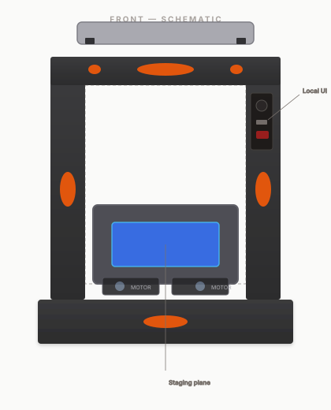

# Mechanical

[All sections](INDEX.md) · [Original presentation files](../presentation/) · [Review-only notice](../NOTICE.md)

Reading edition extracted from the supplied built presentation on October 25, 2026. Interactive controls are represented as text and initial displayed values; this is not a live service or a verified engineering, financial, or manufacturing result. Original internal-review labels are retained as historical document context.

---

## Mechanical

3D reference mesh (TinkerCAD export) plus front orthographic schematic. Hover schematic regions for callouts.

CAD reference (OBJ)

IsoFrontTopRight

Source: TinkerCAD export — compare to 2D schematic; re-export split bodies for production BOM.

2D schematic — front

### Part callout detail

Driven by typed config (not inferred from merged mesh).

Hover a region on the schematic to load engineering notes.

### Open mechanical actions (backlog)

- Re-export CAD with separate objects per subassembly for BOM line items and mass properties.

- Add datum targets and critical dimensions on the next drawing revision (STEP + 2D PDF).

- Define fastener BOM: type, torque, and thread locker where required.

- Document environmental assumptions (temp, vibration) for imaging stability.
