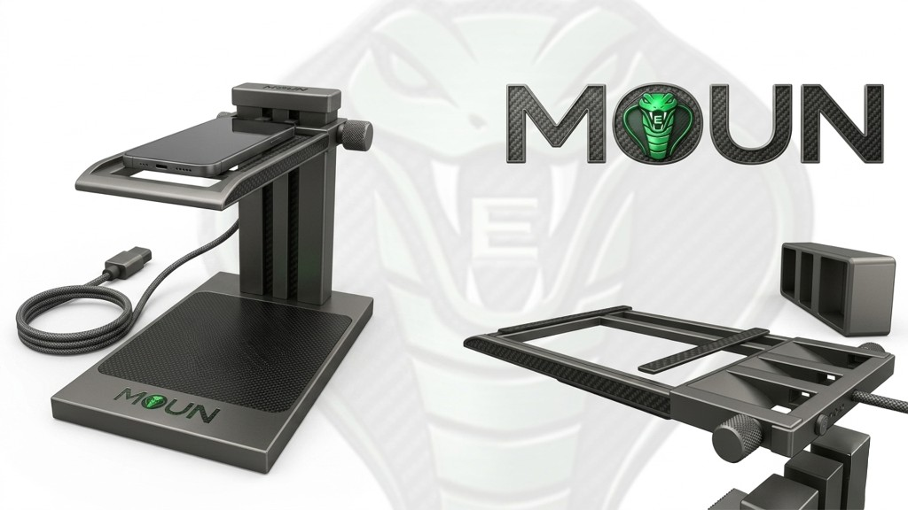
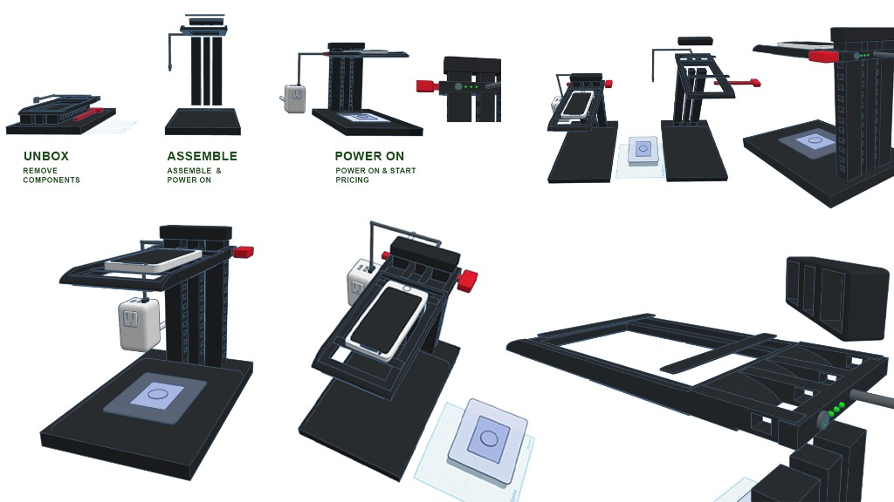
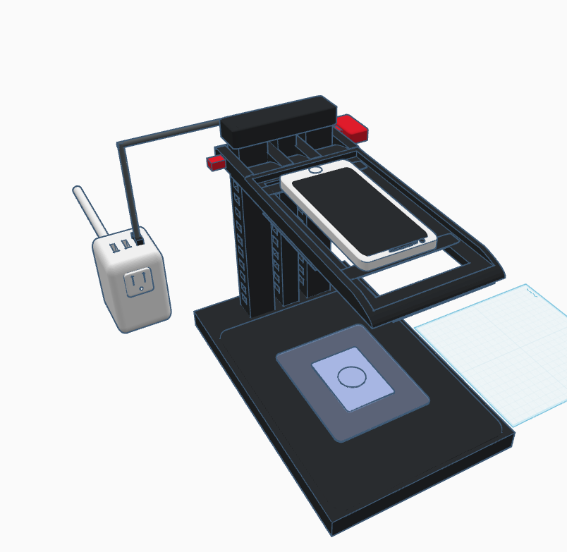
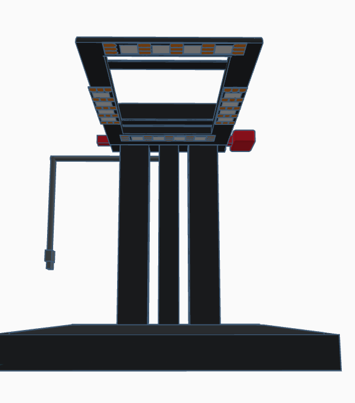
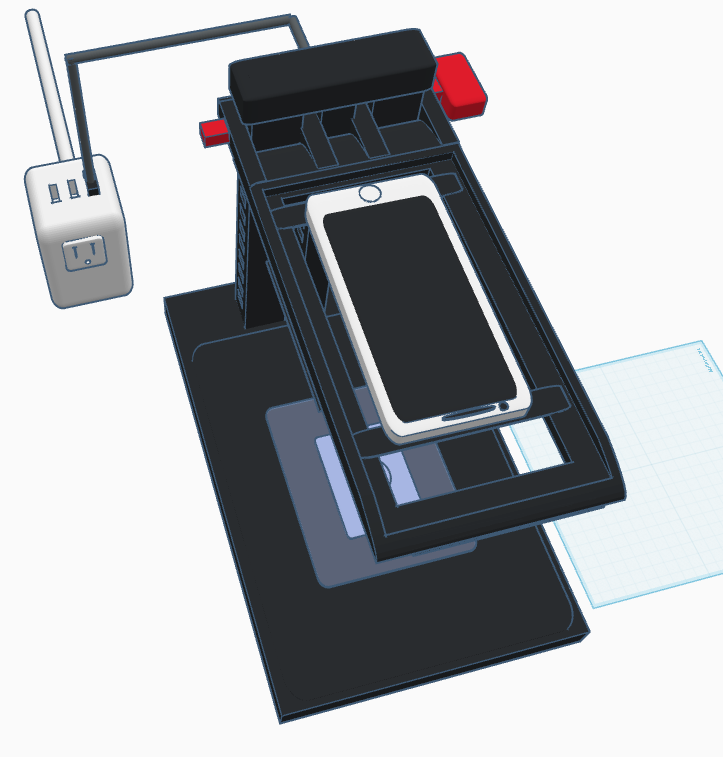
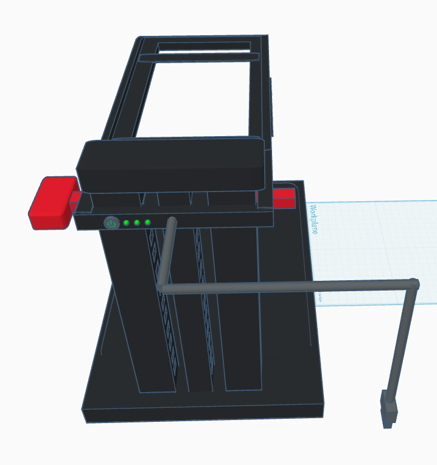
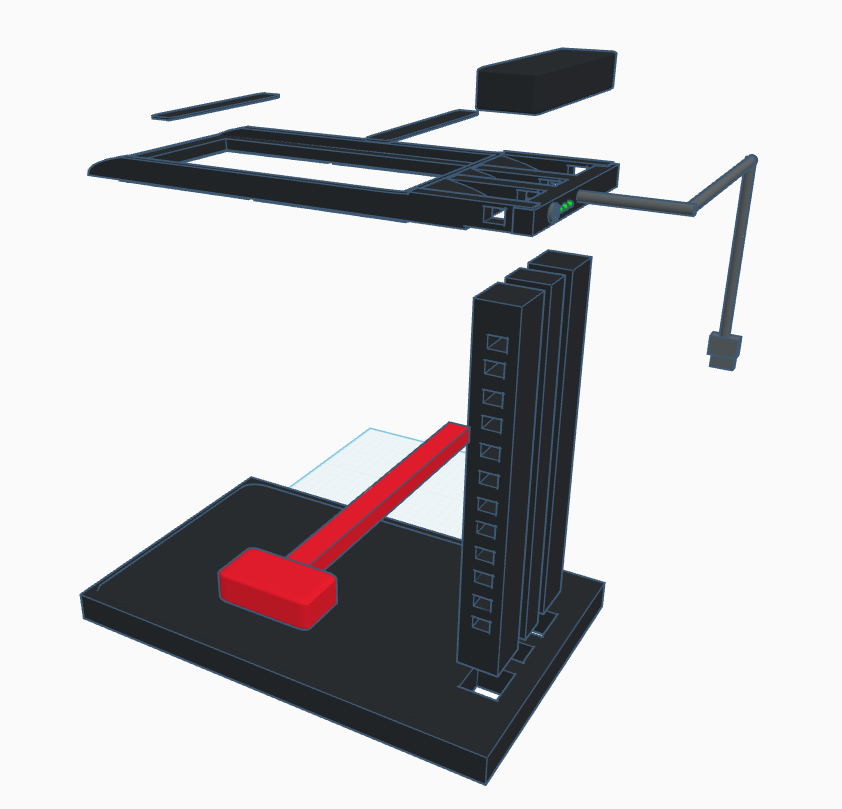
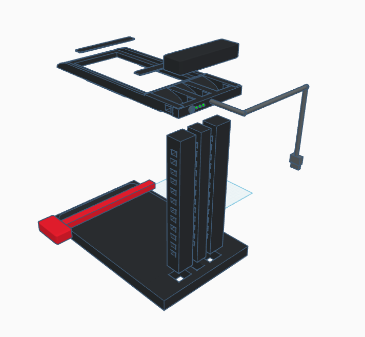

# Moun E Cobra

[All sections](INDEX.md) · [Original presentation files](../presentation/) · [Review-only notice](../NOTICE.md)

Reading edition extracted from the supplied built presentation on October 25, 2026. Interactive controls are represented as text and initial displayed values; this is not a live service or a verified engineering, financial, or manufacturing result. Original internal-review labels are retained as historical document context.

---

Sub-model prototype

Moun / RawGraded Pro

## Moun E Cobra

Wall-forward Eco sub-model — prototype art, assembly storyboard, and the same TinkerCAD mesh folder as the stills.

Eco overview· Moun E · Eco build

Guide 20260414d Updated 2026-04-14

The Cobra is a sleek wall-forward take on the Eco chassis: less enclosure, more open frame. The head piece and matching phone tabs introduce an **all-in-one header electrical unit** — one connection path with a **USB plug head**. A **three-piece bar set** installs side-by-side; a **header cap** keeps the stack aligned to the **footer base**; a **slightly elongated key lock** trims phone wobble. An **easy-access phone bench** keeps the handset within reach while you work the deck.

- Wall-forward layout — open frame instead of wrapped walls.

- Header electrical + phone tabs — single plug-in story at the head.

- USB plug head — one cable path from the all-in-one header unit.

- 3-piece bar set — columns install next to one another.

- Header cap — maintains alignment between head and footer base.

- Key lock — elongated tab to stabilize the phone.

- Phone bench — fast access to the handset above the deck.

Assembly graphic

Unbox · assemble · power on

Three-step story with flat lay, upright stack, and wall power to the header — plus crops for phone bench, USB plug head, key lock, and bar set. Illustrative until pack-out and instructions are frozen.

Unbox (remove components) → assemble & power on → power on & start — header electrical, key lock, and three-piece bars called out in supporting views.

Hero — phone bench, header run, and single USB path to the adapter (TinkerCAD export).

Structure read — bar set, head piece, and USB egress (low hero).

In-use posture — tilted handset on bench, header electrical, one cable to the cube adapter.

Workplane — header UI concept, side tabs, and USB plug head drop.

Exploded — red bench sub-assembly, bar stack, header cap / harness story.

Exploded — footer base, key bench piece, and header electrical tail.

Interactive mesh

### TinkerCAD 3D reference

Orbit the live export (same folder as the Cobra stills). Use for proportion checks against the assembly graphic — freeze STEP for CM vs this mesh.

IsoFrontTopRight

Moun E Cobra — TinkerCAD export next to the Cobra stills; freeze STEP/STL with CM before RFQ.
