# Moun E · Eco build

[All sections](INDEX.md) · [Original presentation files](../presentation/) · [Review-only notice](../NOTICE.md)

Reading edition extracted from the supplied built presentation on October 25, 2026. Interactive controls are represented as text and initial displayed values; this is not a live service or a verified engineering, financial, or manufacturing result. Original internal-review labels are retained as historical document context.

---

Flagship SKU

One bench, many markets

Moun E is the entry tranche with the same capture thesis as the rest of the line — marketplace-grade imagery and trust-heavy categories on one deck.

Illustrative ecosystem collage — partner marks and channel claims require clearance before retail or paid use.

Setup story

Frictionless adoption

Unbox and snap the frame, stage phone and subject, then capture — packaging narrative for retail and onboarding.

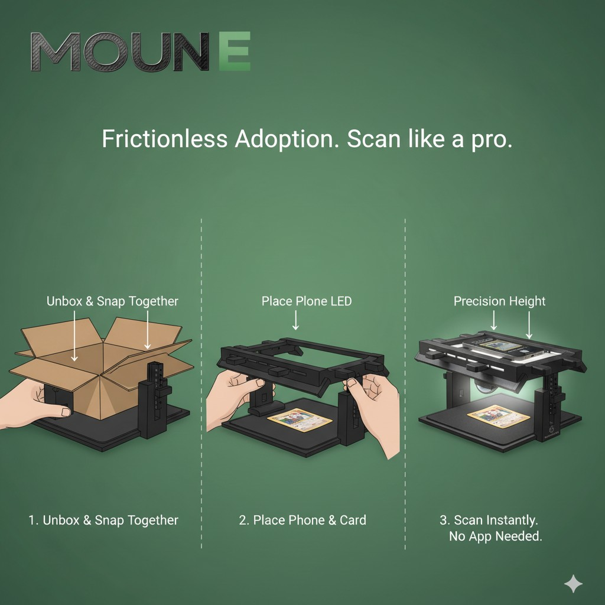

Storyboard for shelf and quick-start — align on-device behavior, app requirements, and final copy with shipped SKU and counsel.

Phase 1 · Plastic + padding + kitted USB strips

Moun / RawGraded Pro

## Moun E · Eco build

This page tracks the retail Moun E (Eco SKU): current Tinkercad chassis — base tray, height-index post, overhead capture frame with underside task-light pockets, and twin-column variants in CAD. CM scope stays mechanical (printed bay, mousepad deck, phone stage, indexed head ↔ post ↔ base). Moun E includes two commodity USB-powered adhesive LED strips in the retail box — brand purchase and kitting; the CM does not design or mold lighting electronics.

Eco overview (storyboard)· Moun E · Cobra· Pro build· Pro manufacturing

Guide 20260414d Updated 2026-04-14

Moun E lineup

Retail Eco SKU

Phase-1 investment, manufacturer scope, and **current Moun E** structure stills (head ↔ post ↔ base). The **Moun E Cobra** wall-forward sub-model has its **own page** (Eco submenu → Moun E · Cobra) with art, assembly graphic, and interactive 3D mesh.

Phase 1 · Key initial investment

### Lead with Moun E — the Eco tranche that fits early capital

Starting with the full Pro build ties up more cash in custom electrical kitting, assembly minutes, and supplier complexity than most seed checks want to carry before sell-through exists. Moun E (Eco) is the deliberate alternative: contract for plastic parts + mousepad padding; lighting is two commodity USB strips kitted at pack-out (not CM-built EE) — so Phase 1 money buys mold readiness, first inventory, and channel proof without funding the whole Pro harness stack on day one.

After Moun E proves manufacturing, packaging, and demand, the Pro line earns its tranche: same family, richer BOM, LED-in-box experience, and the economics already modeled on the Pro manufacturing page.

Plastic + padding · kitted USB strips

#### Moun E — Eco SKU (simplest strip)

Moun E is the retail Eco configuration: the most stripped-down embodiment of the same capture idea — plastic base tray, mousepad fabric as the working pad, and a printed overhead stage on an indexed post (rail + pin lock in the exploded pin-stack views below). Current CAD emphasizes a charcoal workstation frame with underside task pockets for lighting callouts. Two commodity USB-powered adhesive LED strips ship in the box (brand purchase + kit); the CM builds mechanics only, not custom electrical work.

For contract manufacturing, scope stays intentionally narrow: provide plastic parts and padding. Commodity LED strips are a parallel buy and pack-line step. Printed guides, centering templates, or measurement overlays visible in renders are illustrative — not CM-fabricated unless added to scope.

Renders may show example “measurement” geometry or slots; treat those as industrial-design communication, not an EBOM line. Freeze what the CM actually builds vs. what the user prints or buys separately before RFQ.

Current structure (CAD)

#### Head ↔ post ↔ base — editor explode · seated unit · side read

Current Tinkercad exports: editor explode with spacer stack-up between bridge and base, seated dual-pillar chassis for cosmetic reference, and a side structural pass for top / base / supports. Pin-index and lock detail stay in the prototype gallery and EBOM — freeze shipped geometry with CM before RFQ.

Editor explode — spacer block shows the post / bridge stack-up; orange pockets under the head remain lighting communication geometry until EBOM freeze.

Seated chassis — current dual-post frame with capture deck and underside task row; use this read for pack-out and cosmetic signoff vs earlier wireframe-only explodes.

Side structural read — top lattice, base footprint, and column / arm layout for tolerance and interference checks (ghost geometry is CAD communication, not a second ship SKU).

Sub-model prototype

### Moun E Cobra

Wall-forward Eco sub-model — full gallery, assembly storyboard, and interactive TinkerCAD mesh on a dedicated page.

Open Moun E · Cobra — art & 3D viewer

Moun E · continued

Prototype CAD & manufacturing context

Hero chassis gallery, shelf storyboard, polished showcase, and the rest of the Eco CM checklist.

Prototype CAD

#### Moun E chassis · modular kit · hero views

Internal tiered frame, base / post / bridge trio, low-angle structure, underside task-pocket row, and full-rig editor capture — charcoal plastic with cyan edge readout. Orange panels mark lighting / connector communication zones; freeze vs EBOM and retail claims with CM and counsel before RFQ.

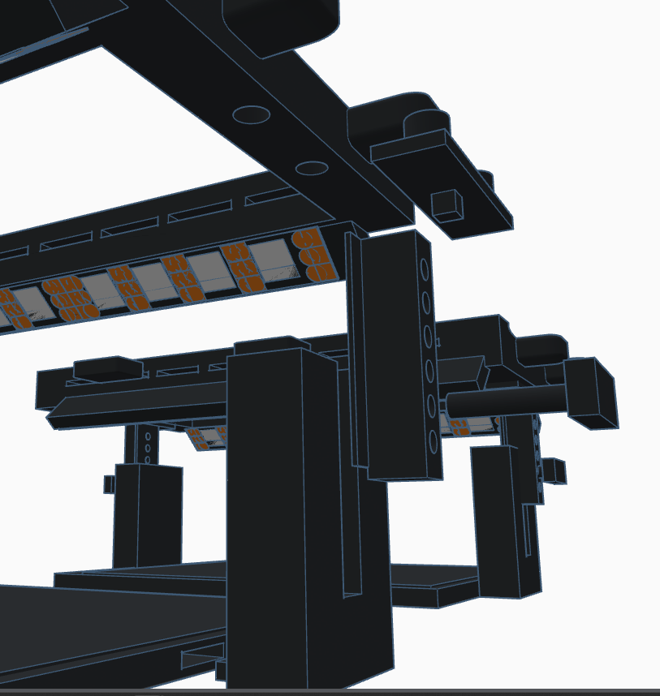

Internal chassis — layered bays, mounting tabs, and underside pocketing for the task-light region (freeze vs EBOM with CM).

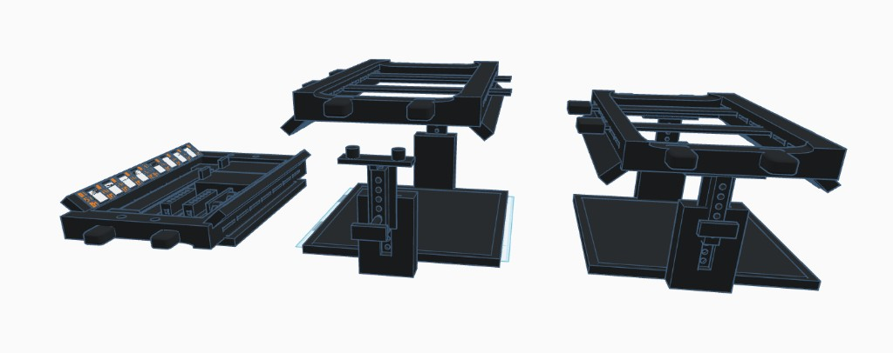

Modular trio — deck tray, indexed post + pilot frame, and seated bridge for instruction and pack-out sequencing.

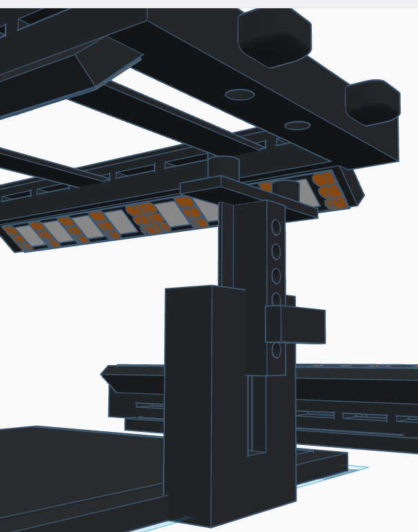

Low-angle structure — height-index column, capture frame, and communication geometry for LED / connector zones.

Underside detail — alternate grey / orange pockets for dual-plane lighting callouts; illustrative until silkscreen or insert scope locks.

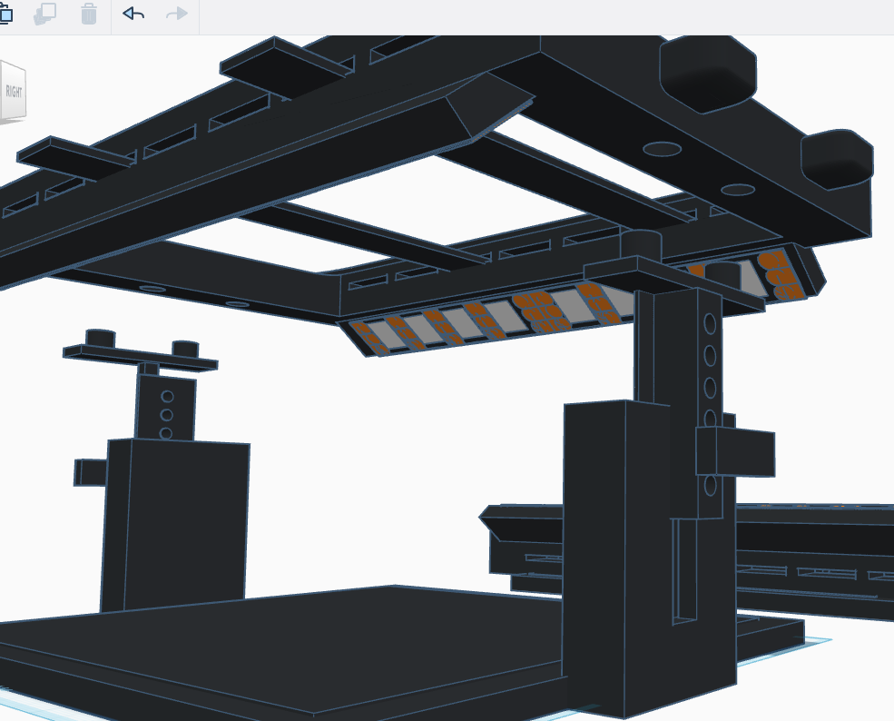

Full-stack authoring view — complete Moun E rig in CAD; editor chrome is not product.

Semi-final look

### Eco Version — matte presentation

Unified matte-black plastic for the base, pillars, and phone bridge; pad/padding at the working deck. Height index on the column, open sight lines for the camera, and optional under-lip lighting drawn as integrated wash — aligned with Phase 1 industrial design and CM cosmetic targets.

Other Eco imagery in this guide uses bright, distinct colors so subassemblies, stages, and optional LED zones read clearly. That breakdown style explains how parts work together; it is not the ship finish.

Low angle — peg/slot height adjust, deck lip, optional strip location under the forward edge.

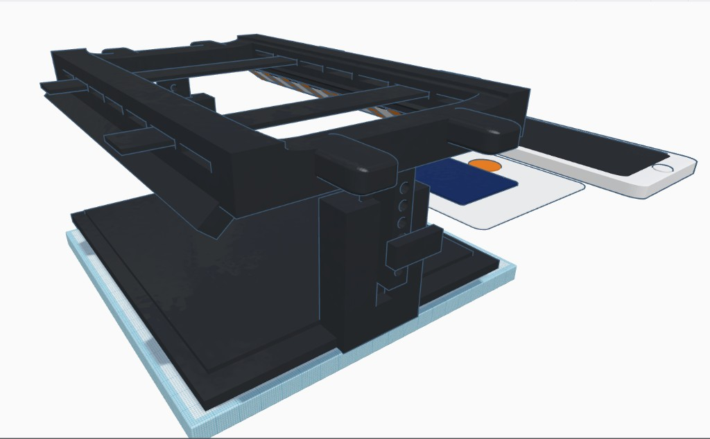

Perspective — bridge over pad; accessories at side show scale (not in base BOM unless scoped).

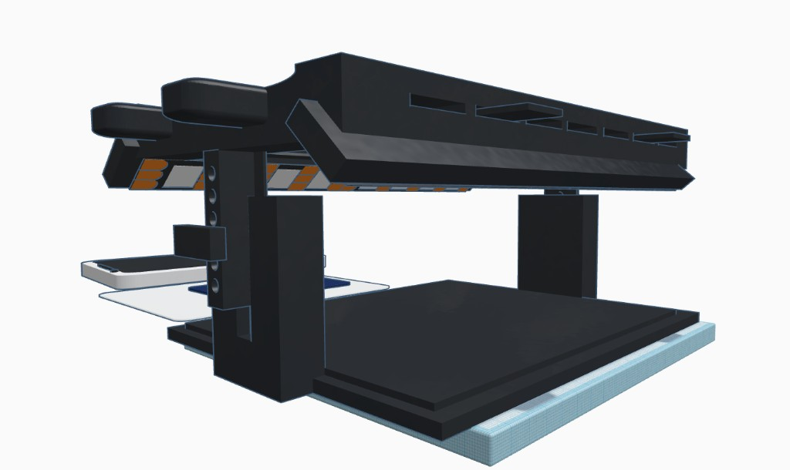

Deck underside — optional task lighting integrated into the bridge (user or CM add-on per SKU).

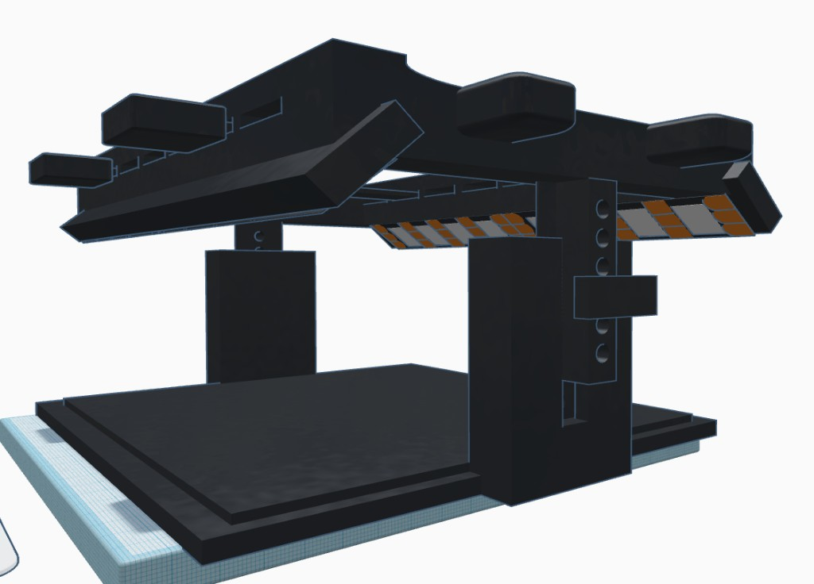

Canopy + wings — structure and light bounce surfaces before final texture/finish lock.

Shelf storyboard

#### Moun E · assembly & use (prototype)

Explainer layout for packaging and retail: recycled-content base intent (pending supply-chain lock), precision height columns, optics & lighting rig with dual-plane LED callouts, and the in-use capture path with phone over the deck. Align final claims with CM quote and counsel before external print.

Assembly row: base platform → secure columns and height adjuster → mount scanner head (optics & lighting rig, integrated dual-plane LED) → complete Moun E. Use row: phone interface, repeatable imaging for grading, dual-plane LEDs, precision height, specimen on deck.

Footnote from source art: performance and specifications are illustrative until quote; patent pending and design subject to change — confirm before any public or paid use.

Assembly & shipping

### Exploded kit — how the basic parts go together

Exploded CAD lays out the major pieces so packaging and work instructions can follow a simple order: base first, deck / mat, vertical support and bridge, fasteners and pins last. The separation is exaggerated for clarity — final ship density and void fill follow the CM carton and insert design.

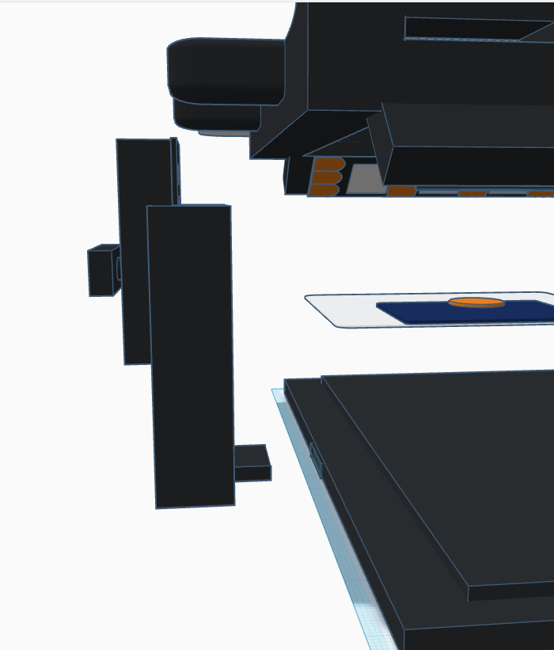

Vertical explode — bridge / housing, support column, subject deck with mat and coin, foundation base.

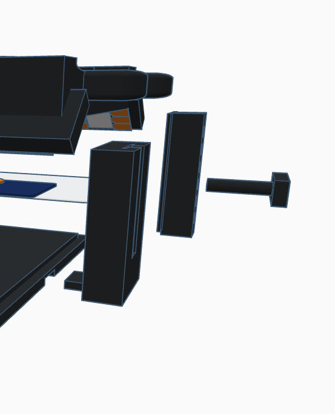

Isometric spread — base plate, pad layer, height column, side rail, locking peg for indexed assembly.

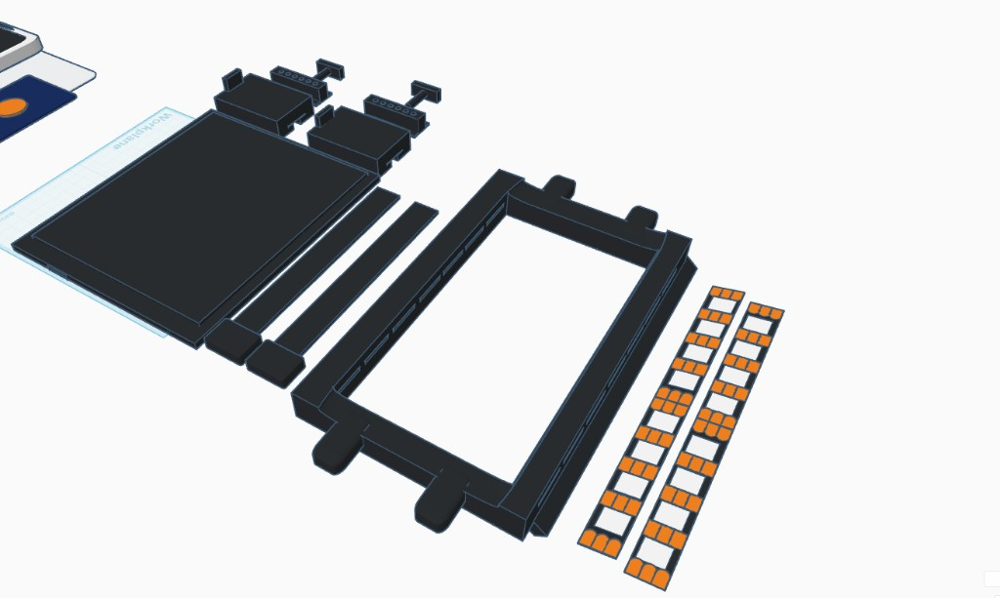

Kit layout — main platform, connector blocks, rails, outer frame, optional overlay strips (grading / reference geometry).

Usage examples

### Phone on the stage, card or coin on the mat

The phone sits on the upper frame so it is easy to position and tilt: you can maneuver to different angles without blocking the camera or giving up the shot you want. The working mat stays open — place a card or coin anywhere on the pad that makes sense for the capture.

Operators can use their own preferred grading plastic prints, or a single overlay that handles both coins and cards in one sheet — same deck, one accessory path.

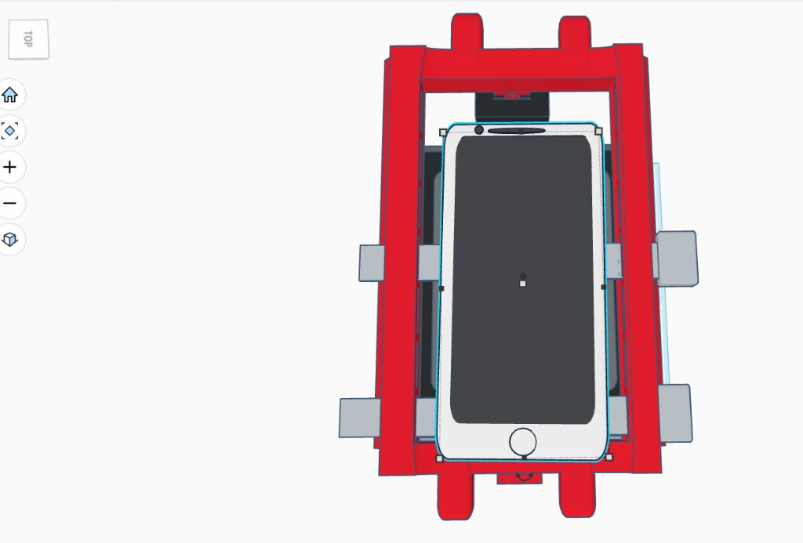

Plan view — phone centered on the frame; mat stays clear for flexible specimen placement.

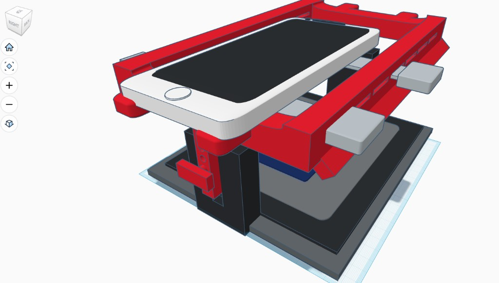

Isometric — stage height and rails leave the camera sight line open toward the deck.

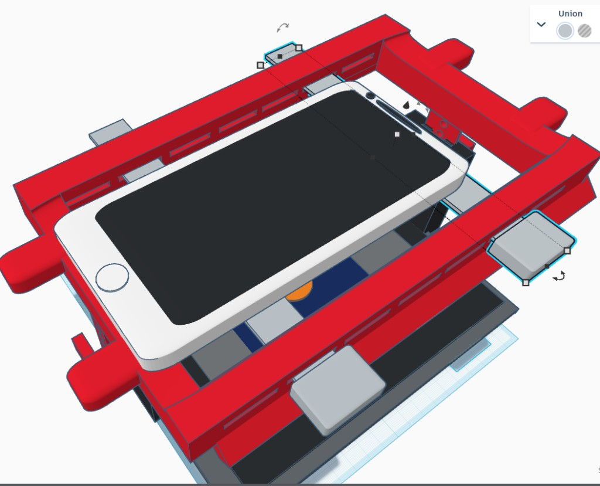

Adjustable rails and fitment — index the phone without sacrificing camera clearance.

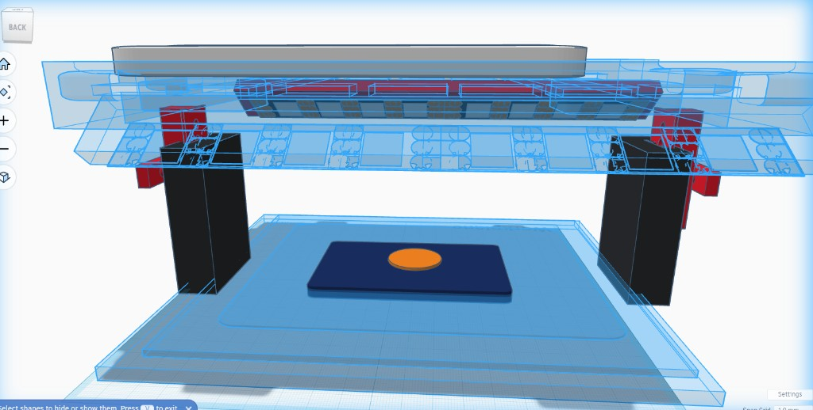

Bridge layout — specimen on the mat under open volume; optional overlay can register card + coin together.

Prototype in use

### Moun E — AI preview (desk workflow)

Illustrative AI-generated preview: gunmetal frame, twin pillars with indexed height scale, phone staged face-down in the bridge with integrated task lighting onto the mat, MOUN.E plaque (forest “E”), specimen centered for capture. Environment, UI, LED integration, and finishes may change before production — use for narrative and layout read, not CM-first-article sign-off.

Concept preview — controlled illumination under the bridge, card on the recessed mat, scan workflow on the handset. AI render for positioning and brand alignment only.

Retail identity

### Moun E Eco-Scanner — shelf artwork

Retail faces the market as Moun E Eco-Scanner: gunmetal / carbon panel art, forest-green “E,” white feature callouts (smartphone scanning, precision height, optics, dual-plane LED). Same plastic + pad CM scope as elsewhere on this page — “E” carries Eco positioning and recycled-packaging intent where suppliers lock it in.

AI-generated packaging visuals for creative, retail, and investor review only. Partner marks (eBay, TCGplayer, RawGraded, etc.), certification art, QR destinations, and compatibility strips need brand, partner, and counsel approval before production print.

Shelf angle — front + side + partial back: MOUN. and forest E, product render, eco leaf mark, performance copy and certification row. Illustrative only.

Front / twin layout — smartphone scanning, precision height, professional optics, LED dual-plane, RawGraded-style badge, eBay / TCGplayer strips, QR. Final copy TBD with counsel.

### Manufacturing process (broken down)

- 1 1 · Release & CM packet

Freeze what the CM builds vs. what is user-printed, aftermarket, or illustrative in CAD.

- Revision-controlled STEP/STL for every molded or FDM-shipped plastic part; no “overlay” geometry in the EBOM unless you intend to ship it.

- Single-page scope statement: plastic + pad from CM; commodity USB LED strips (2×) are **brand-purchased** and kitted — not CM electrical engineering, harness fab, or custom PCBs.

- Approved materials list (filament or resin spec if CM prints; pellet grade if outsourced IM later).

- 2 2 · NRE & tooling

One-time spend before recurring COGS — lower touch than full Pro (Moun P) because there is no electrical FA loop.

- First-article signoff on mechanical stack (fit, boss torque, pad nest flatness).

- Work instructions and photos for trim, pad bond, and pack — no ICT or burn-in station.

- Packaging dieline + label proof (or bulk-pack waiver if channel allows).

- 3 3 · Plastic production

Shell, frame rails, phone stage / gantry prints — same FDM discipline as Moun P (Pro), fewer electrical-driven tolerances.

- Lot-controlled print or molded shots with traceable batch IDs.

- Deburr and cosmetic criteria for customer-facing surfaces.

- Optional sub-assembly: snap-fit gantry to base before pad work if it reduces damage in pad bonding.

- 4 4 · Pad program

Mousepad roll or blank → cut → adhesive or mechanical retention per stack-up.

- Nest CAD + cutter program (steel rule, laser, or CNC) matched to print tolerances.

- PSA cure time and clamp recipe; pull-test on sample corners.

- Incoming QC on roll: thickness, curl, and edge fray.

- 5 5 · Mechanical assembly & kitting

Fasteners, feet, optional printed clips — plus pack-in of two pre-purchased USB LED strips (verify count, bundle, no soldering).

- Torque spec on plastic bosses; avoid over-drive that cracks ribs.

- Kit verification against pick list: hardware + **two sealed commodity LED strips** per ship unit.

- If shipping multi-bag: order-of-operations so heavy parts do not crush pad face.

- 6 6 · QC & release

Dimensional and visual sampling; optional spot-check that USB strips power on (commodity QC at supplier is primary).

- Phone rest stability check at target device weight.

- Pad plane photo spot-check under strip lighting when strips are unboxed for audit (not metrology — consistency only).

- Carton drop or vibration per channel requirement (Amazon vs. wholesale).

- 7 7 · Pack-out & logistics

Inner pack, slip, outer carton; COO and compliance labels as required.

- Pack density target to protect pad surface (no point loads on fabric).

- Master carton manifest for 3PL or direct import.

### RFQ exclusions (base Eco)

- Custom LED PCBs, harness fabrication, or in-CM electrical assembly — commodity strips are brand-sourced and kitted.

- Shipped measurement overlays, grading templates, or printed “ruler” inserts unless explicitly added to scope.

- Firmware, app, or cloud services — software is never part of this hardware RFQ.

### Moun E BOM — Eco (draft line IDs)

| Line | Domain | Description | Notes |
| --- | --- | --- | --- |
| EC-P-001 | Printed | Main bay shell / frame (flat panels, ribs, pad nest) | Same class as HB-P-001; strip lighting is commodity adhesive placement — no CM-molded LED channels unless specced. |
| EC-P-002 | Printed | Phone stage / gantry / height-index column set | May be multiple STLs; kit as one mechanical subfamily. |
| EC-P-003 | Printed | Optional clip-in retainers or cord pass-through blanks | Omit if not shipping; keep out of base quote if scope is strictly shell + pad. |
| EC-M-001 | Material | Mousepad sheet — cut to nest outline | Pressure-sensitive adhesive or mechanical retainers; same deck class as Moun P (Pro). |
| EC-H-001 | Hardware | Screws, heat-set inserts (optional), rubber feet | USB pigtails live on **commodity** LED strips (brand kit), not CM-fabricated harnesses. |
| EC-L-001 | Electrical | USB LED strip lights (2×) — 5V, self-adhesive, commodity wholesale | Required retail kit contents; sourced separately (wide supplier base). CM may only kit — no EE design. |

### Eco CM stack — indicative cost breakdown

Structured for RFQs where the CM builds mechanics only and kits brand-supplied commodity USB strips — not custom boards or in-CM EE. Variable rows include illustrative strip COGS; replace with binding quotes before commitment. The Global marketplace anchors block below layers what offshore B2B listings advertise when design is already mature — it does not replace your executed CM quote.

Same MOQ sensitivity as Pro (~300–500 floor for sensible NRE amortization). Request 500 / 1k / 2k tiers.

Currency: USD

Variable stack (per unit)

$16.35 – $46.55

Materials + assembly + pack + illustrative OH

One-time NRE (total band)

$500.00 – $2,700.00

Mechanical FA + pack art — amortize over MOQ

Example @ 1,000 units

+$0.50 – $2.70 NRE / unit

Indicative mfg floor ≈ variable + NRE amort (ex freight)

| Bucket | Line | Type | Low | High | Basis / notes |
| --- | --- | --- | --- | --- | --- |
| NRE / startup | First article, mechanical WI, fixture check (one-time) | One-time | $350.00 | $1,900.00 | No electrical FA; still depends on CM engineering touch time. Offshore packaged R&D listings sometimes advertise lower entry when STEP/EE packs are already mature — see global anchors below. |
| NRE / startup | Packaging dieline + label proof (one-time) | One-time | $150.00 | $800.00 | Same as Pro strip; skip if bulk inner pack. |
| Materials | Printed bay + stage set (outsourced FDM or CM cell) | Per unit | $6.50 | $16.00 | Grams, material (PLA/PETG), scrap, regional print labor. |
| Materials | Mousepad blank + cut + adhesive | Per unit | $2.00 | $5.50 | Roll stock volume + die or CNC cut. |
| Materials | Hardware kit (fasteners, feet, optional inserts) | Per unit | $0.60 | $2.20 | Reel-scale buys; kitting fee may be separate. |
| Materials | Commodity USB LED strips (2×), 5V adhesive — brand purchase, kitted | Per unit | $1.75 | $3.10 | Illustrative wholesale tiers (e.g. ~$0.35–$1/strip at volume); no CM EE — add only pack labor. Rounded for two strips + handling. |
| Assembly | Direct labor (trim, mechanical close, pad bond, strip kit, pack) | Per unit | $2.75 | $9.00 | Includes placing two sealed strips in box; target ~10–24 loaded minutes at burdened rates. |
| Assembly | QC sampling (visual / dimensional — allocated) | Per unit | $0.35 | $1.25 | Lower than full Pro kit; no LED burn-in or harness continuity. |
| Logistics | Inner carton, insert, slip sheet | Per unit | $0.80 | $2.50 | Plain kraft vs retail color box. |
| Overhead / margin | CM SG&A + profit (illustrative % on COGS) | Per unit | $1.60 | $7.00 | Negotiated; some CMs quote all-in landed. |

#### Global marketplace anchors

Offshore R&D + first-sample economics (planning only)

When geometry and electrical intent are already documented — no green-field concept art — B2B listings often advertise full electronics design + DFM-style packages around ~$100 at MOQ 1, with supplier timelines that claim first articles in roughly a week and mass production within ~30 days for straightforward SKUs. A single landed verification build (engineering + checked PCBA + simple mechanicals) can still be modeled near ~$250 or lower once you add only freight/duties and commodity strip kitting instead of custom in-house EE.

- Treat advertised tiers as the floor of a negotiation, not COGS: scope PCBA vs kitted commodity strips explicitly so quotes match Moun E retail reality.

- Rapid CNC / plastic prototype lines at MOQ 1 with fractional-dollar-per-piece machining quotes explain how mechanical validation stays cheap beside the EE bundle.

- Anyone with manufacturing access can scale the same verified data pack — moat is brand, QC, channel execution, and patent posture, not secret physics.

Links are primary listing references only (not endorsements). Vendor performance varies; validate with golden samples, inspection, and contracts before transferring IP.

- [Custom electronics product design & development](https://www.alibaba.com/product-detail/Custom-Electronics-Product-Design-and-Development_1601631553259.html)

- [CNC machining · rapid prototyping · custom parts (MOQ 1)](https://www.alibaba.com/product-detail/CNC-Machining-Rapid-Prototyping-Custom-Parts_1601689477042.html)

- [Industrial + mechanical design → production](https://www.alibaba.com/product-detail/Custom-Industrial-Design-Mechanical-Design-Production_1601658053204.html)

- [Electronics design & development · PCBA](https://www.alibaba.com/product-detail/Electronics-Product-Design-and-Development-PCBA_1601603809161.html)

Not a quote or GAAP cost. Add freight, duties, inbound inspection, and channel-specific compliance. Step-up to full Pro (Moun P) economics when in-box custom harness/LED assembly and electrical test are in CM scope. Marketplace list prices exclude negotiation, tooling surprises, and rework — triangulate any advertised ~$100 / ~$250 anchors with real POs.

### Assembly sequence

- 1

Print & trim

Run shell, stage, and optional clip parts; remove brim/supports; deburr nest edges and phone contact surfaces.

- 2

Dry fit pad

Check mousepad blank against nest; sand print high spots if the pad must sit coplanar for consistent phone capture.

- 3

Mechanical close

Install feet, fasteners, and any slip-on gantry; verify no interference with pad bond area.

- 4

Deck bond / retain

Adhere or mechanically retain mousepad per adhesive datasheet; clamp or weight flat until cure.

- 5

Release inspection

Visual + dimensional sample per WI; carton pack without point loads on pad fabric. Spot-check strip count and seal integrity; full electrical FA is on the commodity supplier.

### Print guidance (FDM)

Shared discipline with Pro (Moun P) shells — see Pro manufacturing for full-station contrast.

- Orientation

Lay wide panels flat; ribs vertical for Z strength on the short phone-ledge cantilever.

- Walls / infill

Start from 3+ perimeters and 15–25% infill for shallow trays; increase if ledge flexes under phone weight.

- Material

PETG or PLA+ for stiffness vs ease; ABS/ASA only if enclosure tolerates fumes and warp control.

- Post-process

Sand visible faces; optional vapor smoothing only where material datasheet allows and ventilation is safe.

### Eco kit QC checks

- Phone rests without rocking; camera clears intended capture angle.

- Pad fully bonded — no lifted corners after 24h room-temp dwell (if PSA).

- No burrs in card path or phone corners that could snag labels.

- Boss torque and fastener strip-out spot-check on first article and per lot sample.

- Batch or lot ID on kit slip when shipping CM-finished goods.

Parallel to Pro manufacturing: same print discipline, narrower BOM and CM line. Map EC-* lines into the main Manufacturing BOM tool only when you freeze a unified schema.
