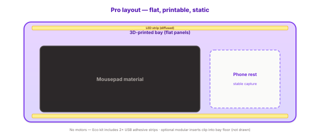

# The Pro build

[All sections](INDEX.md) · [Original presentation files](../presentation/) · [Review-only notice](../NOTICE.md)

Reading edition extracted from the supplied built presentation on October 25, 2026. Interactive controls are represented as text and initial displayed values; this is not a live service or a verified engineering, financial, or manufacturing result. Original internal-review labels are retained as historical document context.

---

Moun P · Pro line · 3D printable

Moun / RawGraded Pro

## The Pro build

Moun P is the printed flat bay + in-box LED harness path: FDM-friendly panels, shallow working volume, and kit assembly sized for makers and casual grading — without full-station motors, sense bridges, or premium gel. Economics and CM scope live on Pro manufacturing; Moun E (Eco) has its own page in the menu.

Updated 2026-04-09

What this page covers

### Pro (Moun P) — static printed bay, richer kit than Eco

This section spells out product shape: flat printed plastic bay, mousepad working plane, retained LED illumination for phone capture, and explicit out-of-scope lines vs the full station program. For mold-ready capital, Moun E strip scope, and color-coded CAD galleries, use Eco build in the sidebar.

Eco build (Moun E) — galleries, exploded views, prototype desk hero, BOM / CM.

### Positioning

The Pro (Moun P) line targets makers and casual graders who want the fuller all-in-one bench — printed bay, LED path, and kit assembly — without the cost or complexity of motorized leveling, sense bridges, or premium edge gel. The chassis is designed around FDM-friendly flat panels and a shallow bay: efficient plastic volume, sanded or vapor-smoothed where it matters, with a commodity mousepad sheet as the working plane.

Electronics stay minimal: keep the LED illumination path you already value for consistent capture, powered from a simple USB feed or low-voltage brick — no servos, no gearmotors, no closed-loop controllers.

Modularity is still real but lighter: clip-in or screw-down retainers instead of heavy interlocking metal stacks; fewer unique fasteners; optional printed inserts instead of machined subframes. You trade ultimate rigidity and service depth for printability and price.

Conceptual plan: maximize printable flat area, minimize part count, keep lighting — motion and heavy modularity deferred to the full station program.

#### Flat printed plastic bay

Walls and trays from common filament (e.g. PLA or PETG) in mostly flat extrusions — easy beds, minimal supports, oriented for strength across the short span of a phone and card.

#### Polished, not premium

Finish expectations are hobby-grade: wet-sand, flame polish on suitable materials, or paint — not injection cosmetic class, but presentable for a desk product.

#### Mousepad working surface

Standard mousepad sheet or roll stock cut to fit — the same class of material called out for the flippable deck elsewhere, without the silicone perimeter or gel line item in the base SKU.

#### LED lighting retained

Keep diffused task LEDs for repeatable white balance and glare control when shooting with a phone. Pro targets an integrated harness and power path in kit (see Pro manufacturing); Moun E uses kitted commodity USB strips with narrower CM scope — detailed on Eco build.

#### Phone as the camera

Integrated stand, groove, or adjustable ledge so a typical smartphone sits stable for overhead or oblique capture — still an all-in-one workflow vs a pile of retail jigs.

### Explicitly out of scope (base Pro / Moun P SKU)

- No rotating motors, linkages, or automated flip — the deck is static.

- No “full” sense bridge or IMU stack in the base Pro BOM (can be added later as an upgrade path).

- Not a substitute for lab-grade metrology; it is deliberately less serious while still useful for sorting, listing prep, and casual grading assists.

### Program comparison — Pro, Eco, full station

| Aspect | Pro build | Eco (simplest) | Full station program |
| --- | --- | --- | --- |
| Motion & mechanics | Flat, stationary bay — 3D-printable panels. | Static plastic gantry / bay — peg or pin height adjust; no motors. | Motorized / articulated concepts per engineering release. |
| Edge treatment | Printed rim; optional TPU bumper print — no medical gel SKU in base. | Printed rim + mousepad only — no gel line in scope. | Silicone gel surround and higher-touch edge spec where released. |
| Electronics & lighting | Integrated LED harness + power in kit; phone does sensing and software. | Two commodity USB adhesive strips included in retail kit (brand purchase + kit); CM does not fab custom boards. | MCU, sensors, bridge, and firmware as in build guide. |
| Modularity | Lighter clips, fewer layers, smaller spare count. | Minimum part count: base, stage, pad; optional user prints. | Full modular stack (insert, guide, gel, bridge, etc.). |
| CM / manufacturing scope | Printed shells, pad, harness, LED kit per Pro manufacturing page. | Plastic + padding from CM; commodity strips kitted alongside — no custom EE; CAD overlays illustrative unless in scope. | Production BOM, NRE, and partner manufacturing. |
| Cost posture | Optimize for filament grams + commodity inputs. | Lowest gram count + fewest purchased lines — on-ramp to the same capture story as Moun P and the full station. | Production BOM, NRE, and partner manufacturing. |

Retail naming is Moun P / Pro; some engineering paths and assets may still use legacy “hobbyist” filenames. Thermoplastics mentioned are examples; validate UV resistance and off-gassing for your environment before shipping kits.
