# Product features

[All sections](INDEX.md) · [Original presentation files](../presentation/) · [Review-only notice](../NOTICE.md)

Reading edition extracted from the supplied built presentation on October 25, 2026. Interactive controls are represented as text and initial displayed values; this is not a live service or a verified engineering, financial, or manufacturing result. Original internal-review labels are retained as historical document context.

---

Market disruptor

Moun / RawGraded Pro

## Product features

Hardware designed to break the “mixed retail module” ceiling: one calibrated workstation that protects specimens, unifies TCG and coin reference geometry, stays visually neutral for AI and resale photography, and stays economical through modular service.

Updated 2026-04-09

Disruption is the integration — retail never optimized the loop; Moun does.

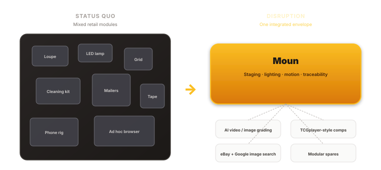

Retail optimizes parts in isolation. Moun optimizes the capture loop — the choke point for AI, market data, and resale photography.

### Why this is disruptive

The first integrated bench that upstreams signal into AI, pricing, and image search

Collectors today duct-tape together magnifiers, templates, lamps, and phone rigs. That fragmentation caps every downstream tool — models see noisy frames, marketplaces see inconsistent crops, and a scuffed work surface becomes part of the “story” in your pixels. Moun is built to remove those losses at the source: protection, reference geometry, neutral surfaces, and serviceable modules in one coherent product architecture.

This is not an accessory bundle. It is a single capture-native envelope: repeatable pose, controlled glare paths, and a mark-free optical plane so the same specimen looks like itself in video grading pipelines, TCGplayer-style comps, and eBay / Google image discovery.

When wear happens, the economics intentionally mirror modern electronics: replace the sub-assembly, not the entire philosophy of the product. That shifts lifetime cost from unpredictable bench labor to predictable spare SKUs.

### The work surface

Plastic all-in-one guide + unmarked flippable insert

Card and coin references live on a single removable plastic module. The flippable base insert stays free of printed markings — one face is a blank field, the other a solid contrast surface — so manufacturing can stay cheaper than decorating every reversible pad, and you can ship variants without the guide. Below: TinkerCAD concept renders, then a schematic summary.

#### Conceptual CAD — card & coin pad

The flippable insert includes a side that stays free of markings; all card and coin registration lives on a removable plastic guide — one all-in-one overlay for both TCG and coin work. Drop it in when you need references, lift it off for a plain field or to hit a lower manufacturing cost on variants that ship without the guide.

Study geometry exported from TinkerCAD; final tolerances, materials, and drive layout follow the released engineering revision.

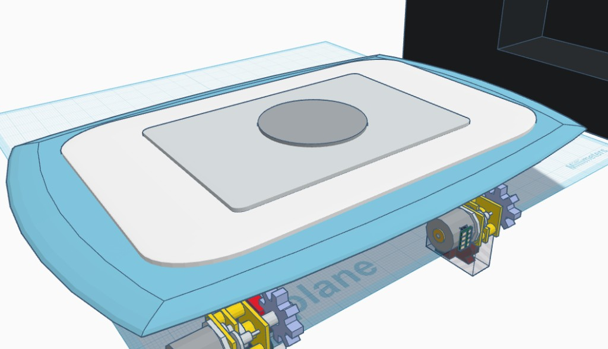

Guide stack + chassis

All-in-one plastic guide (combined card window + coin references) seated on the pad; blue frame and drive hardware below the workplane. Markings are confined to this module, not the flip insert.

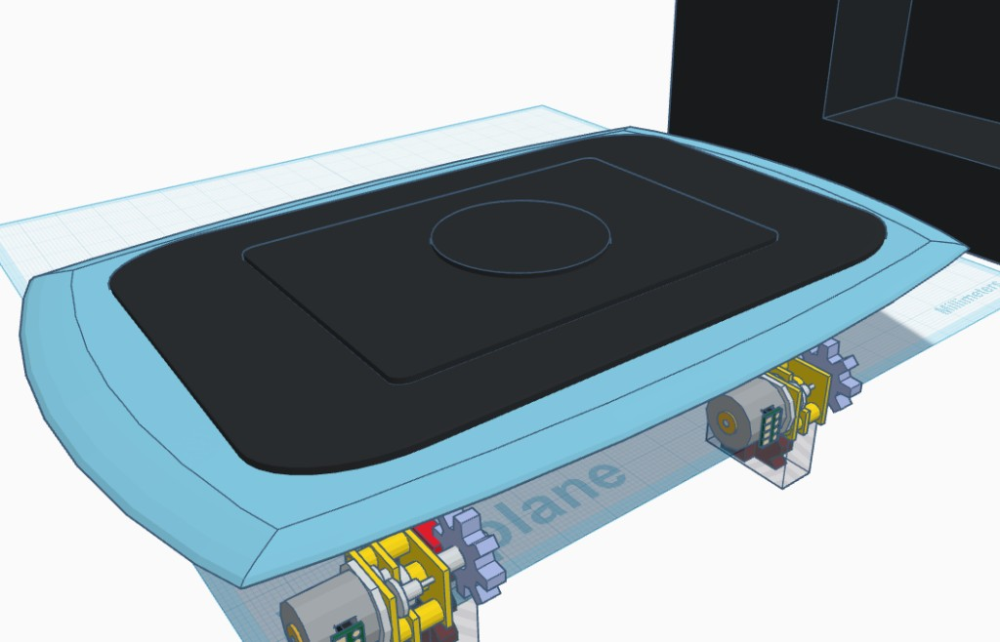

Contrast face — guide on

Contrast side of the base insert with the plastic guide installed: full alignment for video and AI pipelines while the insert itself stays unprinted.

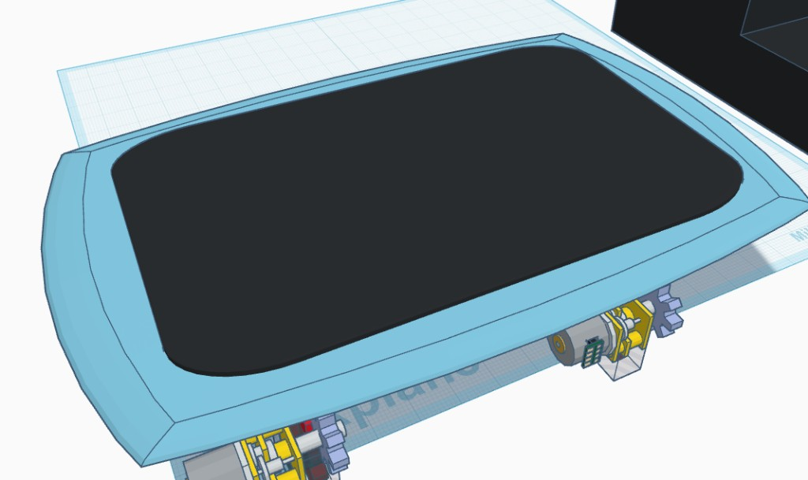

Contrast face — guide off

Plastic guide removed: unobstructed pad for bare-field capture. Same insert — manufacturing can omit the guide SKU entirely for cost-sensitive builds.

#### Printed guide — rough concept (not final)

Retail often sells card centering grids and coin sizing templates as separate pieces. The modular guide combines nested squares around a central circular measurement zone on one piece of very affordable translucent plastic. Dimensions, typography, and ring counts will change before release.

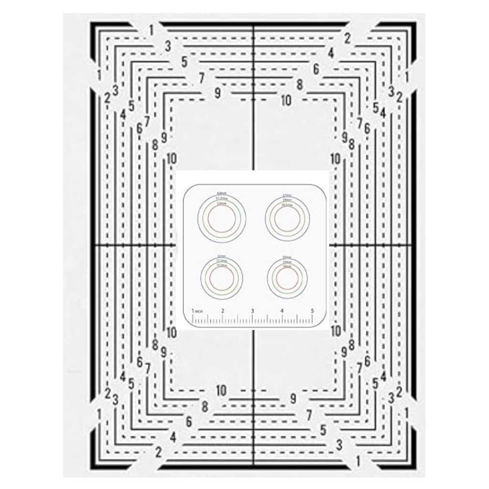

Working concept art: combined card grid and coin circles on one sheet — subject to revision before tooling or print release.

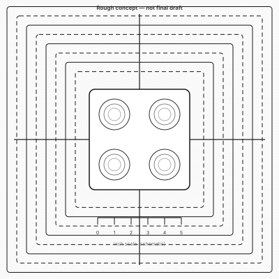

Vector sketch only: nested card frames around a central coin zone; production art will finalize numbering, mm callouts, and line weights for translucent plastic print.

#### Structure beneath the card / coin measurement plastic

The affordable translucent guide is only what you see on top. Under it, the concept stacks a flippable working surface (mouse-pad–class material in these studies), a silicone gel surround, then a chassis with a mount plate, motor modules, and cooling — the modular mechanical layer that supports and positions the pad independently of the printed overlay. Images are conceptual TinkerCAD exports; interfaces and counts will be frozen in the engineering release.

TinkerCAD study geometry — not substitute for STEP, ECAD, or thermal validation.

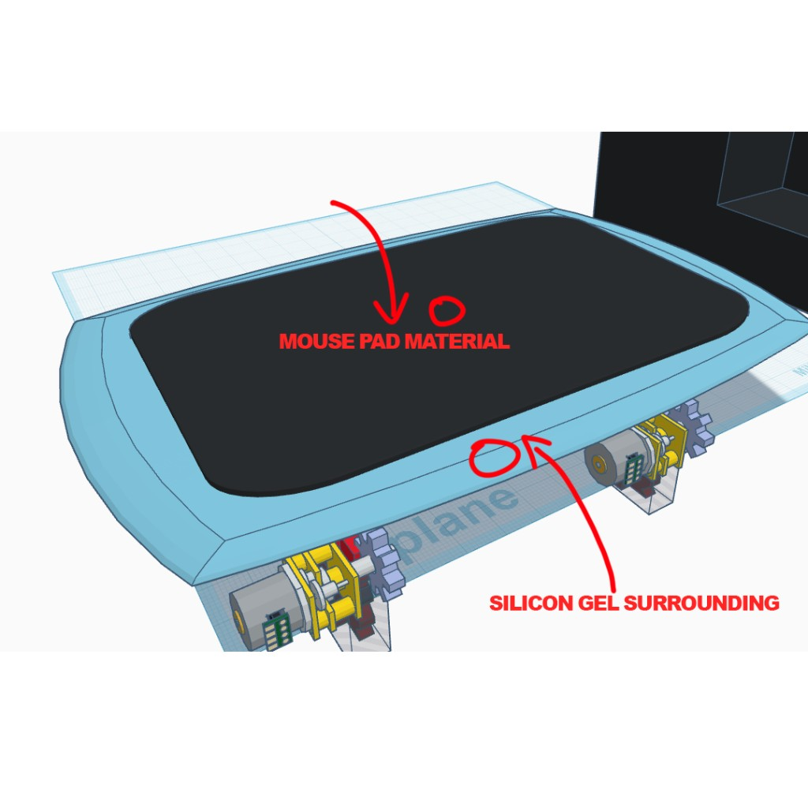

Labeled top stack

Callouts in-model: working surface vs silicone surround. Drive hardware sits below the deck — the measurement plastic would rest on the black pad above this mechanism.

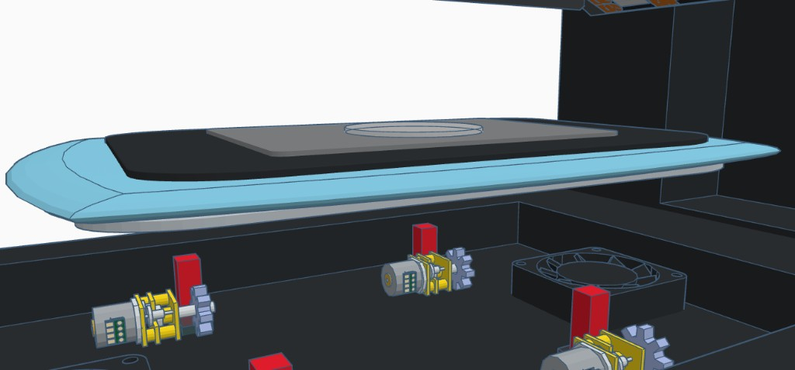

Exploded — pad vs chassis

Floating assembly: translucent plastic guide on the pad, silicone rim, then the lower housing with motors and a cooling fan — showing how the overlay separates from the motion / thermal base.

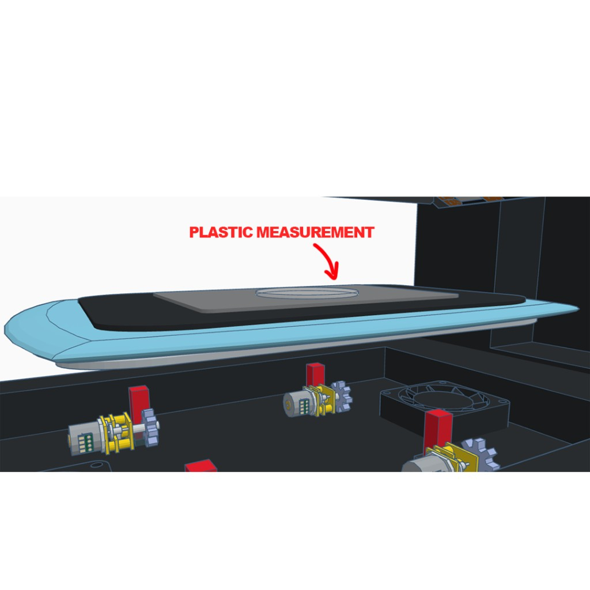

Plastic measurement layer

Same stack with the printed guide called out: it is a thin module over the flippable surface — not the same part as the silicone edge or the drivetrain below.

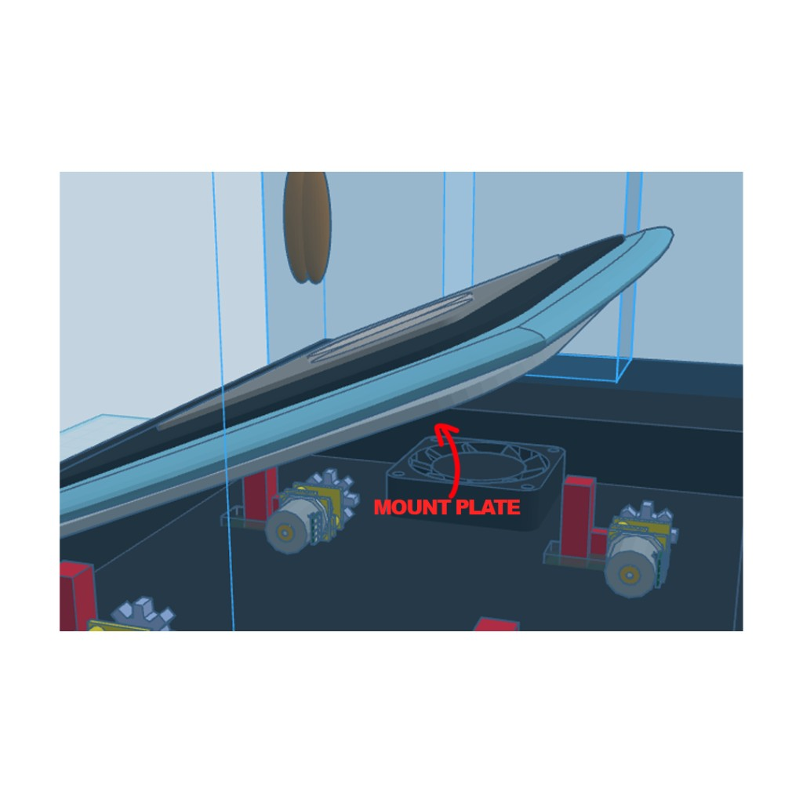

Mount plate & actuators

Mount plate between the pad assembly and motor modules: the mechanical interface where leveling / tilt / lock concepts attach — spare-friendly subassemblies instead of a sealed monolith.

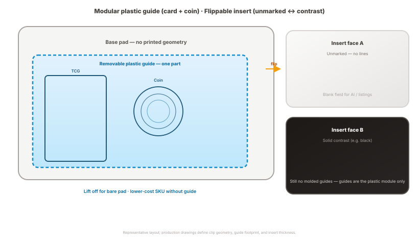

Markings are isolated on the optional all-in-one plastic guide. The reversible insert supplies an unmarked side and a contrast side only — keeping decoration and molding costs on the small guide SKU when you need registration lines.

Modular guide

### All-in-one plastic guide — TCG & coin on one removable surface

Registration marks are not baked into the flippable base. They live on a separate modular plastic guide: squares around a circle — nested card centering frames surrounding a central coin and measurement inset. Today those tools usually ship as separate retail templates; this guide combines them onto one affordable translucent plastic sheet (e.g. screen-printed or similarly produced). The rough concept art in the product section is not the final draft — it illustrates intent only. See also the “structure beneath the measurement plastic” gallery: that is how the pad, silicone surround, mount plate, and drivetrain sit under this overlay in the current TinkerCAD concept.

One sheet replaces separate coin templates and card grids — fewer SKUs for you, one familiar object for the operator.

Translucent plastic keeps cost down and lets the pad color show through when you want context under the guide.

Removing the guide simplifies the top assembly: the base pad does not need its own printed graphics.

- Single translucent plastic sheet: nested squares around a shared center — card frames plus coin rings in one overlay.

- Combines what retail usually splits across separate SKUs; optional at purchase or removable in the field.

- Worn or scratched guide? Replace the inexpensive printed module, not the whole station.

Mark-free workflow

### Flippable base insert — unmarked face vs contrast face

The flippable insert is intentionally free of printed grading marks. One face is a blank field — no registration lines — for captures where any background pattern would pollute AI or resale imagery. Flip to the opposite face for a solid black or white contrast plane when your pipeline needs edge pop or neutral catalog lighting, still without molded-in guides (those stay on the optional plastic module).

Separating “markings” from the flip insert keeps molding and finishing cheaper: decorate one small plastic guide SKU, not the entire reversible pad.

A truly unmarked side means listing photos and video frames do not inherit accidental ruler ticks from the base.

When a face wears out, swap or flip the insert; guides remain an independent spare.

- Unmarked face: maximum cleanliness for image search, AI grading, and buyer-facing shots.

- Contrast face: choose black or white for the session without committing graphics to the molded insert.

- Faster turnover: lift the plastic guide off, flip the insert, or swap modules — without a single integrated “do everything” slab that is expensive to replace.

Protection

### Medical-grade silicone gel padding on every hard edge

The perimeter is cushioned with medical-grade silicone gel — the same class of material trusted where skin contact and long-term compression matter. On a grading station, that choice is about more than comfort: it turns sharp corners into compliant boundaries so incidental bumps don’t become impulse paths into the specimen, the optical stack, or the operator’s sleeves.

Gel behaves predictably across temperature: it damps micro-shock instead of ringing like rigid bumpers, which matters when you are millimeters from a slab candidate or a proof coin.

Edge treatment also defines where hands naturally rest — pushing contact away from abrasive metal seams that could snag fibers or scratch a label.

For documentation and AI, fewer unplanned vibrations means fewer re-takes and less motion blur in video-first grading flows.

- Shock isolation at the rim — not just “rubber feet,” but continuous compliant geometry.

- Operator-friendly: reduces cold-metal contact points during long sorting sessions.

- Protects the station’s own alignment: less jarring of the bridge / motion interface than hard-edge designs.

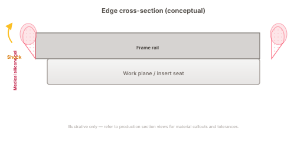

Compliant gel turns hard corners into damped boundaries — protecting specimens, optics, and repeatability.

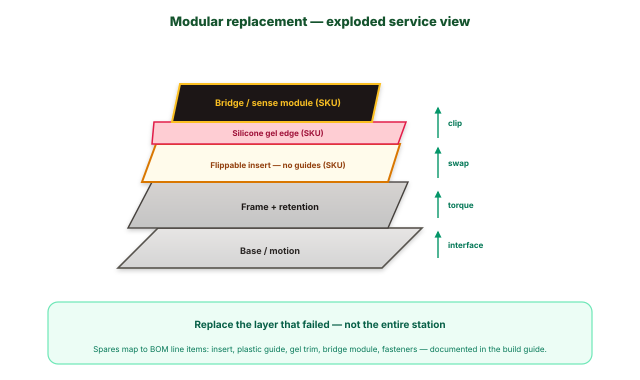

The optional all-in-one plastic guide (card + coin) clips onto the pad stack above the flippable insert — its own spare SKU, not shown in this vertical slice. Service strategy: clear layers, clear swaps — the opposite of a glued monolith.

Serviceability

### Replaceable modules — affordable spares, not mystery repairs

Glue-only monoliths optimize factory cost at the expense of ownership: one worn rail or cracked trim often implies depot timelines, vague labor quotes, or “replace the whole thing.” Moun is architected around defined interfaces: flippable inserts, the optional plastic guide, edge treatments, bridge sub-assemblies, and wear items are intended as catalog spares you can swap with documented torque and alignment checks.

Economic disruption: move lifetime cost from “whatever the bench charges” to predictable line items.

Logistics disruption: keep a spare insert, plastic guide, or bumper on hand instead of parking the whole workflow.

Factory-friendly SKUs: a base product can ship without the guide module when markings are not required, keeping entry manufacturing simpler.

- Module strategy pairs with the manufacturing BOM: retention features, part numbers, and assembly order are first-class.

- Failure isolation: impact or contamination in one zone does not force a total teardown.

- Affordable modular replacement beats tedious all-in-one repair for most field failures.

### Legacy repair economics

Monolithic glue-only designs externalize pain to the owner: long turnaround, unclear labor, and “replace everything” when one interface wears. That is the service model Moun is built to avoid.

### Disruptive service model

Modular replacement aligns cost with reality: buy the layer that failed, follow documented torque and alignment, and return to grading — without funding a bench mystery project.

Module boundaries, torque specs, and insert SKUs are tracked in the engineering build guide and BOM exports — keep marketing claims aligned with the released revision.

“Market disruptor” describes product intent versus fragmented retail and repair norms; it is not a guarantee of commercial outcomes.
