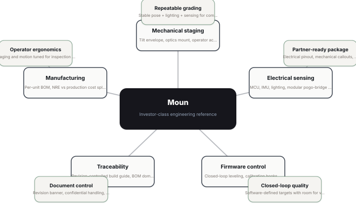
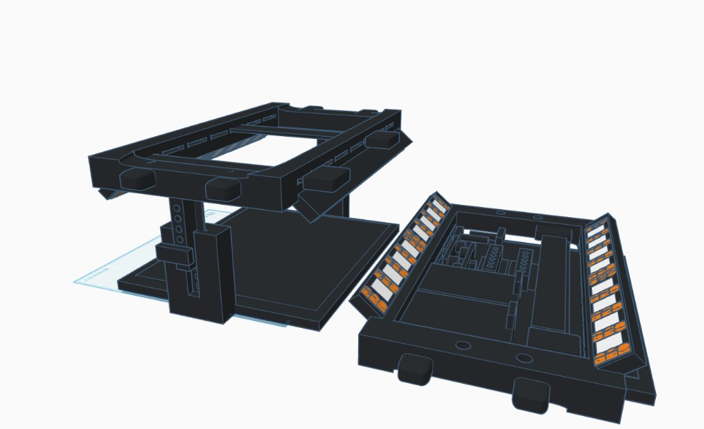
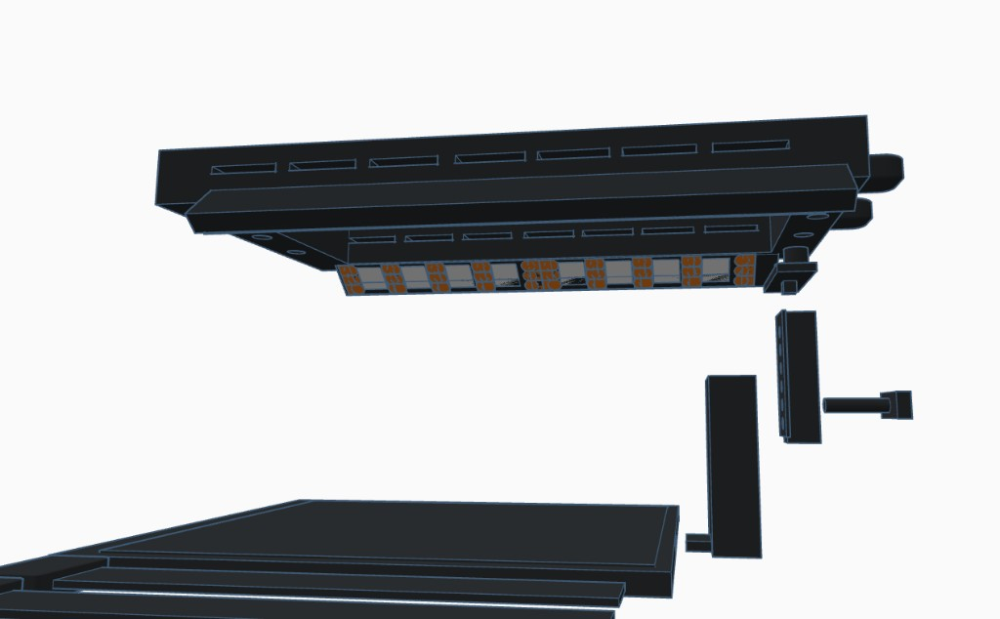
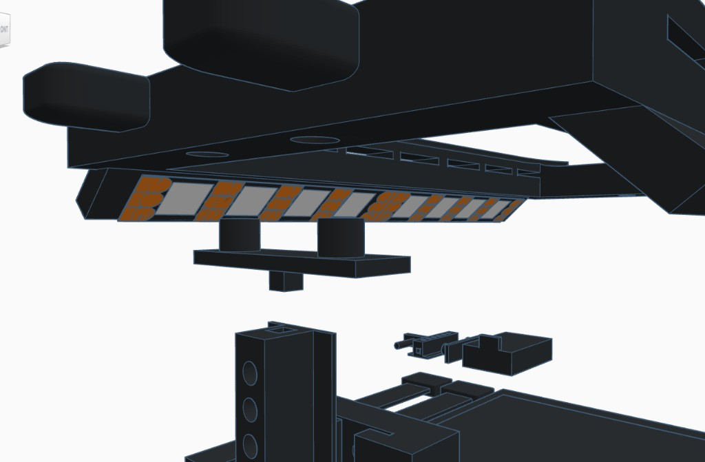
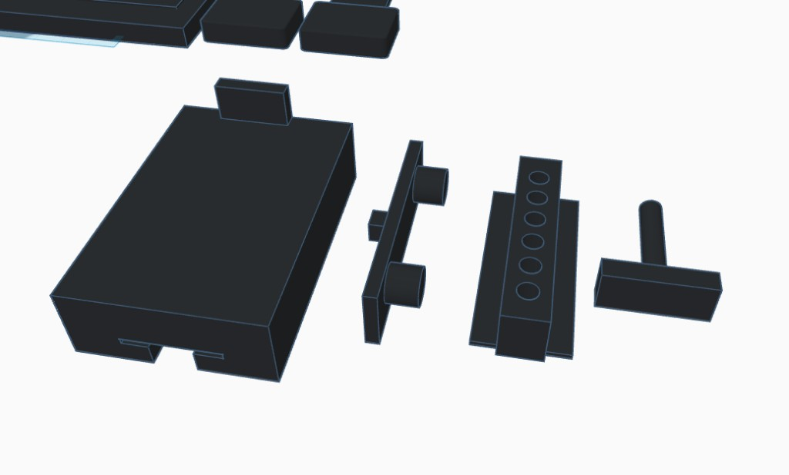
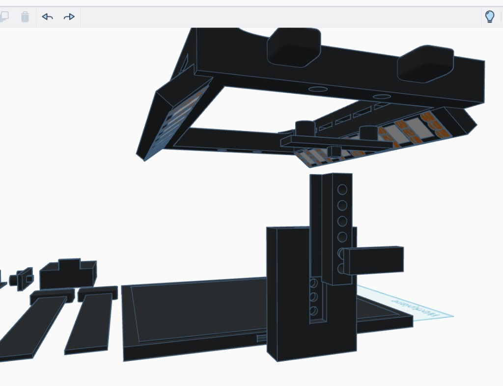
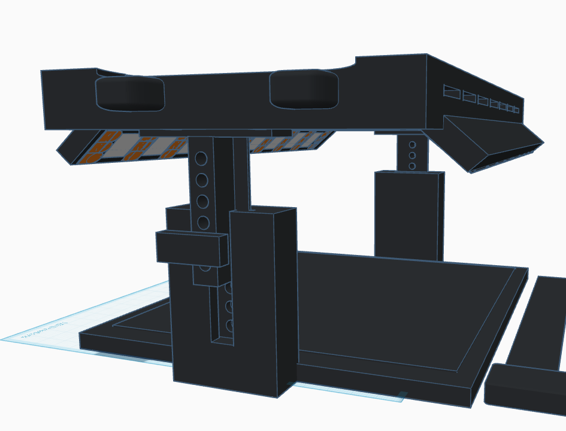
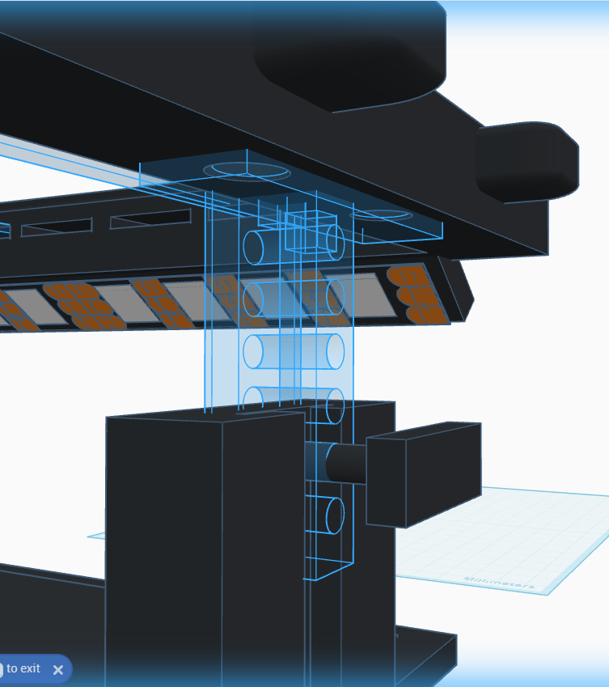
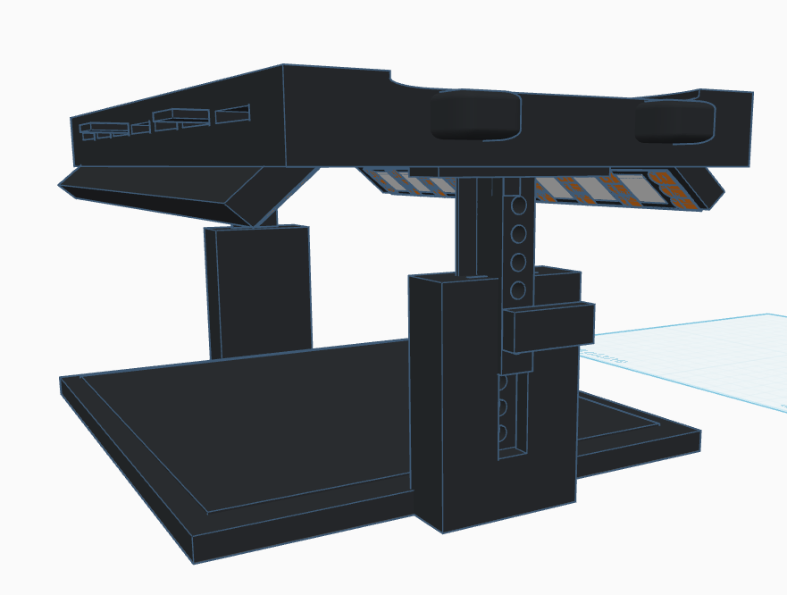
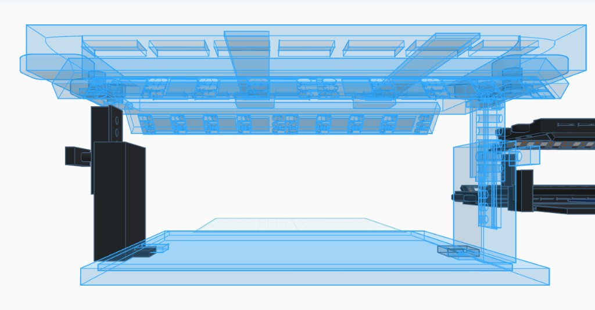

# Product whitepaper

[All sections](INDEX.md) · [Original presentation files](../presentation/) · [Review-only notice](../NOTICE.md)

Reading edition extracted from the supplied built presentation on October 25, 2026. Interactive controls are represented as text and initial displayed values; this is not a live service or a verified engineering, financial, or manufacturing result. Original internal-review labels are retained as historical document context.

---

Moun · Internal narrative

Moun / RawGraded Pro

## Product whitepaper

Internal narrative: engineering definition, staged Eco-first rollout, EPIC model line, and IP preparation — structured below after the thesis (problem, solution, patentability, and commercial fit).

Updated 2026-04-12 Internal — IP draft

Investor thesis · pain → fix → revenue

### The phone already won — the bench is where margin leaks

Live shopping (Whatnot, eBay, short-form discovery) made handsets central from solo sellers to high-scale shops. Moun captures the hardware dollar on the layer that makes every comp, listing, and AI pass actually work — without a second capture device burning the clock.

Pain points

Why the status quo leaves money on the table

- Marketplace, search, and AI tools assume a clean asset — but kitchen tables, con spill light, and shaky rigs produce glare, bad framing, and failed comps. The sensor is fine; the scene is not.

- “Best-effort” stacks of tents, tripods, and lamps were never one system. Setup and re-staging time scales linearly with volume — the wrong economics for professional throughput.

- High-velocity sellers run five-figure sessions in hours with the phone as camera and checkout. A parallel capture handoff or second phone loop wastes the narrow window when the clock is the show.

- Shops cross cards, coins, bullion, jewelry, and watches — ad hoc lighting does not port across categories without re-rigging.

The fix

One integrated workstation — phone stays the hub

Moun is a purpose-built inspection and capture bench: specimen deck, controlled task lighting, and repeatable phone- or tablet-friendly geometry in one sellable envelope — Eco (Moun E) through the EPIC line (E · P · I · C) as price and capability step up.

- Unified deck + illumination + capture path — not another pile of unrelated SKUs. Operator stays on the specimen: inspect, shoot, comp, list.

- Lighting and plane tuned for slabs and raw stock so downstream apps see the same asset every time.

- EPIC roadmap — Eco → Pro → Investor → Curator — one family for manufacturing, packaging, and IP continuity.

- Entry benches maximize phone-native throughput; higher tiers bridge to desktop and partner workflows where the program specifies — without abandoning floor ergonomics.

Revenue & opportunity

Why this is a serious check size

- Hardware attach on spend already going to inventory and shows — you sell the layer that makes TikTok-, eBay-, and Whatnot-class workflows reliable in the feed.

- Live commerce tailwind: as discovery and simulcast selling grow, capture quality becomes conversion — bad lighting is lost GMV.

- Throughput equals margin: seconds saved per lot compound across thousands of listings and high-dollar session days.

- TAM stretches beyond TCG to numismatics, precious metals, jewelry, and watches — same comp motion, larger basket.

- IP optionality: integrated apparatus claims plus continuation strategy along EPIC — diligence for counsel, not a promise of exclusivity.

Patent & sellability (counsel)

For qualified counsel: an integrated grading-and-valuation workstation combining staging, controlled illumination, and docked capture in one apparatus supports a concrete filing narrative distinct from fragmented retail tools — especially with dependent claims tied to the EPIC roadmap. Commercially, buyers pay for a defined bench that makes existing apps work at the counter, show, and prep table. Not legal advice; not a guarantee of grant or freedom to operate.

Trademark status:  Moun does not currently have a registered trademark obtained or issued. The name “Moun” and related labels in this document are project references only, pending clearance and any future filing — not assertions of nationwide rights.

Creator & AI platform

[RawGraded.com](https://rawgraded.com) — An AI platform developed by Joseph D. W. Edwards, creator of Moun.

### Concept map & EPIC roadmap

#### EPIC release roadmap

Shelf SKUs spell EPIC — Eco, Pro, Investor, Curator — stepping up from mechanical-first capture benches to full electromechanical programs. Each release adds capability and CM scope; the diagram under this block shows the production-intent engineering domains for the Investor-class station.

E

Eco

Moun E

Mechanical-first: printed bay + mousepad deck from the CM. Retail kit includes two commodity USB adhesive LED strips (5V) — brand-sourced and kitted; CM does not fabricate lighting boards.

Step-up:  Ground-1 entry — lowest capital path to shipped units. Proves the integrated capture thesis before funding in-box electrical kitting.

P

Pro

Moun P

Static bay family with in-box LED task lighting, harness, and kit assembly per manufacturing scope (Pro / Moun P build pages).

Step-up:  Adds coordinated in-box lighting and assembly vs the Eco strip — richer SKU, higher CM load, same capture story.

I

Investor

Moun I

Full station program: engineered frame, sensing, MCU, modular pogo bridge, firmware closed loops, partner-ready BOM — matches the hub diagram below.

Step-up:  Step-up to production-intent electromechanics, metrology, and document control for partner RFQs and certification paths.

C

Curator

Moun C

Flagship bulk workflow: conveyor-fed line, separation, dust treatment, integrated flip/capture mechanics, custom control software — engineering teaser; visuals not yet published.

Step-up:  Positions the line for high-throughput vendors and card-room scale — largest footprint and manufacturing complexity in the family.

#### Engineering domain map (Investor-class)

The hub-and-spoke map describes the full Moun engineering stack (motion, sensing, firmware, traceability, manufacturing) as documented for the Investor-class program — not the Eco CM job, which is mechanical plus kitted commodity lighting, not custom EE.

Roadmap:  retail EPIC sequence from mechanical-first Eco through Curator. Hub:  engineering pillars and outcomes for the Investor-class reference stack — edit both in `whitepaperModel.ts` (`EPIC_ROADMAP_MAP`, `CONCEPT_MAP`).

Stage 1 · Introduction flagship

#### Moun E (Eco build) — proof of concept you can invest in

Stage 1 is only Moun E: mechanical-first Eco build (plastic + mousepad from the CM) plus two commodity USB-powered adhesive LED strips in the retail kit — sourced off-the-shelf and kitted, not custom CM electronics, with only a small BOM lift. It is the flagship introduction — not a throwaway pilot — because it establishes the capture thesis, packaging story, and competitive edge versus fragmented retail for thousands of use cases at a low landed-cost entry. That makes the first check easier to place: channel proof and sell-through without funding the full Pro harness stack on day one. Pro, Investor, and Curator follow as separate stages when the line is ready to step up.

EPIC · Shelf line

#### EPIC release model (shelf line)

The Moun model line is sequenced to spell EPIC — Eco, Pro, Investor, Curator — with shelf codes E · P · I · C (Model P = Moun P static bay; Model I = Moun I full station). Phase 1 leads with Moun E; complexity and price posture step up through the line. Full-station mechanical, electrical, firmware, and manufacturing pages live under Investor · Moun I in the sidebar; Pro holds Moun P (static printed bay) only.

The same letter line is carried through this build guide so engineering releases, packaging art, and IP records trace one product family as capability steps up from Eco through Curator.

| Code | Line | Shelf name | Role |
| --- | --- | --- | --- |
| E | Eco | Moun E | Entry · smartphone scanning studio; plastic + padding; 2× USB adhesive LED strips (commodity kit). |
| P | Pro | Moun P | Pro line · Moun P static bay — richer kit than E (in-box lighting path per manufacturing scope). Some engineering paths still use legacy “hobbyist” filenames. |
| I | Investor | Moun I | Full station program — production materials stack, motion/sensing, and partner-ready BOM as in the engineering build guide. |
| C | Curator | Moun C | Flagship bulk workflow for shops and vendors: proprietary conveyor-fed analysis line — load a stack, run a controlled belt, single-file output with separation, dust treatment, and integrated flip/capture mechanics plus custom control software. Larger manufacturing footprint; sellable to card rooms pricing bulk inventory. Engineering and visuals not yet published. |

### Four retail stages (EPIC)

#### Four stages — one SKU per stage, each an iteration of the last

The EPIC line does not bundle multiple SKUs into a single “Phase 1.” There are four stages: Stage 1 is Moun E (Eco build) alone — the introduction flagship that sets the tone for the family. Stages 2–4 are Moun P, I, and C in order, each improving on the previous SKU with a clear step-up in features, electronics content, and manufacturing load. Investors can underwrite Stage 1 at a low capital entry while the roadmap stays coherent for channels and IP.

Introduction flagship · POC

##### Stage 1 — Moun E · Eco build

Eco build: 3D-printable flat bay, commodity mousepad working surface, two USB adhesive LED strips required in the retail kit (commodity buy + kit), phone-friendly deck; plastic + padding from the CM — no custom electrical assembly by CM. Sets product tone, brand, and operator loop for the entire EPIC line — cards, coins, slabs, and adjacent categories on one integrated bench story.

- Investable proof at the lowest CM scope — mold readiness, first inventory, and sell-through evidence before larger BOM tranches.

- Thousands of real-world use cases (shows, shops, mail-in prep) with competitive differentiation vs tents and DIY stacks.

- Foundation for patents, packaging, and retail narrative that Stages 2–4 inherit.

Iteration · In-box lighting

##### Stage 2 — Moun P · Pro line

Pro (Moun P) static bay: same family with in-box LED task lighting, harness, and kit assembly per manufacturing scope. Stage 2 adds coordinated electrical content and assembly versus Stage 1 — not a second SKU hidden inside “Phase 1,” but the next retail release after Eco has earned its tranche.

- Richer SKU for buyers who want the full in-box lighting experience without jumping to the Investor-class station.

- Manufacturing and assembly discipline carried forward from Eco with a stepped-up BOM.

Iteration · Full electromechanical stack

##### Stage 3 — Moun I · Investor-class station

Production-intent Moun: engineered frame, sensing, MCU, modular pogo bridge, firmware closed loops, document-controlled BOM — the architecture documented in the engineering build guide and summarized in the concept map’s Investor-class hub.

- Metrology, repeatability, and partner-ready RFQ packages for serious retail and OEM conversations.

- IP and certification paths aligned to the full hardware story.

Iteration · Bulk throughput

##### Stage 4 — Moun C · Curator-class (teaser)

Flagship bulk workflow for high-volume vendors: conveyor-fed line, separation, dust treatment, integrated flip/capture mechanics, custom control software — largest footprint in the family. Engineering and public visuals trail Stages 1–3; positioning is forward-looking.

- Scales the same lineage for card rooms and bulk inventory workflows when manufacturing and software mature.

Stage 1 · Moun E

### Retail embodiment — Eco-Scanner (illustrative photography)

Controlled capture posture with dual-plane LED emphasis, precision-height column, phone bridge over the specimen deck, and MOUN. E Eco-Scanner cartons in scene. For internal thesis and IP narrative — not a compliance photo; freeze claims, packaging marks, and certification-style icons with counsel and CM before external use.

Illustrative retail hero — performance copy and marks on boxes are mockups pending final art and channel-ready substantiation.

### Mechanical assembly (CAD)

Pro mechanical reference

#### Head ↔ base attachment — exploded & side-by-side

These views document how the printed head indexes to the base and vertical post: bridge peg, socket alignment, and height-index holes on the column. Exploded spacing matches how we expect pack-out and work instructions to read; the paired frame shows the same lineage assembled versus the head opened out for internal clearance review.

Assembled vs disassembled — left: head carried on the vertical post from the base; right: head shell laid flat showing internal partitions and dual orange task-light banks as modeled in CAD.

Exploded isometric — vertical gap shows the stack order from base deck through post interface to head.

Attachment stack — middle bracket pilots the head; central peg targets the post socket before final seat.

Part lineup — base, connector/interface, and head pieces in the order operators assemble from deck up.

Workspace context — subassemblies beside the main stack for instruction diagrams and investor walkthroughs.

Dual-pillar assembly — indexed height holes and collars as modeled; matches the telescoping story in mechanical specs.

CAD source may show UI chrome (e.g. editor cube); not part of the shipping product. Freeze geometry vs CM scope before RFQ.

Moun E · Eco structure (CAD)

#### Head ↔ post ↔ base — pin-lock height rail

Updated exploded views lock the story investors and CM both need: the head carries the phone bridge and task-light pocket; a sliding rail indexes in the base pillar; a T-bridge and cross-pin set height before the head drops onto the peg stack. Orange / grey and copper pads are CAD communication for the lit region — not signed electrical BOM.

Editor explode — spacer block shows the post / bridge stack-up; orange pockets under the head remain lighting communication geometry until EBOM freeze.

Seated chassis — current dual-post frame with capture deck and underside task row; use this read for pack-out and cosmetic signoff vs earlier wireframe-only explodes.

Side structural read — top lattice, base footprint, and column / arm layout for tolerance and interference checks (ghost geometry is CAD communication, not a second ship SKU).

### Physical attributes

### Motion & envelope

Mechanical targets tied to the CAD reference mesh; verify on first article.

- Tilt range (target)

85°

Confirm against hard stops, linkage, and cable strain relief.

- Overall footprint

TBD

Record L × W × H at max extension from released STEP / drawing.

- Working volume

TBD

Clear aperture for specimen + camera / sensor sightlines.

### Sensing & optics

Physical parameters that affect grading repeatability.

- Lighting CRI (target)

95+

Module PN, binning, and thermal derating in electrical BOM.

- Level accuracy (target)

<0.2°

IMU mount stiffness, calibration procedure, temperature drift.

- Bridge interface

Magnetic pogo

Retention force, wipe distance, cycle life — document in ECAD release.

### Materials & finish

Surface and structure choices for durability and brand presence.

- Frame materials

TBD

Alloy / polymer grades, anodize / powder coat spec.

- User-touch surfaces

TBD

Texture, cleanability, and wear expectations.

- Brand-visible elements

TBD

Logo placement, deboss vs label; align with specimen capture for trademark filing.

### Human factors

Physical relationship between operator, specimen, and controls.

- Viewing angle

TBD

Nominal eye point vs display / optical path.

- Actuation

TBD

Knobs, switches, or software-only; force and travel.

- Ambient assumptions

TBD

Bench lighting, vibration, ESD — qualification environment.

### Patent preparation

#### Patent counsel notice

Patent strategy requires a registered patent attorney or agent. The summaries below are invention themes for discussion only — they are not claim language, prior-art analysis, or freedom-to-operate opinions. Do not rely on this text for filing deadlines, claim scope, or international strategy.

#### Patent portfolio concept (internal strategy)

##### Integrated system as first reduction to practice

Treat the Eco build (Moun E) as the earliest physical embodiment suitable for structured disclosure: dated lab records, CAD revisions, photos, and build videos showing the unified deck, lighting posture, and capture loop as one product — not a one-off pile of unrelated retail parts.

##### Evolution along EPIC — continuations and claim families

Plan for dependent claims, continuations, continuation-in-part applications, or divisionals as the line adds capability from Pro through Investor and Curator (lighting, sensing, motion, bulk handling). Goal: a maturing patent family that tracks hardware evolution instead of a single static claim set frozen at the first prototype.

##### Differentiation vs fragmented retail (diligence thesis)

Channel positioning contrasts Moun with commodity light tents, mixed DIY SKUs, and bolt-on phone rigs — useful for invention story and marketing. That narrative is not a substitute for prior-art search or examination; “no integrated competitor product identified internally” must be verified by counsel-led search before any public uniqueness claim.

A market scan or internal product review does not replace patent examination or freedom-to-operate analysis. Rights are fact- and jurisdiction-specific; this section documents documentation habits and filing strategy themes for discussion with qualified counsel only.

##### All-in-one grading and valuation station for collectibles (apparatus)

A unified inspection and pricing-oriented workstation for collectibles including, but not limited to, TCG cards, coins, and figurines — combining a specimen deck or staging region, controlled illumination, and integrated or docked capture (e.g. phone rest) within one physical product, as distinct from ad hoc assemblies of unrelated retail tools. Valuation-related capture (comps, listing prep, or grading-assist workflows) is in scope as part of the same integrated envelope.

Brief patent counsel

- Anchor priority and disclosure timing to physical prototypes of the integrated workstation — Eco / Moun E as Stage 1 reduction to practice, with dependent claims for Pro / Investor / Curator embodiments as the EPIC line gains features.

- Broaden dependent claims across specimen classes (flat media, slabs, small three-dimensional figures) while avoiding overbreadth that reads on unrelated industries.

- Claim set: system claims (station + lighting + deck), method claims (grading or valuation workflow using the station), dependent claims for modular bridge / removable guide.

- Map continuation / CIP / divisional strategy explicitly to EPIC roadmap milestones so claim families evolve with hardware across four retail stages (E · P · I · C), not only abstract “early vs late” labels.

- Coordinate utility vs design protection if chassis silhouette is distinctive; schedule prior-art review on “integrated grading desk” combinations before asserting novelty over fragmented retail tools.

##### All-in-one card and coin measurement overlay (plastic sheet / guide)

A single removable overlay carrying both card registration geometry (e.g. nested rectangular centering frames) and coin reference geometry (e.g. concentric diameter rings, scale) on one planar sheet — addressing the prior pattern of buying separate card grids and coin templates.

Brief patent counsel

- Consider utility claims on functional layout and interchangeability with the station deck; consider design patent on ornamental aspects if novel.

- Maintain file history: rough print concepts, revised drawings, production CAD — enablement and written description.

- Search overlapping tool patents (centering templates, coin gauges); draft around known references with counsel.

##### AI-assisted video grading process (methods / systems)

Computer-implemented pipelines that ingest video (or frame sequences) of collectibles under controlled or semi-controlled capture, apply model-based or rules-assisted analysis to support grading or pre-grading decisions, and output structured results tied to the capture session — potentially distinct from single-image-only classifiers when temporal consistency, motion, or multi-angle evidence is used.

Brief patent counsel

- Separate patent family from pure hardware: software claims, training data handling if novel, and integration claims tying AI output to the station or RawGraded.com-style services.

- Alice / §101 risk: be ready to articulate technical improvement beyond “abstract idea” with counsel.

- Preserve versioned model cards, evaluation metrics, and example sessions for enablement discussions.

##### Step-by-step grading workflow with tilt and pose control (methods)

Guided operator flows that prescribe an ordered sequence of grading steps, including controlled tilt, rotation, or pose changes between captures, so that downstream AI or human review sees a repeatable evidence chain — rather than a single ad hoc snapshot.

Brief patent counsel

- Claim interaction between hardware pose (manual or assisted tilt) and software prompts; consider method claims independent of exact motor configuration for Stage 1 static rigs.

- Document timing, ordering constraints, and failure/retry behavior as potential differentiators.

- Cross-reference video grading theme for divisional or continuation strategy.

##### Slab authenticity validation and future-proof fraud-prevention for grading-linked value (methods / systems)

Processes and system designs for validating authenticity of encapsulated slabs (or similar graded products), including measurement, procedural, or cryptographic practices intended to stay robust as counterfeiting evolves (“future proofing”). Broader scope: maintaining fraud-prevention measurement practices and procedures tied to reputable collectible grading and valuation services — i.e., authenticity assurance that underpins market trust and can affect the original or residual value of consequential assets. Service-level claims may interact with platform (e.g. RawGraded.com) and partner grading organizations; coordinate with counsel on inventorship and joint development.

Brief patent counsel

- Business-method sensitivity: frame technical effect (measurement integrity, audit trails, tamper evidence) with specific structures, not generic “trust” alone.

- Define clearly what “slab,” “encapsulation,” and “reputable service” mean in claim terms without locking to a single third-party brand.

- Privacy and regulatory overlays (consumer protection, not legal advice here) — discuss with counsel if claims touch KYC or certification regimes.

##### Internal action checklist

###### Invention capture

- Maintain dated lab notebooks / design logs tying Stage 1 prototypes to problem/solution statements.

- Maintain a simple roadmap map: Eco → Pro → Investor → Curator feature deltas vs target filing dates (for counsel — not public claim language).

- Archive CAD revisions, photos, and assembly videos showing the integrated station and unified overlay in use.

- List “delta vs retail” — what combination of features is not taught by separate card-only and coin-only tools alone.

- For AI video and tilt workflows: retain screen recordings, logs, and model revision history showing step order, pose changes, and outputs.

- For slab / authenticity: document measurement protocols, data retained, audit trails, and how updates preserve backward compatibility or migration paths (“future proofing” in engineering terms).

###### Counsel engagement

- Deliver invention disclosure memo covering hardware themes, software/method themes (AI video, step/tilt, slab validation), EPIC roadmap linkage, and intended divisional / continuation strategy.

- Request prior-art landscape and FTO opinion before public sales if budget allows — include integrated workstation + unified overlay combinations vs fragmented hobby SKUs; separate apparatus vs software vs service-process searches if warranted.

- Discuss international filing (PCT) vs US-first given cost and sales geography.

###### Filing hygiene

- Avoid public disclosure of unfiled details before counsel sets a filing date (grace periods vary by jurisdiction).

- Assign rights from contributors and contractors via written agreements.

- Track one-year bar and any foreign filing deadlines from first public disclosure or offer for sale.

### Trademark preparation

Current status:  Moun does not currently have a registered trademark obtained or issued. The name “Moun” and related labels in this document are project references only, pending clearance and any future filing — not assertions of nationwide rights.

### Legal notice

This section is an internal checklist and template only. It is not legal advice. Engage qualified IP counsel for clearance search, filing strategy, and specimen review.

### Mark candidates

Keep this table aligned with packaging, UI strings, and invoices so specimens match real use.

| Type | Mark text / asset | Role | Notes |
| --- | --- | --- | --- |
| Word mark | Moun | Primary product name | Confirm stylization (title case vs logotype) and whether “Station” is claimed descriptively; counsel may suggest disclaimer or composite mark strategy. |
| Word mark | RawGraded Pro | Alternate / line name | Align with packaging, UI, and invoices so specimens match use in commerce. |
| Logo / design | GS monogram + wordmark | Design mark candidate | Export vector (PDF/SVG) and high-res raster specimens; keep layered source for USPTO-ready black-and-white variant. |
| Slogan (optional) | TBD | Tagline | Only file if used consistently in marketing; weak slogans may be harder to register. |

### Goods & services (draft)

Nice class numbers are hints only — counsel selects final classes and wording for the application.

- Class 009

Electronic inspection apparatus; calibrated grading stations featuring sensors and lighting for quality control.

Tie wording to actual product specs and manuals; avoid over-broad claims that invite office actions.

- Class 042

Software as a service (SaaS) for inspection data, calibration, and grading workflows (if offered).

Include only if you sell/host software separately from the hardware; otherwise omit or narrow.

- Class 040

Custom manufacturing and assembly of inspection equipment for others (if applicable).

Use if you operate as an OEM/contract manufacturer under the mark.

### Distinctiveness notes

- Descriptive terms (e.g., “grading station” generically) are weaker without acquired distinctiveness — document sales duration, advertising spend, and survey evidence if counsel recommends.

- Coined or arbitrary marks are stronger; keep a short rationale in the file for why the mark is not merely descriptive of the goods.

- If counsel requires a disclaimer on descriptive fragments of the mark, consider composite mark or stylization to preserve registrability.

### Preparation checklist

#### Clearance & ownership

- US knockout / full clearance search on word marks and key design elements (USPTO + common law).

- Confirm legal owner entity matches cap table / operating company signing declarations.

- Inventory domain names, social handles, and app store listings for consistency.

#### Use in commerce & specimens

- Capture dated photos of mark on device, packaging, and UI (showing goods sold or transported).

- Keep invoices, purchase orders, or marketing pages showing mark + goods/services.

- Prepare black-and-white drawing of logo for application if filing design mark.

#### Filing packet

- First use anywhere / first use in commerce dates (verify with counsel before asserting).

- Specimen files per class: JPEG/PDF within USPTO limits; web specimens may need annotations.

- Goods/services list finalized to match actual use — avoid “intent to use” drift for classes you do not plan to sell.

#### Ongoing maintenance

- Document §8 / §71 renewal windows; set reminders after registration.

- Policing: monitor TSDR and marketplace for confusingly similar marks.

- Update this whitepaper when the product name, logo, or goods/services change.
